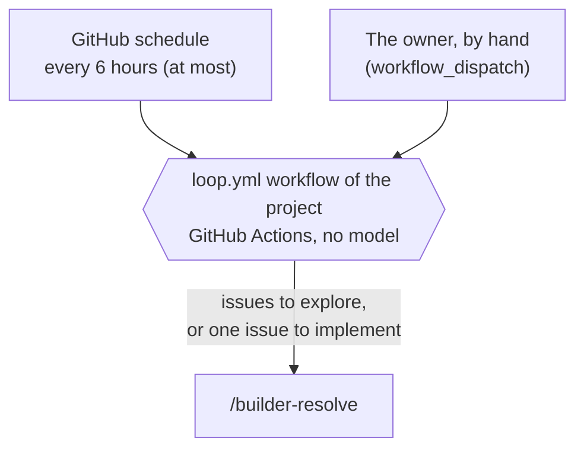

# Architecture

> The platforms of the loops, and how each job starts. All parts are built. The loops run the latest release of aboveloop, not its `main`. The list of every component, with where it is, is in [L3-loop-components](L3-loop-components.md). The workflow `loop.yml` in detail is in [L3-loop-workflow](L3-loop-workflow.md).

## 1. Platforms

| Part | Platform | Why |
| --- | --- | --- |
| The trigger | GitHub Actions: the workflow `loop.yml` of each project | No model, so a run with no work costs nothing (E3, P6). GitHub already holds the issues and the PRs. |
| The agents | Cursor cloud agents, through the Cloud Agents API | The owner's choice (§2). Each agent does one job one time, with only the keys of that job (E2). |
| GitHub identity | One GitHub App of the loop; each run mints one-hour tokens from it. | Each token has the smallest scope and a short life (E2). One App for everything ([L2-loops §5](L2-loops.md#5-names-and-domains)). |
| Keys | Stored one time on the Mac of the owner, `~/.config/aboveloop/`; copied into the repo secrets. The owner accepts that each repo holds the App key ([L2-loop-untrusted-text](L2-loop-untrusted-text.md#3-design-requirements) A1) | Never in a repo or a chat. |

## 2. Routines

A routine is one skill, the trigger that starts it, and the platform that runs it. The general rules are in `entry` (spec-and-plan, "routine 跑在哪"). In the loops in CI:

- **The trigger is always the workflow `loop.yml`** of a project. The GitHub schedule starts it, and the owner can start it by hand.
  - Why: it uses no model, so a run with no work costs nothing (E3, P6).
- **The platform is always a Cursor cloud agent.** The workflow `loop.yml` launches it through the Cursor Cloud Agents API (`POST https://api.cursor.com/v1/agents`).
- No Claude routines and no Cursor automations.
  - Why: the owner chose GitHub Actions as the trigger and Cursor cloud agents as the platform.

### 2.1 How each job starts

- **An agent starts only when there is work.** The workflow `loop.yml` examines the state first (E3, E4). Thus an empty run costs no model use.
- **The schedule is a wish, not a promise.** GitHub delays scheduled runs under load and can drop them. Measured: 4 or 5 of the 8 slots ran in each repo, and some runs started 4–5 hours late (W10). Thus no job depends on a run at a fixed time (E4).
- **Each project has its own workflow `loop.yml`.** It is `.github/workflows/loop.yml` in the project, a copy of `skills/setup-app/references/loop.yml`. The skill `setup-app` puts it there, and `setup-dev` calls `setup-app` for a project that does not have it.
- **There is one copy of the code** (P3). The workflow `loop.yml` of each project uses the composite action `services/loop` of aboveloop at its latest release: it finds the latest release tag that the owner pushed, checks out aboveloop at its commit into `.aboveloop`, and runs `uses: ./.aboveloop/services/loop` ([L2-release §2.2](L2-release.md#22-what-runs-for-real-reads-only-the-latest-release-)). The Actions access of aboveloop is "none": the checkout needs only a token of the App that reads aboveloop, and a stale copy with `uses: …@main` fails.
