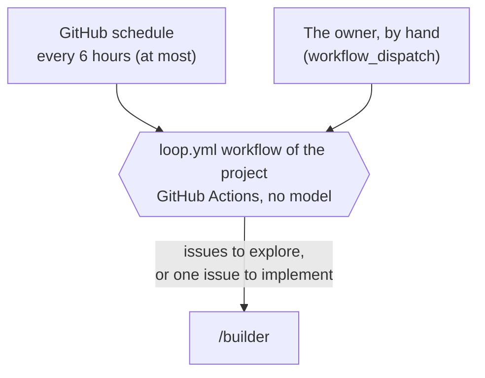

# Architecture

> The platforms of the loops (§1), and the routines: what starts each job and what runs it (§2). All parts are built.

Marks: ✅ built · 🔶 partly built · ⬜ not built.

## Summary

- **The trigger of each job in CI is the workflow `loop.yml` of the project**, on GitHub Actions. It uses no model ([§1](#1-platforms), [§2](#2-routines)).
- **The agents are Cursor cloud agents.** Each one does one job one time, with only the keys of that job ([§1](#1-platforms)).
- **One GitHub App of the loops (`<your GitHub App>`) gives each run short tokens** with the smallest scope ([§1](#1-platforms)).
- **No Claude routines and no Cursor automations** ([§2](#2-routines)).
- **No job depends on a run at a fixed time.** An agent starts only when there is work, and the schedule is a wish. The chart in [§2.1](#21-how-each-job-starts) shows what starts each job.
- **The loops run the latest release of aboveloop, not its `main`** ([§2.1](#21-how-each-job-starts)).
- Every component and where it is: [L3-loop-components](L3-loop-components.md). The workflow `loop.yml` in detail: [L3-loop-workflow](L3-loop-workflow.md).

## 1. Platforms

| Part | Platform | Why |
| --- | --- | --- |
| The trigger | GitHub Actions: the workflow `loop.yml` of each project | No model, so a run with no work costs nothing (§2). GitHub already holds the issues and the PRs. |
| The agents | Cursor cloud agents, through the Cloud Agents API | The owner's choice (§2). Each agent does one job one time, with only the keys of that job (E2). |
| GitHub identity | One GitHub App of the loops; each run mints one-hour tokens from it. | Each token has the smallest scope and a short life (E2). One App for everything ([L2-loops §6](L2-loops.md#6-names-and-domains)). |
| Keys | Stored one time on the Mac of the owner; copied into the repo secrets. The owner accepts that each repo holds the App key ([L2-loop-untrusted-text](L2-loop-untrusted-text.md#3-design-requirements) A1) | Never in a repo or a chat. |

The owner's part of the setup (the keys, the GitHub App, the install on each repo), and where each part is: [L3-loop-components §1](L3-loop-components.md#1-global-aboveloop-set-up-once) and [§2](L3-loop-components.md#2-each-app-setup-app).

## 2. Routines

A routine is one skill, the trigger that starts it, and the platform that runs it.

**The general rules, for a routine of any system** (the loops of aboveloop, and a loop of a product, for example a data loop):

- **Each system writes its routines in its own spec:** the skill, what starts it, the input, the model, the capabilities, the cost, and how far each connection point is verified. There is no separate spec of all routines. This section is the example.
- **Only GitHub Actions starts a routine.** A schedule, a manual run, and a wake from another service (`workflow_dispatch`) are all in a workflow of the project. The workflow uses no model: it examines the state first, and starts an agent only when there is work. An empty run costs no model use (E3, P6).
- **A Cursor cloud agent does the work.** The workflow starts it through the Cursor Cloud Agents API (`POST https://api.cursor.com/v1/agents`), one agent for each piece of work. No Claude routines and no Cursor automations.
  - Why: the owner chose GitHub Actions as the trigger and Cursor cloud agents as the platform.
  - The model: [L3-loop-workflow §2](L3-loop-workflow.md#2-the-agents) "Models" (in a session: `entry`, 「用哪个模型」).
- **The trigger does two things only:** it names the skill, and it gives the input. The input is in the prompt, marked as untrusted data. A skill names no platform and no frequency. The agent finds its work in the state, not in a time window.
- **The keys stay in the workflow.** An agent gets only the key that its work needs, through `envVars`. The Cursor key never goes to an agent. The GitHub token of a Cursor agent cannot open an issue (measured: 403). When an agent must write an issue, the workflow mints a token for one hour from the GitHub App of the loops (`<your GitHub App>`), with only the permissions of that work. No long-lived personal token.
  - One exception (⬜): the implement run gets the App key, so it mints a new token when its hour runs out. Why: a heavy spec in CI works longer than one hour, and the owner chose to give the builder the App key. The risk and its stops: [L2-loop-untrusted-text](L2-loop-untrusted-text.md#3-design-requirements) A6.
- **The code of the workflow is in one copy.** `setup-app` installs the workflow of the loops into each project from its reference file. The code is a composite action of aboveloop. Another system that runs an agent on a schedule uses the same method.
- **The step that makes a result writes it.** The step that opens an issue writes all of its context. The step that closes an issue writes why it closes it. No extra trigger only to write a result.

In the loops in CI:

- **The trigger is always the workflow `loop.yml`** of a project. The GitHub schedule starts it, and the owner can start it by hand.
- **The agent is a Cursor cloud agent** that `loop.yml` launches (the general rules above).

### 2.1 How each job starts

- **An agent starts only when there is work.** The workflow `loop.yml` examines the state first (E3, E4). Thus an empty run costs no model use.
- **The schedule is a wish, not a promise.** GitHub delays scheduled runs under load and can drop them.
  - Measured: 4 or 5 of the 8 slots ran in each repo, and some runs started 4–5 hours late (W10).
  - Thus no job depends on a run at a fixed time (E4).
- **Each project has its own workflow `loop.yml`.** It is `.github/workflows/loop.yml` in the project, a copy of `skills/setup-app/references/loop.yml`. The skill `setup-app` puts it there. `setup-dev` calls `setup-app` for a project that does not have it.
- **There is one copy of the code** (P3). The workflow `loop.yml` of each project uses the composite action `services/loop` of aboveloop at its latest release ([L2-release §2.2](L2-release.md#22-what-runs-for-real-reads-only-the-latest-release-)):
  1. It finds the latest release tag that the owner pushed.
  2. It checks out aboveloop at its commit into `.aboveloop`.
  3. It runs `uses: ./.aboveloop/services/loop`.
  - The Actions access of aboveloop is "none". The checkout needs only a token of the App that reads aboveloop. A stale copy with `uses: …@main` fails.
