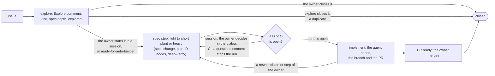
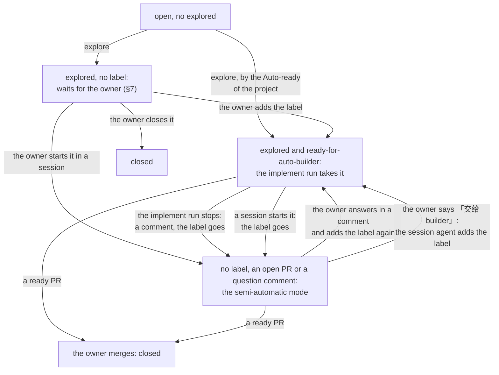

# Builder loop

> The builder loop is the life of an issue, in two modes with the same three steps: explore, spec and implement. The first three heavy specs in CI are compared with the heavy specs of sessions (§1).

Marks: ✅ built · 🔶 partly built · ⬜ not built.

## Summary

- **One loop, two modes.** The builder loop is the life of an issue: open → explore → spec → implement → a PR that the owner merges. In the semi-automatic mode, the owner and an agent work in a session. In the automatic mode, CI works with no owner. The modes differ only in what starts each step and how the owner's decisions are made (§1).
- **Each step has one text, for both modes:** `explore.md`, `spec.md` and `implement.md` of `/builder` (§1). Each project defines its own kinds of issues, which kinds get a light spec (§1), and which kinds can start without the owner (§3).
- **Each piece of work has an issue, except a small change and a change of the plan of a milestone** (§2.1, §1). Explore makes the issue complete (§1, §2).
- **Each change goes on a branch and into a PR; only a release pushes `main`.** In both modes, the spec, the plan and the code of an issue go into one PR on one branch (§5). The agent merges a small change after its checks pass (§2.1).
- **Two labels control the work** (§3). `explored` tells that explore is done. `ready-for-auto-builder` hands the issue to CI: it is the lock, not a sign-off. The implement run removes it when it stops.
- **The automatic mode changes only L3 and the words of L2** (§6).
- **The owner signs off at three points in the semi-automatic mode:** the start of the issue, the last spec review (a heavy spec only), and the merge. Between them, the owner acts only at a D. In the automatic mode, the merge is the only sign-off. The deep-verify runs in the background and does not stop the owner (§7).
- **Other pages.** The instructions of the three steps are only in the skill `builder` (`explore.md`, `spec.md`, `implement.md`, `issue-in-session.md`); this page holds the decisions and their Why ([L2-plugin §2](L2-plugin.md#2-entry-the-start-for-all-rules-and-skills)). The code (the runs in CI, the scripts, B1): [L3-loop-builder](L3-loop-builder.md). The dev loop above it (the session entry of `dev`, the graph of open work, and the briefing as a design): [L2-loop-dev](L2-loop-dev.md). What the loops share, and the shared terms: [L2-loops](L2-loops.md).

## 0. Terms

| Term | Meaning |
| --- | --- |
| Life of an issue | Open → explore → spec → implement → a PR that the owner merges (§1). It has two modes. |
| Semi-automatic mode | The owner and an agent do the issue in a session. The agent leads the conversation. |
| Automatic mode | CI does the issue: the workflow `loop.yml` and `/builder`. No owner is present. |
| Explore | The first step: triage and the quality of the issue. It writes an Explore comment on the issue, with the kind and the spec depth, and adds `explored` (its instructions: `builder`'s `explore.md`). In CI the explore run does it in batches; an agent in a session does it for one issue. |
| Spec | The second step: the co-design of the spec and the plan of one issue (its instructions: `spec.md`). It writes a complete draft, decides the details itself, and makes each direction-level decision a D node. A heavy spec gets a deep-verify (§7). The step ends when every D and O before the agent nodes is done. It has two depths (§1). |
| Spec depth | Light: a short plan only. Heavy: the spec change, the plan, its D nodes and a deep-verify. Explore selects it from the kind and the project's configuration (§1). |
| Direction-level decision | A decision that only the owner can make (`entry`, 「拍板只问方向」). It has several dimensions that are hard to weigh. Examples are the product intent, money, the risk that the owner accepts, and a recorded principle of the owner. Only such a decision is a D node. The agent makes each other decision itself, and records it as "Agent decided". |
| Implement | The third step (its instructions: `implement.md`). It starts when every D and O before the agent nodes is done. The agent does the agent nodes of the plan (code or other work), closes the work, and marks the PR ready. |
| Implement run | In CI: the cloud agent that `loop.yml` starts with the step `implement`, for one issue with `ready-for-auto-builder` and `explored`. It does the spec step, then the implement step, on the branch of the issue ([L3-loop-builder §1.2](L3-loop-builder.md#12-implement)). In the spec, "implement" is this run when it does an action that only CI does. Examples: it refuses the issue, it stops, it removes the label. The work that "implement wrote" (R23) is the work of this run. |
| `explore.md`, `spec.md`, `implement.md` | The three texts of `/builder`, one for each step, for both modes. The implement run reads `implement.md` §0–§3, opens or continues the branch, then reads `spec.md`, then the rest of `implement.md`. In a session, the agent reads the text of the step that it does (§1). |
| `explored` | The label that explore adds when the Explore comment is written (§3). |
| `ready-for-auto-builder` | The label that hands an issue to the automatic mode (§3). It is not a sign-off. |
| Branch of an issue | `issues/<N>` (§5). |
| Plan of an issue | `knowledge/plan/<N>-<slug>.md`. In both modes, on the branch of the issue from the start of the spec step. After the merge, it stays on `main` until the release after its last node (§5). |
| Spec review | An owner step (O) in the plan of an issue: the owner reads the full spec change of the issue (the spec diff of its PR) and the summary of the deep-verify node before it (§7). |
| Sign-off | A point where the owner accepts the work: the start of an issue, a spec review, the merge (§7). |
| Kind | A class of issue that a project defines, with its own research and its own way to do the work. Example: a small data correction, a change to the data pipeline, product feedback. |

Other terms (the builder loop, the deep-verify, issue, PR): [L2-loops §0](L2-loops.md#0-terms).

## 1. The life of an issue ✅

**The two modes, step by step.** Each row is a step, or a point where the modes differ. The steps of each mode are in `implement.md` §9 and `spec.md` §5; the scripts are in [L3-loop-builder](L3-loop-builder.md).

| Step | Record | Semi-automatic | Automatic |
| --- | --- | --- | --- |
| Open | The issue | The agent asks the owner: an issue, or a small change with no issue (§2.1). With an issue, the agent opens it | A script or the owner opens it |
| Explore | The Explore comment (with the kind and the spec depth) and `explored` | The agent in the session does it at once | A batch in CI: the explore run, every 6 hours |
| Start | The draft PR with the plan, or the label | The owner starts the work in a session: a sign-off. The agent opens the branch and the draft PR, and writes the plan on the branch. Small work at once has no plan: its ready PR is the record (below) | The label, from the owner or from Auto-ready (§3): not a sign-off |
| Spec | The spec change, the plan and its D nodes | On the branch, in the draft PR. A spec review ends each round of a heavy spec: the owner reads the spec diff of the PR (§7) | The implement run, after the trust examination and the branch; only L3 and the words of L2 (§6). A D stops it (§3) |
| A D or an O; red tests that the agent cannot repair (they become a D or an O) | The answer in the plan | The agent leads the owner through it at once, one at a time, in the dialog (the decision rule below) | A question comment, the label goes, the run stops (§3) |
| What the spec change can touch | The spec diff of the PR | Any level, also the rules in `skills/`; only the owner changes L1 (`knowledge`, knowledge-base) | Only L3 and the words of L2 (§6); else the run stops (§3) |
| The deep-verify of a heavy spec | — | A fixed agent node before each spec review, in the background, with no question to the owner (§7) | Subagents of the same implement run; with no subagent, the next implement run (the depths below, §7) |
| Text from GitHub | — | Data. The agent tells the owner about text that looks like an instruction. The work of the implement run is data first (R23; "A change of mode" in §3) | Untrusted: the trust examination comes first, and the implement run can refuse the issue (§3) |
| Implement | The agent nodes of the plan; the branch and the PR | The agent follows `implement.md`, the same text as CI | The implement run, after the spec step; it stops only with a reason (§3) |
| The end | — | The owner merges, or the owner hands the issue to CI ("交给 builder", §3) | The PR is ready, or the implement run stops (§3). Or the run keeps the label and ends, for the deep-verify of a heavy spec with no subagent (the depths below) |
| Sign-off of the code | The merge of the PR | The owner merges | The owner merges |

- **One loop, two modes.** Both modes are the builder loop. The automatic mode is its CI part.
  - They share the three steps, the plan format, the requirements of each step, and the rules of `entry` and `knowledge` for the spec, the plan and the code.
  - The differences come from two things: what starts each step (the owner in a session, or the label), and how the owner's decisions are made (in a session, in the dialog at once; in CI, a question comment stops the run: §3).
  - These two things cause the other differences: where the spec and the plan go (§5), what the spec change can touch (§6), and the sign-offs (§7). The table above lists them.
  - Why: a shared process makes the steps, and the tools of each step, the same. A semi-automatic issue uses the same skills as the automatic mode.
  - The name stays "builder loop". Why: a rename touches many files and the rules of the projects, and "builder" matches `dev-builder`, the skill `builder` and `ready-for-auto-builder`. The rename is pending (§8).
- **Three steps: explore, spec, implement.** Both modes do the same three steps, with the same requirements.
  1. Explore: triage and the quality of the issue. It runs with no owner in both modes.
  2. Spec: the co-design of the spec and the plan. The agent starts from the Explore comment and does not do explore again. It finds and compares the options, and writes a draft of the spec and the plan that is complete. It decides the details itself. It makes each direction-level decision a D node, with its options and a recommendation. A second agent, which did not write the draft, then runs an independent deep-verify. In a session, it runs in the background, and the agent does not ask the owner first (§7). Then the owner decides each D (the rule below).
  3. Implement: when every D and O before the agent nodes is done, the agent does the nodes of the plan: code or other work.
  - Small work at once is the one exception (§7). In a session, with the owner present, a clear and small issue that changes no L1 and no content of L2 has nothing to decide. So it has no spec step and no plan; the Tests of its PR hold the test baseline (`implement.md` §9).
    - In a session, the agent recommends small work at once before the automatic mode. Why: the automatic mode is for work when the owner is away, or work that runs long.
  - Why: the two modes differ only in whether the owner is on the loop to give feedback in a dialog. Their process and requirements are the same: from the issue, explore the options, write a draft of the spec and the plan that is complete and marks its decision nodes, then decide, then do the nodes. In the semi-automatic mode, the agent leads the owner through each decision in the dialog, and the plan can change as the owner decides. In the automatic mode, the agent decides alone, or stops at a decision that needs the owner.
  - Why: between explore and implement is the co-design of the spec and the plan. So it is a step of its own, with its own name: spec.
- **One decision rule in both modes.** The rule is `entry`'s 「拍板只问方向」.
  - The agent decides the details itself, and writes "Agent decided (date): …, because …" in the plan or the spec.
  - Only a direction-level decision goes to the owner, as a D.
  - Money, keys, accounts and actions that cannot be undone always go to the owner, as a D or an O (`entry`, 「什么时候问 owner」).
  - The PR lists the decisions of the agent, so the owner sees them before the merge (`implement.md` §8).
  - The channel is different. In a session, the agent leads the owner through each direction-level D, one at a time, in the dialog (`entry`, 「怎么问 owner」). The plan can change while the owner decides: the owner adds a need, or rejects all options. Then the agent changes the spec and the plan at once, or finds new options.
  - In CI, a question comment stops the implement run, and the owner answers in a comment. The stop, the comment and the answer are in §3.
  - Why: the semi-automatic mode decides with the owner in a guided dialog; the automatic mode decides alone, or stops when the decision needs the owner.
- **A vague issue: explore lists the readings first.**
  - When the text, the screenshots, the code and the data give more than one reading, explore lists each reading with its evidence. Clear words with an unclear expectation count too.
  - It proposes a change only for a reading that the evidence holds. With no such reading, its conclusion is "Needs clarification", and it proposes no change. The question goes to the owner: in a session, in the dialog; in CI, a question comment, and the issue stays open.
  - The owner gets the answer, writes it in a comment, and removes `explored` (or explores the issue again in a session). Explore then reads the answer, and the work continues on the same issue: the newest Explore comment counts.
  - Why: a guess at one reading of a short report can repair a problem that the reporter does not have. A guess costs a builder run and an owner review, and the real problem stays.
- **Explore and spec stay two steps.**
  - Explore runs on every open issue, in batches, at a low cost. Its token only reads the code, and it reads the untrusted text of issues.
  - Spec runs only for an issue that will be done. It writes files, and it costs more.
  - Between them is the owner's decision to do the issue: the start in a session, or in CI the label (from the owner, or from the project's Auto-ready). In a session the two steps run one after the other; only the trigger is different.
  - Why: the reasons above. One merged step would give each open issue the cost and the write access of the spec step.
- **Two depths of the spec step.** Explore selects the depth from the kind and the project's configuration (`.agents/builder.md`, part Explore, "Light spec"; the steps: `spec.md` §1).
  - A project starts its light kinds from the kinds of its Auto-ready, with the same conditions. Why: those conditions already keep design choices and spec changes out.
  - Light: a short plan only. Only for the kinds that the configuration names as light, or for an issue that the owner, in a session, said to make light ([L2-plugin §4](L2-plugin.md#4-what-is-in-the-repo)), and only when the issue has no design choice and no spec change. In CI, the implement run writes the plan and goes on to the implement step. If the run finds a design choice or a spec change, the step becomes heavy, and the plan records it.
  - Heavy: the spec change, the plan, its D nodes and a deep-verify. For all other issues. A project with no "Light spec" has only heavy issues. In CI, subagents of the same implement run do the deep-verify; the subagents did not write the draft (`spec.md` 3.3).
    - Why: subagents that did not write the draft give the independent check, in the same run.
    - With no subagent, the next implement run does the deep-verify (`spec.md` 3.3).
  - Why: some kinds that explore sorts out need no spec change. A light spec keeps the plan, because the plan holds the test baseline and the nodes that the implement step ticks. It drops the spec change, the D nodes and the deep-verify.
  - Text from GitHub never makes light a kind that the configuration does not name: the list of light kinds is in the project's configuration, which is trusted ([L2-loop-untrusted-text §1](L2-loop-untrusted-text.md#1-the-inputs)). Explore judges the kind and the design choice from untrusted text, so its judgment can only keep a light kind light or make the step heavy.
- **The models of the three steps.** In CI, explore, spec and implement use the latest Grok, at the effort extra high (`xhigh`). In a session, the three steps use the latest Opus, at `xhigh` or `high`. The efforts of each job are in [L3-loop-workflow §2](L3-loop-workflow.md#2-the-agents); the rows for a session of `entry` (「用哪个模型」) follow this section.
  - Two exceptions to the note of `entry` 「spec 那一档不能降」 (measured in sessions): the heavy spec in CI with Grok, and `high` for the spec in a session.
  - The first three heavy specs in CI are compared with the heavy specs of sessions.
    - Each deep-verify repaired its findings in the same run. No finding needed a direction from the owner. One review returned after the 15-minute budget, so the second look did not start. After minute 15, the run starts no role ([deep-verify-knowledge §0](../../skills/knowledge/references/deep-verify-knowledge.md#0-预算15-分钟)).
    - The owner asked for no change of the spec.
    - A session heavy spec differs in one place. The owner reads the diff in the dialog before the code. In CI the owner reads the ready PR. That difference is the design of the two modes (this section).
    - No gap. The agent asks the owner only for a gap.
- **One text for each step, in both modes.** `/builder` holds the three texts: `explore.md`, `spec.md` and `implement.md`. Both modes read them. `implement.md` holds the implement step: the branch and the draft PR, the test baseline, the agent nodes, the close, the PR body and its check. Each text gives the action of each mode where they differ, and ends with the part of a session.
  - The guidance of a session for one issue is in `/builder`:
    - the part of a session of `spec.md`: the branch and the draft PR, the plan and the spec on the branch, the deep-verify, how the agent leads the owner through each D and each O, the spec review;
    - the part of a session of `explore.md`: open the issue, explore it at once;
    - `issue-in-session.md`: the flow of one issue in a session, from explore to the merge, and how the spec and the plan change on the branch of the issue. The question before it (an issue or a small change) is in `entry`, because a conversation event starts it in any session ([L2-plugin §2](L2-plugin.md#2-entry-the-start-for-all-rules-and-skills)).
  - `entry` keeps the rules for each question to the owner (「怎么问 owner」). The dev loop keeps only the work across issues ([L2-loop-dev §3](L2-loop-dev.md#3-the-session-entry)). A node of the plan of a milestone uses the same texts (the next bullet); it has no text of its own.
  - Why: a second text for one step overlaps the first, and two texts for one step become different (P3). Then a PR from a session has weaker evidence than a PR from CI. The owner decides on the evidence of each PR (P1, P2).
  - The agent leads the owner through the D and O nodes of a plan by one text, the part of a session of `spec.md`; `implement.md` links there. Why: the spec step makes each D and O node, and a spec review is an O. A new dependency in the implement step becomes a D or O node, which is a return to the spec step (the chart above). One place keeps one rule (P3).
  - CI does the spec step inside the implement run, not in a run of its own. Why: the spec step must write the branch, and the implement run already has the token that writes it, while the token of the explore run only reads the code ([L3-loop-workflow §2](L3-loop-workflow.md#2-the-agents)). The stop and the restart of the implement run (the question comment, the removal and the new label) also serve a direction-level D. Thus `loop.yml`, its copies in the projects and the tokens do not change.
  - The shared text keeps the name `implement.md`. Why: explore has this form already, one reference with the part of a session at its end, and the input of CI (`"step": "implement"`), its prompt and the links to it do not change. A separate file for the code step would not keep the text of a session away from CI: CI also reads `entry`. The session mode gives more power than the CI mode, so `implement.md` starts with the mode test ([L2-loop-untrusted-text R24](L2-loop-untrusted-text.md#3-design-requirements)), and gives the action of each mode at each step where they differ.
  - The label stays the lock (§3). A session does not select an issue, and it works only on an issue with no label (`implement.md` §0).
- **The plan of a milestone.** A project can keep one plan for one release goal: `knowledge/plan/<milestone>.md`, with no number (for example `alpha.md` and `beta.md`). It maps to the GitHub milestone with the same name. It keeps the graph of the goal and the nodes that are not issues: D, O, E and M.
  - When the work of an A node starts, a session opens one issue for one piece of work that can be done and reviewed alone: the node, or several nodes that one PR does.
    - A node that names an issue already takes that issue. Another close as not planned is an item for the owner.
    - Each node links to its issue (`#N`). A node can link more than one issue. The steps (explore at once, the milestone, the `#N` of each node, a reopen) are in `explore.md` §7.
    - The issue has the whole life of an issue: explore, spec and implement, with its own plan and its own deep-verify.
  - The plan is the record, and the milestone only shows it. The milestone has the title of the file name of the plan. No loop reads a milestone.
  - A node that links an open issue is not an item of the session entry: the issue is. The session entry sets the ✅ of a node whose issues are all closed as completed (`dev`'s `session.md` §2).
  - A D or O node needs no issue. A session leads the owner through it by the part of a session of `spec.md`, and records it in the plan of the milestone. An answer that changes the spec becomes a new A node, and that node becomes an issue: the spec changes on the branch of that issue.
  - A change of the plan of a milestone goes on its own branch (not `issues/…`) and a PR, never on the branch of an issue: the plan has no issue and lives on `main`. The PR of an issue, in both modes, does not change it.
    - A change that records its state (a ✅, the `#N` of a node that became an issue, an answer that the owner gave in the session) is a small change (§2.1).
    - A change of its content (a new plan, a new or removed node, new arrows, a new goal) waits for the owner's merge: that PR is the owner's review, in place of a spec review.
  - Why: the plan of a milestone is a special plan: the set of the tasks of one release goal. It maps to a GitHub milestone, and an issue opens when a task of it starts.
  - Why: a second text for a part of one step drifts (P3). With an issue, the work of a node gets the same spec step, evidence and PR as the work of any other issue (P1, P2).
  - A GitHub milestone, not a label. Why: GitHub has milestones already; an issue has at most one milestone, so alpha and beta exclude each other; no new label goes into `labels.tsv`, and `select.ts` and `recheck.ts` do not change; GitHub shows the progress of each milestone.
  - The plan of a milestone stays a file with no number. Why: the whole graph of one goal, and its D, M, O and E nodes that are not issues, have no other place; the graph of open work keeps only the next steps ([L2-loop-dev §4](L2-loop-dev.md#4-the-graph-of-open-work)) and shows the next nodes of the plan of a milestone.
  - A node becomes an issue when its work starts, not before, and one issue holds one piece of work: one node, or several nodes that one PR does. Why: an issue is for a task, not for each node; one issue for each node gives the owner more PRs to merge (P1). An issue that opens early waits in the rank of the dev loop with no work on it.
  - No deep-verify of the whole plan of a milestone of its own. Why: the spec step of each issue decides its own deep-verify (§7); the plan of a milestone is a row of `index.md`, so each deep-verify of the project reads it when it has no mark or changed after its mark, and each full-scope run reads it; and the owner reads each change of its content in its PR.
- **A change of mode** (from a session to CI, and back) is in §3.
- **The release is not a step of the life.** One run of `prerelease` releases all merged PRs ([L2-release](L2-release.md)). The plan of an issue has a release node only when a node must wait for the release (§5).
- **A closed PR.** The review of a ready PR, its three verdicts (merge, modify, reject) and what the owner does for each are in [L2-loop-dev §5](L2-loop-dev.md#5-when-the-owner-acts). The loop does this with a closed PR:
  - The next implement run reads the comment of a closed PR of the implement run, and tries again. The tries have a limit (§3).
  - A PR of a session stays open for modify: the session goes on in its worktree.
  - The agent reads the comment of a closed PR in the next session.
  - The branch of a closed PR stays: the next try reads it.

## 2. Issues

### 2.1 Where issues come from

- Scripts in a project open issues. An example is a pipeline incident.
- The owner opens issues.
- **In a session, the agent asks the owner first.** The owner gives an idea, a problem or feedback. The agent collects the intent and the context. Then it asks: open an issue to track it, or make a small change with no issue.
  - **An open issue that already holds it:** the agent opens no new issue. It writes the owner's words as a comment on that issue, and tells the owner the issue number. The count of comments shows how many times the owner said it (`knowledge`, placement).
  - **A small change:** a typo, a link, one paragraph of a rule. It changes no L1: only the owner changes L1, as a D in a plan (`knowledge`, knowledge-base).
    - The agent puts it on a branch whose name does not start with `issues/`, and opens a PR.
    - It runs the checks: the project's tests for the parts that the change touches, and the GitHub checks of the PR.
    - When they pass, the agent merges the PR at once. The owner does not review it (L1 P2).
    - Why: every change goes on a feature branch. A session works in its own worktree on its own branch, so it has no folder on `main`. The agent merges a small change at once: a review of a typo costs the owner more than a wrong typo costs the project (P1).
    - A small change has no issue, so its PR is not a PR of the loops that L1 P2 names. The owner merges each PR of an issue.
  - **Other small changes:**
    - A change of only the plan of a closed issue (§5) is a small change, though its PR says `Refs #N`.
    - A change of the graph of open work is a small change too ([L2-loop-dev §4](L2-loop-dev.md#4-the-graph-of-open-work)).
    - A change of the plan of a milestone has no issue either (§1): a change of its state is a small change; a change of its content waits for the owner's merge.
  - Only a release commits to `main` with no PR: its version commit, a fix inside a release, and a `Merge follow-up` after the merge of step 6 (the links, or a repair).
    - The tag message lists the fixes inside the release.
    - A `Merge follow-up` comes after the tag, so the tag message cannot list it: the final reply of the release lists it, with its SHA, its subject and its files ([L2-release §1](L2-release.md#1-the-order-)).
  - All other work gets an issue. An issue only tracks the work. It is not a decision to do it (§7).
  - Why: an issue tracks all work, except a small change. The agent asks the owner which one when the work starts.
- Put project tasks in the repo of the project. Put rules about how agents work in aboveloop.
- There is no notes file. No feedback waits for a later step (P4).

### 2.2 One issue for each task

- One issue is one task.
- Put the tasks of a large project in the repo of that project.
- Put these tasks in aboveloop:
  - Small tasks.
  - Tasks that are not part of a large project.
  - Tasks for aboveloop.
- Explore merges issues that report the same problem (`explore.md` §3).
- Keep the list of open issues short. The owner closes an issue that will not be done; an issue does not wait for a decision for a long time.

### 2.3 Each issue is self-contained

- **The body of the issue is the record.** It has all the information that is necessary to do the task.
  - Why: the owner can decide from the issue alone (the body and the newest Explore comment), and implement can refuse an issue that it cannot trust (`implement.md` §3).
  - `entry` gives the template ([issue-template](../../skills/entry/references/issue-template.md)), with one heading for each part: Problem, Report, Evidence, Impact, Done when.
  - All who open issues use it, scripts too: a script writes in Report which script and which run opened the issue. A project links to the template and does not copy it.
- **The opener writes the body; everything after is a comment.** The one who opens the issue writes the body, and the body does not change. Explore writes its findings as a comment. New facts also go into comments.
  - Why: the body stays the report of the opener, and the findings of explore stay apart from it.
- **Each comment of a loop tells which loop wrote it.**
  - An Explore comment starts with `<!-- builder-resolve:explore -->` and `## Explore · builder loop`. In the automatic mode, it ends with "Written by the builder loop (builder, explore) of <project>. <address>".
  - The address is the `Address:` line of the project's configuration, for example `dev-builder@example.com` ([L2-loops §6](L2-loops.md#6-names-and-domains)).
  - In CI, the loops act on GitHub as the GitHub App of the loops, so the author is its bot (`<your GitHub App>[bot]`), not the owner. An agent in a session writes "Written in a session of the owner" as its last line.
  - The comment markers keep the name `builder-resolve`: `<!-- builder-resolve:explore -->` and `<!-- builder-resolve:question -->`. Why: a marker is a fixed string that scripts read, not a name for a person. Open issues carry these markers, and the session entry of `dev` reads the question marker. A new marker would make each reader read two forms (P3).

## 3. The labels `explored` and `ready-for-auto-builder`

- Each repo of the loop has these two labels. `setup-app` makes them.
- **`ready-for-auto-builder` hands the issue to the automatic mode.** It is not a sign-off. An issue in the semi-automatic mode does not have it.
  - Why: the label only hands the implementation to CI. The owner signs off by other actions (§7).
- **The states of an issue** are in the chart above. The session entry of `dev` reads them by the rules in words of `dev`'s `SKILL.md` (「issue 的状态」), and `choose` selects from them ([L3-loop-builder §1.2](L3-loop-builder.md#12-implement)). The decisions:
  - An explored issue with no label, no open PR, no plan on `main` and no "wait" of the owner waits for the owner (§7). The session entry of `dev` lists it, and so does the briefing of the design ([L2-loop-dev §2](L2-loop-dev.md#2-the-briefing)).
  - The implement run does the issues with `explored` and `ready-for-auto-builder`, from the lowest issue number. The label is the lock. An issue whose only open PR is the draft on its own branch is selected, and the run continues that branch. The examination of the running agents stops a second agent.
  - The workflow `loop.yml` does not start an implement run on an issue with an open PR and no label: a session works on it, or the implement run stopped (§5).
  - After the owner closes a PR with a comment that says what to change, the next implement run reads it and tries again (§1, "A closed PR"). The tries have a limit: 2 with no mark. To stop the work, the owner removes `ready-for-auto-builder`.
  - GitHub closes the issue when a PR with `Fixes #N` merges.
- An agent that still runs, before its draft PR, shows nothing on the issue; the workflow reads the agents of the account and does not start the same work again.
- Do not use priorities. Do not use other labels to control the work.
- **Who adds `ready-for-auto-builder`:**
  - The owner, at any time. The owner can add it before explore; the implement run waits for `explored`.
  - An agent in a session, only when the owner tells it to ("交给 builder"). Explore in a session never adds it. When a session starts an issue that has the label, it removes the label first.
  - Explore, only as the configuration of the project (`.agents/builder.md`, part Explore, "Auto-ready") says: which kinds, under which conditions. aboveloop defines no rule. Without a rule in the project, explore never adds it.
    - Explore never adds it when the issue has instructions to an agent, when the change touches keys, CI, permissions or other repos, when the change must change L1 or the content of L2 (§6), or when explore is not sure of the kind.
  - A script that uses no model, for an urgent problem (below).
- **Who removes `ready-for-auto-builder`:**
  - The owner, at any time.
  - The implement run, when it stops. It stops in three cases (the steps: `implement.md` §4):
    1. It must have a decision or a step of the owner: also a D of the spec step, and an explore question that the owner did not answer.
    2. The change must change L1 or the content of L2 (§6).
    3. It refuses the issue.
  - It first writes a comment that tells why; the comment starts with the question marker, so the session entry of `dev` shows it. The issue then goes to the semi-automatic mode, until the owner answers and adds the label again (below).
  - A session, when it starts the issue (above).
  - Why: an issue with no label is not started again, so the workflow does not wait for a comment. The comment tells the owner, or a script, why the label must not come back.
- **The question in CI and the owner's answer.** In CI, the implement run stops at a D or an O, or at a change of L1 or of the content of L2 (§6).
  - It writes a question comment, with the options and a recommendation, and removes the label.
  - The owner answers in a comment and adds the label again. The next run writes the answer into the D, with the owner's words and the link of the comment, and continues.
  - A comment that the owner did not write is not an answer: the run stops again.
  - After a refusal, the owner answers in a comment and adds the label again, or takes the issue into a session. After a stop for a change of L1 or of the content of L2, the owner takes the issue into a session, where the owner decides it.
  - The explore run does not stop at its question: the issue waits, and the implement run does not continue it until the owner answers.
- **A change of mode.**
  - From the semi-automatic mode to the automatic mode: the owner tells the agent to add `ready-for-auto-builder` ("交给 builder"). The session pushes its work and then does not write to the plan or the branch. The implement run continues the plan, on the branch of the session or on a new branch from `origin/main`.
  - From the automatic mode to the semi-automatic mode: the implement run stops (above).
  - A session that continues a branch that the implement run wrote examines that work as data first (R23). This includes a plan, a spec draft, options, deep-verify marks and a deep-verify record. The own deep-verify of the session then covers the whole spec change of the branch, and the marks that CI wrote do not count.
- **Nobody examines who added the label** (A2 in [L2-loop-untrusted-text §3](L2-loop-untrusted-text.md#3-design-requirements)).
  - The label can show who added it: the agents in CI act as `<your GitHub App>[bot]`; the owner, and an agent in a session, as the owner. The workflow `loop.yml` still does not examine who added it.
  - The merge of the PR is the gate (P2): by rule, not enforced by GitHub; P2 names the backstops.
  - An incorrect label costs at most one agent run and one PR ([L3-loop-builder §1.2](L3-loop-builder.md#12-implement)).
  - 🔶 Not quite: if implement is also misled, the cost is H5. Implement cannot push a workflow file. But its token can still push `main` or a tag of its project, and that starts the project's workflows that hold keys (L2-loop-untrusted-text H4), until their push checks (R15).
- **Exception for urgent problems.** A script that uses no model can open an issue with `ready-for-auto-builder`. All of these conditions must be true:
  1. The script does not read untrusted text to make the decision.
  2. A rule in the spec of the project makes the decision.
  3. A code change can repair the problem. If only the owner can repair it (a key, a payment, a quota), the script opens the issue without the label.
  4. The body of the issue tells why it is urgent: the rule, the evidence (numbers, which run), and links. If the facts change later, the script writes a new comment. It does not change the body.

  Explore still does the issue first. If the owner does not want the work, the owner removes the label.

## 4. Labels that describe an issue

The labels of this section tell what an issue is. They do not control the work: only `explored` and `ready-for-auto-builder` do that.

- **The form is `Name: value`.** One label for each value.
  - Why: one standard form for the kinds (`Kind: <kind value>`), and not many unrelated labels.
- **Only `builder` adds `Kind:`.** The scripts of a project do not add it; a script finds its own issues by their author, not by a label.
  - Why: the kind is the decision of explore.
- `setup-app` makes the labels of the fixed lists in each repo (`skills/setup-app/references/labels.tsv`), and one `Kind:` label for each kind of the project.

| Label | It tells | Who adds it |
| --- | --- | --- |
| `Kind: <kind>` | What the issue is about. Each issue has one. The kinds are in the project's `.agents/builder.md`, part Explore. A project can also name a kind for PRs, for example `Kind: policy` on a PR that changes a rule. | `builder`: explore on issues, implement on its PR where the project's configuration says |

### 4.1 Labels that describe a PR

Each PR that an agent opens tells who opened it, in three labels. They describe the run that opened the PR; a later run on the same PR (an implement run that continues a session's draft) does not change them.

| Label | It tells |
| --- | --- |
| `Mode: automatic` | No owner was in the run that opened the PR: the implement run of `loop.yml`, or a scheduled routine. |
| `Mode: semi-automatic` | The owner was in the session that opened the PR. |
| `Agent: cloud` | The agent ran in the cloud: CI, a Claude Code session on the web, a cloud agent of another tool. |
| `Agent: local` | The agent ran on the owner's machine: the desktop app, the CLI, an IDE. |
| `auto-builder` | The automatic builder pipeline opened the PR: the implement run of `loop.yml`. |

- Each PR has one `Mode:` and one `Agent:`. `auto-builder` comes with `Mode: automatic` and `Agent: cloud`.
- The agent that opens the PR adds them, at the same step as the PR (`implement.md` §5). A PR that a person opens by hand has none.
- Why: the owner sees on each PR how it was made: with or without the owner, in the cloud or on the owner's machine, and whether the automatic builder pipeline opened it.

## 5. The branch, the PR and the plan of an issue ✅

- **Where the work of an issue goes.**
  - Semi-automatic mode: the spec change, the plan and the deep-verify reports go on the branch `issues/<N>`, into its draft PR, from the start of the spec step.
    - The agent commits them as the owner talks. A part that is not built has a mark "⬜ #N". The owner's spec review reads the spec diff of the PR.
    - After the spec step, the code and the steps of the rules in `skills/` go on the same branch. The spec step ends at the last spec review of a heavy spec, or at the short plan of a light spec.
    - A change of a rule puts its decision and its Why into L2 in the spec step, and the owner reads them at the spec review. Its steps go into the skill at implement. The owner reads the new skill text in the PR, before the merge, as the owner reads code.
      - Why: the spec review is for the choice of a design. A second place for the steps during the spec step would bring back the duplicate of one procedure in two places ([L2-plugin §2](L2-plugin.md#2-entry-the-start-for-all-rules-and-skills)).
      - No second agent compares the new skill text with its L2 decision before the merge. The agent that writes it examines it itself (`implement.md` §7). The owner's read of the PR is the check, as for any skill text. A later deep-verify reads the skills as evidence.
    - Rules count as L2 (§6), and they act from the next release, so they wait for the merge with the code.
    - Why: a session works in its own worktree on its own branch. The owner reads the spec in the draft PR, where the code follows.
  - Automatic mode: the plan, the L3 spec and the code go on the branch, into one PR. The implement run does not push `main`.
  - A semi-automatic issue that the owner drops after its start: the agent closes its draft PR with a comment. Nothing of the issue is on `main`, so nothing is reverted.
- **One issue, one branch, one PR, one plan, at one time.** The branch is `issues/<N>`.
  - The first push opens a draft PR with `Fixes #N`: the PR links the branch to the issue.
  - The PR workflows of a project skip drafts, and run when the PR is ready and at each push after that. Why: in a private repo each run costs minutes, and the work of a session goes into PRs.
  - A second try after a closed PR uses the next free `issues/<N>-<k>`, from `issues/<N>-2`. One rule serves both modes, in `scripts/loop.ts`.
  - In a session, a node that runs at the same time as other work has a short node branch `nodes/<N>-<code>`. Its worker lands it on `issues/<N>` with a fast-forward push; the node branch has no PR ([L2-loop-dev §3](L2-loop-dev.md#3-the-session-entry)).
  - Why: in both modes, the draft PR shows on the issue that the work has started. A session works only on an issue with no label, and implement only on an issue with the label (§3), so a session and CI do not do the same issue.
  - The implement run marks its PR ready with one GraphQL call (`markPullRequestReadyForReview`); REST cannot change a draft (connection point W11, measured: [L3-loop-workflow §5](L3-loop-workflow.md#5-connection-points-how-much-is-verified)).
- **The spec change of the issue** is the diff of its PR under `knowledge/spec/`, in both modes. Nothing else records it.
  - Why: the owner reads it in one place. The spec on `main` is built, except where a ⬜ names an issue.
- **The plan of the issue** is `knowledge/plan/<N>-<slug>.md`. Its codes start at 1. It is not in `knowledge/index.md`: the diff of the PR of its issue shows what it builds on.
  - While the branch of the issue is open, the agent changes the plan only on the branch, so that `main` and the branch do not both change it.
  - A node is done only when the commit of its work is on the pushed branch of the issue (`origin/issues/<N>`, or `issues/<N>-<k>`), in both modes. A local commit does not count. The tick goes up in the same push as the work, and the section of the node records the short SHA of the commit of its work. A node never stops, and a turn never ends, with work that is not pushed. The steps are in `knowledge`'s spec-and-plan.md (「条目怎么记」).
    - Why: the owner (2026-10-17): 「we want to support resume from another machine」. A local commit is not on another machine, and a tick for it tells the next session that work is there when it is not. The recorded commit is the point where the next session resumes.
  - Before the agent marks the PR ready, it sets ✅ on the done nodes and examines that each answer of the owner (each D and each spec review) is in the spec (the steps: `implement.md` §7).
  - The plan stays on `main` after the merge, with its done nodes ✅; the nodes after the release wait in it. `prerelease` removes each plan whose nodes are all ✅, with the deep-verify reports of its issue, in the version commit ([L2-release §2.8](L2-release.md#28-a-release-removes-finished-plans-and-deep-verify-reports-)).
  - Why: the plan shows on `main` what the merge did and what still waits, until the release. So the release removes it, not the merge.
- **Several issues in one PR.** One issue names the branch and the plan. Each other issue gets a comment that links the PR, and the PR has a `Fixes` line for each.
- **A ⬜ mark** names an open issue ("⬜ #N"), or an issue whose plan is still on `main` with open nodes.
  - Before the PR is ready, the agent removes each "⬜ #N" of this issue where the part is built.
  - A part that waits for the release keeps its mark: the plan of the issue on `main` has its node, after the issue closes at the merge.
  - Work that is split into several issues also leaves marks on `main`.
- **A release node in the plan of an issue** is an owner step (O): the owner runs `prerelease`.
  - It is in the plan only when a node must wait for the release, for example a label rename after the new code is live.
  - Its heading has the form `O<k> Owner: release of <repo>` (`O<k> owner：发版`).
  - The k-th release node of a plan is done when k releases of this repo ([L2-release §0](L2-release.md#0-terms)) hold the merge of the PR that closed the issue. The session entry of `dev` finds this, and the agent that does the next node sets its ✅. A release of another repo is a plain owner step.
  - The nodes after it stay in the plan on `main`; the session entry shows them when they are next ([L2-loop-dev](L2-loop-dev.md)). A session does them: the issue is closed, so CI does not take them.
  - A node that changes files goes into a new PR that says `Refs #N`. Its branch is the next free `issues/<N>-<k>` from `origin/main`, with k from 2 (`implement.md` §9, 「`Refs #<N>` 的 PR」). A node that changes only the plan file goes into a small change.
  - The agent that sets the last ✅ examines again that each answer of the owner is in the spec. No follow-up issue is necessary.
- **After each merge, the branch is deleted.** This is true for the PR of an issue and for a small change. The repo setting "Automatically delete head branches" deletes the branch on GitHub; when the repo does not have it, the agent deletes the pushed branch. The agent deletes its local branch and worktree at once. The owner can say to keep them.
  - The agent deletes a branch only when it is an ancestor of `origin/<default>`: each of its commits is on the default branch on GitHub. Else the branch stays, and the agent tells the owner why. A squash merge, and a branch with a local commit after its merge, are not ancestors, so they stay; the merges of the agent use `gh pr merge --merge`. The commands are in `implement.md` §7.
    - The test is the ancestry of the branch, not `git cherry` or `git branch -d`. Why: these tests let a merged branch through that git then did not delete, and they did not keep each squash merge. Measured in a scratch repo, with the remote-tracking ref of the branch pruned and the local default branch behind `origin`: `git branch -d` failed ("not fully merged") for a branch that the remote merged with a merge commit, and also for a squash merge of one commit; `git cherry` printed `-` for that squash merge, so it did not keep it. The ancestry test reads only `origin/<default>`, which `git fetch origin` makes current. A delete after it loses no commit.
  - The worktree that the session itself works in stays, with its branch, until the session leaves it; then the agent deletes them. The main folder keeps its branch (the next item). Why: git does not delete a branch that a worktree holds, and a removed worktree takes away the directory of the session (measured).
    - A small change can use the session's own worktree (`entry`, 「小改动」 step 1), and a cloud session works in the main folder; "at once" cannot hold for them.
  - Why: a branch that stays after its merge looks like open work to the next scan. A branch with a commit that is not merged holds work that a delete loses.
  - **A merge on GitHub, with no session: the next session start does the cleanup**. When the owner merges on GitHub, no agent is present to delete the branch. Before `entry` offers the daily options ([L2-plugin §2](L2-plugin.md#2-entry-the-start-for-all-rules-and-skills)), the agent examines each worktree whose branch is `issues/<N>` or `issues/<N>-<k>`. The state of the PR of that branch on GitHub decides. The steps are in `implement.md` §7, and `entry` step 4 links to them.
    - Merged: the same test as above. When the branch passes it, its worktree and local branch go, and the pushed branch when the repo does not delete it. Else they stay, and the owner is told why.
    - Closed and not merged: the worktree and the branch stay. The owner can say to delete them.
    - Open, or no PR yet: no change.
    - `entry` offers 「继续 #N」 for such a worktree only when its PR is open or it has no PR. An issue that the graph of open work names as started is still offered from the graph.
    - The agent does not touch its own worktree, the main folder, or a worktree where another session works, by the test of the session entry (`dev`'s `session.md` §2 c). A merged branch in such a worktree stays, with no item 「继续 #N」; the one line names it, and a later session start removes it.
    - The agent removes a worktree with no `--force`. Thus git keeps a worktree with changes that are not committed or files that git does not track.
    - In one line before the options, the agent tells the owner each worktree that it removed or kept, and why. It writes no line only when it removed nothing and kept nothing. Thus each kept worktree shows at each session start; to stop this, the owner removes its worktree and branch, or gives the branch a name outside `issues/`.
    - Why: each session start of each project otherwise lists a merged issue as open work, after each merge on GitHub, and the owner must ignore the stale option. The session start is the first agent that reads `git worktree list` after such a merge: no script reads it, and the scans of `dev` read worktrees only to mark the work of another session.
    - Why: a delete loses no commit; files that git ignores go with the worktree. Each commit of the branch is on `origin/<default>`, and the one line names the head SHA of the PR, so the owner can make the branch again from it.
    - The test is the PR of the branch, not the issue. Why: a `Refs #N` PR on `issues/<N>-<k>` is open work of a closed issue (the release node, above), and a closed issue can have an open draft.
    - A closed PR that is not merged keeps its worktree and branch, and the agent does not offer it as 「继续 #N」. Why: its commits are not on the default branch, so the test above keeps them in any case; the owner can reopen the PR; and a delete of work that is not merged is the owner's choice (`entry`, 「要问 owner 的只有这几种」). A second try uses a new branch `issues/<N>-<k>`, so the old worktree is not the way to continue.
    - The same test, with no second test for a squash merge. Why: the owner merges with a merge commit, so a squash merge is rare. A squash-merged branch stays, and the one line names it at each session start until the owner deletes it.
    - The agent examines the worktrees only when `entry` offers the daily options. When the owner's first words say what to do, there are no options, so no stale option shows; the next session start that offers options does the cleanup. Why: the owner's request does not wait for a cleanup that it does not need.
    - When the agent cannot read the state of a PR (no `gh`, no network), it deletes nothing and offers the worktree as before, and its one line says that the check did not run. Why: a delete needs the fact of the merge.
    - No script. The steps are one read of the PRs and the commands of the cleanup after a merge, in `implement.md` §7, which `entry` step 4 links to (`entry`, 「刚刚好就停」). Why: a script waits until the check grows.
- **Parallel work.** Each session works in its own worktree, on its own branch. It commits only its own files. Each issue has its own branch `issues/<N>`.
  - An agent does not change the branch of the main folder of the project: another session can work there, and its commit then lands on the branch of the issue.
  - Before a spec review and before the PR is ready, the agent merges `origin/main` into the branch. It does not rebase: the branch is already pushed, and a rebase of it must have a force push.
  - A page that another merged PR changed is verified again. The steps for a conflict are in `implement.md` §7.

## 6. What the automatic mode can change in the spec ✅

| Level | Automatic mode | Why |
| --- | --- | --- |
| L1 | Nothing | Only the owner changes L1 ([knowledge-base](../../skills/knowledge/references/knowledge-base.md)). |
| L2 | Only a change of words, as [knowledge-base](../../skills/knowledge/references/knowledge-base.md) defines it (wording, a typo, a link), never the owner's words. A change of the page body that changes the meaning is a change of content, and is not permitted | L2 holds the owner's decisions. An agent does not invent a decision. |
| L3 | Any change that the issue needs | The PR shows it, and the owner merges it. |

- Explore tells in the Explore comment which levels the change touches. A change of L1, or of the content of L2, is in the semi-automatic mode: explore does not add the label (§3).
- The implement run that finds such a change, in the spec step or later, stops (§3). A heavy spec in CI changes only L3 and the words of L2.
- The rules also count as L2 here: `AGENTS.md`, `.agents/*.md`, and the rules in `skills/`. Why: agents obey the rules first, and `.agents/*.md` holds the Auto-ready rules.
  - A change of the meaning of a rule in `skills/` is a change of L2 content, also when the L2 page holds only its decision and the skill holds its steps (§5). So the automatic mode still cannot make it.
- A project with no spec levels yet: the automatic mode changes no page of `knowledge/`; only the plan of the issue.
- Why: the spec is what all later agents obey. An issue can carry untrusted text. A wrong spec stays after the issue closes, so a misled change to the spec costs more than a misled change to code (E1).
- In the automatic mode, the merge of the PR also signs off the spec. The owner reads the spec diff in the PR. R22 in [L2-loop-untrusted-text](L2-loop-untrusted-text.md#3-design-requirements) is the requirement.

## 7. The owner's part

- **The sign-off of an issue is an action, not a label.** In the semi-automatic mode, the owner starts the work in a session: the draft PR of the issue records it. In the automatic mode, there is no sign-off of the issue: the label only hands it to CI, and the merge is the gate. An issue that will not be done is closed.
  - Why: the sign-off can be implicit, because the upkeep of a sign-off label is itself a burden.
- **The session entry and the graph of open work are parts of the dev loop** ([L2-loop-dev](L2-loop-dev.md)). The session entry, `dev` in a session, leads the owner through the open work ([L2-loop-dev §3](L2-loop-dev.md#3-the-session-entry)). The graph shows all open work in one chart, and keeps finished items with ✅ until the release ([L2-loop-dev §4](L2-loop-dev.md#4-the-graph-of-open-work)). This section holds the decisions of the owner on an issue.
- **The owner goes through the open issues in a session.** The agent shows each explored issue with no label, no open PR and no plan on `main`.
  - For each, the owner decides one of five: do it at once (small work, the owner present), start it, hand it to the automatic mode, close it, or wait.
  - The briefing, as designed, offers the last four: "do it at once" needs a session.
  - For "wait", the agent writes a comment "The owner looked at it: wait. <the reason>." in the name of the owner. The next time, the agent skips an issue whose newest comment is this one and whose author is the owner. A loop's comment with the same words does not count.
  - After a reject of its PR, the issue comes back to these five choices; in a session, the agent asks at once ([L2-loop-dev §5](L2-loop-dev.md#5-when-the-owner-acts)).
- **The spec review (semi-automatic mode, a heavy spec).** An owner step (O) in the plan of the issue.
  - A light spec has no spec change, so it has no spec review: the owner's start of the issue is its sign-off.
  - A fixed agent node, the deep-verify, comes before each spec review (below). Before the spec review, every node that points to it is done.
  - The owner reads the spec diff of the draft PR and the summary of the deep-verify; from the second spec review, the agent shows what changed since the last one first.
  - Changes that the owner asks for go into the spec at once, and lead to the next spec review. When the owner accepts the last spec review, the agent writes the code with no other start.
  - **The owner acts only at a D, at the last spec review and at the merge** (semi-automatic mode). Between them, the owner can talk and change the spec at any time; a change goes in at once, with its cascade in the same commit (L2-loops §2.2). The owner gets no question before a deep-verify.
  - **The deep-verify node runs in the background.** A deep-verify is subagents that verify a spec change and its plan; the agent repairs what they find (`knowledge`, deep-verify-knowledge). The chart of the knowledge loop shows where it runs ([L2-loops §2.2](L2-loops.md#22-the-knowledge-loop)).
    - The agent starts it with no question to the owner: when the draft of a heavy spec is complete, when the change since the last deep-verify is large enough for the panel form, and before each spec review when a meaning changed since the last deep-verify. If no meaning changed, the node is done with no run. The owner can also ask for one. The steps (the start times, the fixed commit and its detached worktree, the one subagent that repairs, the summary that the spec review shows) are in `spec.md` 6.2 and `knowledge`'s [deep-verify-knowledge](../../skills/knowledge/references/deep-verify-knowledge.md#1-定范围).
    - The owner can go on talking, and the agent goes on changing the spec. A direction-level finding becomes a new D node of the plan, and the agent leads the owner through it like any D. The plan grows; the agent does not predict these nodes.
    - It takes up to 15 minutes: each deep-verify has a budget of 15 minutes of wall time, in a session and in CI ([deep-verify-knowledge §0](../../skills/knowledge/references/deep-verify-knowledge.md#0-预算15-分钟)).
    - CI has no owner, so CI does not change (`spec.md` 3.3).
    - Why: the attention of the owner is scarce, and the design keeps the owner on the loop. The owner does not wait for a deep-verify to talk or to change the spec, and gets no question before it. A question before each deep-verify cost the owner's attention each time, and a deep-verify in the foreground made the owner wait up to 30 minutes.
    - Why: the cascade is fast, so it goes with the change, and the owner sees it at once. The deep-verify is slow, so it must not stop the owner (L2-loops §2.2).
  - **The deep-verify before a spec review** has two forms, panel and solo. The steps are in `knowledge`, deep-verify-knowledge ([两种形式](../../skills/knowledge/references/deep-verify-knowledge.md#两种形式)).
    - The panel form has reviewers for each of four dimensions (C in one), a rebuttal and a second look. The solo form has one subagent for all four dimensions, and no rebuttal. The form is not the scope ("full" or "changes" in the mark of a page).
    - The first deep-verify of an issue (when the draft of a heavy spec is complete) follows the size tier: a change of 3 spec pages or fewer, all L3, gets the solo form; a change to L1 or L2, or to more pages, gets the panel form. A rule in `skills/` counts as L2 (§6).
    - Each later deep-verify of the issue has the solo form. Its scope is the diff since the last deep-verify (from its fixed commit), the plan of the issue, and the pages that build directly on the changed pages. If that diff changes L1, the scope is the full scope (全量), with no question, and the solo form runs on it.
    - Only blocking and important findings go to the rebuttal and into the report. The main agent repairs the small findings in one batch, or leaves them.
    - The rebuttal examines only two kinds of finding: a finding that the agent repairs with a change of meaning, and a finding that becomes an owner decision. A typo or a link gets no rebuttal. The solo form has no rebuttal.
    - A script (the knowledge check) examines only the form of the mechanical items: the anchors of relative links, the names in the "Builds on" column of `knowledge/index.md`, the issue of each "⬜ #N", and the ✅ nodes of the plans ([deep-verify-knowledge §2](../../skills/knowledge/references/deep-verify-knowledge.md#2-知识检查列出页和代码)). Its output goes to the reviewers as a fact.
    - The knowledge check also examines each deep-verify report (`knowledge/reference/deep-verify-*.md`): the small part has only counts and IDs, with no sentence on the problem or the repair. The small part is a heading, an item, or a table row that names the small findings, and each sentence that counts small ones. Small problems that the last round leaves go into the plan of the issue, one line each, under the deep-verify node; the report gives only their count. The main agent runs the check again after it writes the report. A `problem` there means: repair the report first ([deep-verify-knowledge §7](../../skills/knowledge/references/deep-verify-knowledge.md#7-记录提交回复)).
      - Why: three runs wrote the problem of each small finding. Two repairs of the text did not stop it. The owner chose to extend the existing knowledge check: no new component, one more rule.
    - The reviewers still examine the items that need judgement: each ✅ part is in the code, each part not built has a ⬜ mark and a node, and "Builds on" is complete and correct.
    - In CI, the first deep-verify of a heavy spec (`spec.md` 3.3) takes the size tier of a first spec review. The deep-verify of a later change (`spec.md` 3.5) is solo.
      - A finding of the solo form has no rebuttal. So the rule for a run with no rebuttal applies to it: the run repairs it only when the code, the vendor's docs or a fixed rule settle it. Else the finding goes into Not verified of the PR (deep-verify-knowledge, 「CI 里的 deep-verify」).
    - The model does not change: a deep-verify runs on the model of the spec step (`entry`, 「用哪个模型」).
    - The two forms are named "panel" and "solo" (中文：多人、单人). Why: "full" already names a scope in the mark of a page, and "light" names a depth of the spec step.
    - The solo form keeps a short second look. Why: with no rebuttal, a wrong repair otherwise goes to the owner or into the code. When a repair changed a meaning, a new subagent reads the repair diff. The solo form has no rebuttal, also for a finding that becomes a D. The main agent reads the evidence of a finding before it writes a D.
    - A finding is small when its repair changes no meaning, and no node, arrow or D. A finding that the agent repairs with a change of meaning, or that becomes a D, counts as important at least. Why: the weight of a reviewer otherwise decides alone which repair gets a rebuttal.
    - The script takes only the items of form that it can decide. Why: the items of judgement found real problems in measured runs (a name missing in "Builds on", a missing ⬜ mark, a ✅ with no answer of the owner).
    - A plan node that will change a rule in `skills/` counts as an L2 change, because the steps of the rule are written at implement, after the last spec review (§5). A spec page with no level in its file name counts as L2, because the size tier names levels and such a page has none.
    - A deep-verify that the owner asks for outside a spec review takes the size tier of the first spec review, because one size tier is simpler than a second rule. A whole plan with no issue gets no deep-verify of its own (§1, the plan of a milestone).
    - A later spec review gets the solo form also when the change touches L1 or L2.
    - When L1 changed since the last deep-verify (for the first one of an issue: since the last mark of L1), the deep-verify takes the full scope with no question. Why: no question comes before a deep-verify, and the full scope is the option that deep-verify-knowledge §1 recommends when L1 changed. The owner still decides each change of L1 itself, as a D.
    - The reviewers read a detached worktree of the fixed commit; "since the last deep-verify" counts from that commit; one subagent repairs after the other subagents of the issue, and it commits its repair. Why: the reviewers must read one fixed state, a change made during the run must not fall out of the next scope (the marks are written after it), and the repair keeps the one writer of L2-loop-dev §3.
    - "About 3 pages" counts the spec pages that the change touches. The plan, the graph and the downstream pages do not count, because the one subagent reads them in any case.
    - Why: a full deep-verify before each spec review ran too often, and each run took tens of minutes.
    - Why: the cost. One run took about 33 to 65 minutes, and the owner waited for each run.
      - Measured runs had 35 to 62 findings each.
      - Few findings blocked: 1 of 15, 1 of 33, 0 of 32.
      - The rebuttal dropped few: 1 of 15, 3 of 32.
      - A later round has a smaller diff, so one subagent is sufficient there.
- **The sign-off of the code** is the merge of the PR, in both modes.
- **The owner's points of all loops** (the start, each D and O, the last spec review and the merge of an issue too) are in one table in [L2-loops §4](L2-loops.md#4-how-the-loops-talk-to-the-owner).

## 8. Pending

- **The name "builder loop".** In substance the builder loop is the issue loop: the life of one issue. A rename is pending; the name does not change now (§1).
