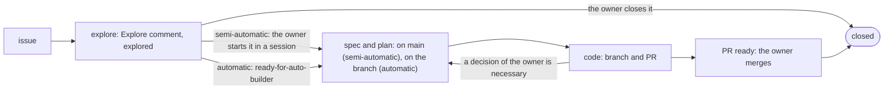

# Builder loop

> The builder loop is the life of an issue, in two modes. In the semi-automatic mode, the owner and an agent work on the issue in a session. In the automatic mode, CI works on it with no owner: the workflow `loop.yml` and `/builder-resolve`. Both modes use the same steps, the same plan, the same rules and one PR. Explore and the code step each have one text that both modes read: `explore.md` and `implement.md` of `/builder-resolve`. Each text gives the action of each mode where they differ, and lists the differences of the modes in its last section. In the semi-automatic mode, the spec and the plan are on `main` until the branch of the issue opens; the code and the rules go on the branch. The owner closes the issues that will not be done, and merges each PR. Each project defines its own kinds of issues, and which kinds can start without the owner. How explore and implement work is in [L3-loop-builder](L3-loop-builder.md). The dev loop above it (the briefing, `start`, the graph of open work) and what the loops share are in [L2-loops](L2-loops.md). ⬜ A live run. ⬜ The rules in `skills/` still call only the CI part the builder loop. The code step still has two texts, `entry` in a session and `implement.md` in CI. ⬜ The two forms of the deep-verify before a spec review, and the script for its mechanical items.

Marks: ✅ built · 🔶 partly built · ⬜ not built.

## 0. Terms

| Term | Meaning |
| --- | --- |
| Life of an issue | Open → explore → spec → code → a PR that the owner merges (§1). It has two modes. |
| Builder loop | The life of an issue, in both modes. The modes share the steps, the plan and the rules. Explore and the code step each have one text that both modes read (`explore.md`, `implement.md`). The differences come from what starts the work and who answers the questions (§1). |
| Semi-automatic mode | The owner and an agent do the issue in a session. The agent leads the conversation. |
| Automatic mode | CI does the issue: the workflow `loop.yml` and `/builder-resolve`. No owner is present. |
| Explore | The first step of `/builder-resolve`. It writes an Explore comment on the issue and adds `explored` ([L3-loop-builder §1.1](L3-loop-builder.md#11-explore)). CI does it in batches; an agent in a session does it for one issue. |
| Implement | The second step of `/builder-resolve`, in CI only. It takes one issue with `ready-for-auto-builder` and `explored`. It writes the plan (if `main` has none), the L3 spec and the code, and opens a PR ([L3-loop-builder §1.2](L3-loop-builder.md#12-implement)). It follows `implement.md`. |
| `implement.md` | The one text of the code step, for both modes (⬜). Implement reads it in CI. In a session, the agent reads it for each PR of an issue ([L3-loop-builder §1.3](L3-loop-builder.md#13-the-code-step-in-both-modes)). |
| `explored` | The label that explore adds when the Explore comment is written (§3). |
| `ready-for-auto-builder` | The label that hands an issue to the automatic mode (§3). It is not a sign-off. |
| Branch of an issue | `issues/<N>` (§5). |
| Plan of an issue | `knowledge/plan/<N>-<slug>.md`. Semi-automatic mode: on `main` from the start of the issue. Automatic mode: on the branch of the issue. It stays on `main` until the release after its last node (§5). |
| Spec review | An owner step (O) in the plan of an issue: the owner reads the full spec change of the issue, after a deep-verify. The first spec review of an issue comes after a full deep-verify (a light one for a change of 3 L3 pages or fewer); each later spec review comes after a light one (§7). |
| Deep-verify | Subagents verify a spec change and its plan; the agent repairs what they find (`entry`, deep-verify-knowledge). The full form has one reviewer for each of four dimensions, and a rebuttal. The light form has one subagent for all four dimensions, and no rebuttal (§7; ⬜ the light form). |
| Sign-off | A point where the owner accepts the work: the start of an issue, a spec review, the merge (§7). |
| Kind | A class of issue that a project defines, with its own research and its own way to do the work. Example: a small data correction, a change to the data pipeline, product feedback. |
| Issue | A GitHub issue. One issue is one task. |
| PR | A GitHub pull request. |

Other terms: [L2-loops §0](L2-loops.md#0-terms).

**Each piece of work has an issue, except a small change. Explore makes the issue complete. In the semi-automatic mode, the spec and the plan go on `main`, and the code goes into one PR on one branch. In the automatic mode, all three go into one PR. In the semi-automatic mode, the owner signs off three times: the start of the issue, each spec review, and the merge. In the automatic mode, the merge is the only sign-off (§7).**

## 1. The life of an issue ✅

| Step | Record | Semi-automatic | Automatic |
| --- | --- | --- | --- |
| Open | The issue | The agent asks the owner: an issue, or a small change with no issue (§2.1). With an issue, the agent opens it | A script or the owner opens it |
| Explore | The Explore comment and `explored` | The agent in the session does it at once | A batch in CI |
| Start | The plan on `main`, or the label | The owner starts the work in a session; the agent writes the plan on `main`: a sign-off | The label, from the owner or from Auto-ready (§3): not a sign-off |
| Spec | The spec change and the plan | On `main`. The agent leads; a spec review ends each round (§7) | Implement; only L3 (§6) |
| Code | The A nodes of the plan; the branch and the PR | The agent follows `implement.md`, the same text as CI (⬜). It leads the owner through each open D or O at once | Implement; it stops only with a reason (§3) |
| Sign-off of the code | The merge of the PR | The owner merges | The owner merges |

- **One loop, two modes.** Both modes are the builder loop. They share the steps, the plan format, and the rules of `entry` for the spec, the plan and the code. The differences come from two things: what starts the work (the owner in a session, or the label), and who answers the questions (in a session, the owner at once; in CI, the agent alone, and a question for the owner stops the work: §3). These two things cause the other differences: where the spec and the plan go (§5), what the spec change can touch (§6), and the sign-offs (§7).
  - Why: a shared process makes the steps, and the tools of each step, the same. A semi-automatic issue uses the same skills as the automatic mode.
  - The name is "builder loop": it matches `builder-resolve` and `ready-for-auto-builder`.
- **One text for explore and one for the code step, in both modes.** `/builder-resolve` holds the two texts: `explore.md` and `implement.md`. Both modes read them. `implement.md` holds the code step: the branch and the draft PR, the test baseline, the agent nodes, the close, the PR body and its check. Each text gives the action of each mode where they differ, and lists the differences of the modes in its last section ([L3-loop-builder §1.1](L3-loop-builder.md#11-explore), [§1.3](L3-loop-builder.md#13-the-code-step-in-both-modes)). `entry`'s execute-plan keeps only what a session alone does, for example to lead the owner through each D and O at once.
  - ⬜ The code step still has two texts, execute-plan in a session and `implement.md` in CI. Only CI writes a test baseline and a PR body of a fixed form. Only CI examines that body with a script.
  - Why: a second text for one step overlaps the first, and two texts for one step become different (P3). Then a PR from a session has weaker evidence than a PR from CI. The owner decides on the evidence of each PR ([L2-loops §2](L2-loops.md#2-the-dev-loop)).
  - The label stays the lock (§3). A session does not select an issue, and it works only on an issue with no label ([L3-loop-builder §1.3](L3-loop-builder.md#13-the-code-step-in-both-modes)).
- **A change of mode.** An issue goes from the semi-automatic mode to the automatic mode when the owner tells the agent to add `ready-for-auto-builder` ("交给 builder"). The session pushes its work and then does not write to the plan or the branch; implement continues the plan, on the branch of the session or on a new branch from `origin/main` (§3). An issue goes from the automatic mode to the semi-automatic mode when implement stops (§3). A session that continues a branch that implement wrote examines that work as data first (R23).
- **The release is not a step of the life.** One run of `prerelease` releases all merged PRs ([L2-release](L2-release.md)). The plan of an issue has a release node only when a node must wait for the release (§5).
- **A closed PR.** The owner closes a PR with a comment that says what to change. In the automatic mode, the next implement reads it and tries again. In the semi-automatic mode, the agent reads it in the next session. The branch of a closed PR stays: the next try reads it.

## 2. Issues

### 2.1 Where issues come from

- Scripts in a project open issues. An example is a pipeline incident.
- The owner opens issues.
- **In a session, the agent asks the owner first.** The owner gives an idea, a problem or feedback. The agent collects the intent and the context. Then it asks: open an issue to track it, or make a small change with no issue.
  - A small change: a typo, a link, one paragraph of a rule. The agent commits it to `main` and pushes it at once.
  - A release also commits to `main` with no PR: its version commit, a fix inside a release, and a `Merge follow-up` after the merge of step 6 (the links, or a repair). The tag message lists the fixes inside the release. A `Merge follow-up` comes after the tag, so the tag message cannot list it: the final reply of the release lists it, with its SHA, its subject and its files ([L2-release §1](L2-release.md#1-the-order-)).
  - All other work gets an issue. An issue only tracks the work. It is not a decision to do it (§7).
  - Why: an issue tracks all work, except a small change that goes straight to `main`. The agent asks the owner which one when the work starts.
- Put project tasks in the repo of the project. Put rules about how agents work in aboveloop.
- There is no notes file. No feedback waits for a later step (P4).

### 2.2 One issue for each task

- One issue is one task.
- Put the tasks of a large project in the repo of that project.
- Put these tasks in aboveloop:
  - Small tasks.
  - Tasks that are not part of a large project.
  - Tasks for aboveloop.
- Explore merges issues that report the same problem ([L3-loop-builder §1.1](L3-loop-builder.md#11-explore)).
- Keep the list of open issues short. The owner closes an issue that will not be done; an issue does not wait for a decision for a long time.

### 2.3 Each issue is self-contained

- **The body of the issue is the record.** It has all the information that is necessary to do the task.
  - Why: the owner can decide from the issue alone (the body and the newest Explore comment), and implement can refuse an issue that it cannot trust ([L3-loop-builder §1.2](L3-loop-builder.md#12-implement)). `entry` gives the template ([issue-template](../../skills/entry/references/issue-template.md)), with one heading for each part: Problem, Report, Evidence, Impact, Done when. All who open issues use it, scripts too: a script writes in Report which script and which run opened the issue. A project links to the template and does not copy it.
- **The opener writes the body; everything after is a comment.** The one who opens the issue writes the body, and the body does not change. Explore writes its findings as a comment. New facts also go into comments.
  - Why: the body stays the report of the opener, and the findings of explore stay apart from it.
- **Each comment of a loop tells which loop wrote it.** An Explore comment starts with `<!-- builder-resolve:explore -->` and `## Explore · builder loop`. In the automatic mode, it ends with "Written by the builder loop (builder-resolve, explore) of <project>. <address>". The address is the `Address:` line of the project's configuration, for example `dev-builder@example.com` ([L2-loops §5](L2-loops.md#5-names-and-domains)). In CI, the loops act on GitHub as the GitHub App of the loop, so the author is the bot of that App (`<app>[bot]`), not the owner. An agent in a session writes "Written in a session of the owner" as its last line.

## 3. The labels `explored` and `ready-for-auto-builder`

- Each repo of the loop has these two labels. `setup-app` makes them.
- **`ready-for-auto-builder` hands the issue to the automatic mode.** It is not a sign-off. An issue in the semi-automatic mode does not have it.
  - Why: the label only hands the implementation to CI. The owner signs off by other actions (§7).
- **Open, without `explored`:** explore has not done it. The next explore batch takes it.
- **Open, `explored`, no label, no open PR, no plan on `main`, and no "wait" of the owner:** the issue waits for the owner (§7). `start` and the briefing (a design that aboveloop does not implement: [L2-loops §2](L2-loops.md#2-the-dev-loop)) list it.
- **Open, `explored` and `ready-for-auto-builder`:** implement does these issues. It starts with the lowest issue number. The label is the lock. The issue is selected when it has no open PR, or when its only open PR is a draft on its own branch `issues/<N>` or `issues/<N>-<k>`; implement then continues that branch. The examination of the running agents stops a second agent.
- **Open, with an open PR and no label:** the work has started in a session, or implement stopped. The workflow `loop.yml` does not start implement on it (§5).
- **Open, with a closed PR:** the owner closed the PR with a comment that says what to change. The next implement reads it and tries again. The tries have a limit: 2 with no mark. To stop the work, the owner removes `ready-for-auto-builder`.
- **Closed:** done, not planned, or merged into another issue. GitHub closes the issue when a PR with `Fixes #N` merges.
- An agent that still runs, before its draft PR, shows nothing on the issue; the workflow reads the agents of the account and does not start the same work again.
- Do not use priorities. Do not use other labels to control the work.
- **Who adds `ready-for-auto-builder`:**
  - The owner, at any time. The owner can add it before explore; implement waits for `explored`.
  - An agent in a session, only when the owner tells it to ("交给 builder"). Explore in a session never adds it. When a session starts an issue that has the label, it removes the label first.
  - Explore, only as the configuration of the project (`.agents/builder-resolve.md`, part Explore, "Auto-ready") says: which kinds, under which conditions. aboveloop defines no rule. Without a rule in the project, explore never adds it. Explore never adds it when the issue has instructions to an agent, when the change touches keys, CI, permissions or other repos, when the change must change L1 or the content of L2 (§6), or when explore is not sure of the kind.
  - A script that uses no model, for an urgent problem (below).
- **Who removes `ready-for-auto-builder`:**
  - The owner, at any time.
  - Implement, when it stops: it refuses the issue, or it must have a decision or a step of the owner (also an explore question that the owner did not answer), or the change must change L1 or the content of L2 (§6). It first writes a comment that tells why; the comment starts with the question marker, so `start` and the briefing show it. The issue then goes to the semi-automatic mode.
  - A session, when it starts the issue (above).
  - Why: an issue with no label is not started again, so the workflow does not wait for a comment. The comment tells the owner, or a script, why the label must not come back.
- The label can show who added it: the agents in CI act as the bot of the GitHub App of the loop; the owner, and an agent in a session, as the owner. The workflow `loop.yml` still does not examine who added it (A2 in [L2-loop-untrusted-text §3](L2-loop-untrusted-text.md#3-design-requirements)). The merge of the PR is the gate (P2): by rule, not enforced by GitHub; P2 names the backstops. An incorrect label costs at most one agent run and one PR, and at most three ready PRs wait for the owner ([L3-loop-builder §1.2](L3-loop-builder.md#12-implement)). 🔶 Not quite: if implement is also misled, the cost is H5: implement cannot push a workflow file, but its token can still push `main` or a tag of its project, and that starts the project's workflows that hold keys (L2-loop-untrusted-text H4), until their push checks (R15).
- **Exception for urgent problems.** A script that uses no model can open an issue with `ready-for-auto-builder`. All of these conditions must be true:
  1. The script does not read untrusted text to make the decision.
  2. A rule in the spec of the project makes the decision.
  3. A code change can repair the problem. If only the owner can repair it (a key, a payment, a quota), the script opens the issue without the label.
  4. The body of the issue tells why it is urgent: the rule, the evidence (numbers, which run), and links. If the facts change later, the script writes a new comment. It does not change the body.

  Explore still does the issue first. If the owner does not want the work, the owner removes the label.

## 4. Labels that describe an issue

The labels of this section tell what an issue is. They do not control the work: only `explored` and `ready-for-auto-builder` do that.

- **The form is `Name: value`.** One label for each value.
  - Why: one standard form for the kinds (`Kind: <kind value>`), and not many unrelated labels.
- **Only `builder-resolve` adds `Kind:`.** The scripts of a project do not add it; a script finds its own issues by their author, not by a label.
  - Why: the kind is the decision of explore.
- `setup-app` makes the labels of the fixed lists in each repo (`skills/setup-app/references/labels.tsv`), and one `Kind:` label for each kind of the project.

| Label | It tells | Who adds it |
| --- | --- | --- |
| `Kind: <kind>` | What the issue is about. Each issue has one. The kinds are in the project's `.agents/builder-resolve.md`, part Explore. A project can also name a kind for PRs, for example `Kind: policy` on a PR that changes a rule. | `builder-resolve`: explore on issues, implement on its PR where the project's configuration says |

## 5. The branch, the PR and the plan of an issue ✅

- **Where the work of an issue goes.**
  - Semi-automatic mode: the spec change and the plan go on `main`. The agent commits them as the owner talks. A part that is not built has a mark "⬜ #N". After the last spec review, the code and the rules in `skills/` go on the branch `issues/<N>`, into one PR. After the branch opens, the spec changes of the issue also go on the branch. An example is the removal of its ⬜ marks. ⬜ The rules in `skills/` do not say this yet. Rules count as L2 (§6), and they act from the next release, so they wait for the merge with the code.
    - Why: the owner reviews the spec and the plan more easily on `main`.
  - Automatic mode: the plan, the L3 spec and the code go on the branch, into one PR. Implement does not push `main`.
  - A semi-automatic issue that the owner drops after its start: the agent strikes the open nodes of its plan and sets ✅ on them, so the next release removes the plan. The owner chooses: revert the spec commits `#N` on `main`, or move their "⬜ #N" to a new issue.
- **One issue, one branch, one PR, one plan, at one time.** The branch is `issues/<N>`. The first push opens a draft PR with `Fixes #N`: the PR links the branch to the issue. The PR workflows of a project skip drafts, and run when the PR is ready and at each push after that. Why: in a private repo each run costs minutes, and the work of a session goes into PRs. A second try after a closed PR uses the next free `issues/<N>-<k>`, from `issues/<N>-2`. One rule serves both modes, in `scripts/loop.ts` (⬜ a session still takes `issues/<N>-2`).
  - Why: in the automatic mode, the draft PR shows on the issue that the work has started; in the semi-automatic mode, the plan on `main` shows it. A session works only on an issue with no label, and implement only on an issue with the label (§3), so a session and CI do not do the same issue.
  - Implement marks its PR ready with one GraphQL call (`markPullRequestReadyForReview`); REST cannot change a draft (⬜ connection point W11, [L3-loop-workflow §5](L3-loop-workflow.md#5-connection-points-how-much-is-verified)).
- **The spec change of the issue** is its commits under `knowledge/spec/`. In the semi-automatic mode, it is the commits `#N` on `main`, and the diff of the branch after the branch opens. In the automatic mode, it is the diff of the branch. Nothing else records it.
  - Why: the owner reads it in one place. The spec on `main` is built, except where a ⬜ names an issue.
- **The plan of the issue** is `knowledge/plan/<N>-<slug>.md`. Its codes start at 1. It is not in `knowledge/index.md`: the spec commits of its issue show what it builds on. While the branch of the issue is open, the agent changes the plan only on the branch, so that `main` and the branch do not both change it. Before the agent marks the PR ready, it sets ✅ on the done nodes and examines that each answer of the owner (each D and each spec review) is in the spec. The plan stays on `main` after the merge, with its done nodes ✅; the nodes after the release wait in it. `prerelease` removes each plan whose nodes are all ✅, with the deep-verify reports of its issue, in the version commit ([L2-release §2.8](L2-release.md#28-a-release-removes-finished-plans-and-deep-verify-reports-)). Implement does the same.
  - Why: the plan shows on `main` what the merge did and what still waits, until the release. So the release removes it, not the merge.
- **Several issues in one PR.** One issue names the branch and the plan. Each other issue gets a comment that links the PR, and the PR has a `Fixes` line for each.
- **A ⬜ mark** names an open issue ("⬜ #N"), or an issue whose plan is still on `main` with open nodes. Before the PR is ready, the agent removes each "⬜ #N" of this issue where the part is built. A part that waits for the release keeps its mark: the plan of the issue on `main` has its node, after the issue closes at the merge. Work that is split into several issues also leaves marks on `main`.
- **A release node in the plan of an issue** is an owner step (O): the owner runs `prerelease`. It is in the plan only when a node must wait for the release, for example a label rename after the new code is live. Its heading has the form `O<k> Owner: release of <repo>` (`O<k> owner：发版`). The k-th release node of a plan is done when k releases of this repo ([L2-release §0](L2-release.md#0-terms)) hold the merge of the PR that closed the issue. `start` finds this, and the agent that does the next node sets its ✅. A release of another repo is a plain owner step. The nodes after it stay in the plan on `main`; `start` and the briefing show them when they are next ([L2-loops §2](L2-loops.md#2-the-dev-loop)). A session does them: the issue is closed, so CI does not take them. A node that changes files goes into a new PR that says `Refs #N`. Its branch is the next free `issues/<N>-<k>` from `origin/main`, with k from 2 ([L3-loop-builder §1.3](L3-loop-builder.md#13-the-code-step-in-both-modes), row Input). A node that changes only the plan file goes into a small change. The agent that sets the last ✅ examines again that each answer of the owner is in the spec. No follow-up issue is necessary.
- **After the merge, the branch is deleted.** The repo setting "Automatically delete head branches" deletes the branch on GitHub. The agent deletes its local branch and worktree.
- **Parallel work.** In the semi-automatic mode, the agent commits the spec and the plan in the main folder, on `main`. It commits only its own files, runs `git pull --rebase`, and pushes: a commit that is not pushed can rebase. Each issue has its own branch and its own worktree for its code. An agent does not change the branch of the main folder of the project: another session can commit there, and its commit then lands on the branch of the issue. Before a spec review and before the PR is ready, the agent merges `origin/main` into the branch. It does not rebase: the branch is already pushed, and a rebase of it must have a force push. A page that another merged PR changed is verified again. On a conflict in a deep-verify mark or a "Checked" date, keep the one of `main` and verify the page again; keep both update records, in date order.

## 6. What the automatic mode can change in the spec ✅

| Level | Automatic mode | Why |
| --- | --- | --- |
| L1 | Nothing | Only the owner changes L1 ([knowledge-base](../../skills/entry/references/knowledge-base.md)). |
| L2 | Only a change of words, as [knowledge-base](../../skills/entry/references/knowledge-base.md) defines it (wording, a typo, a link), never the owner's words. A change that needs a line in the update record of the page is a change of content, and is not permitted | L2 holds the owner's decisions. An agent does not invent a decision. |
| L3 | Any change that the issue needs | The PR shows it, and the owner merges it. |

- Explore tells in the Explore comment which levels the change touches. A change of L1, or of the content of L2, is in the semi-automatic mode: explore does not add the label.
- Implement that finds such a change later stops (§3).
- The rules also count as L2 here: `AGENTS.md`, `.agents/*.md`, and the rules in `skills/`. Why: agents obey the rules first, and `.agents/*.md` holds the Auto-ready rules.
- A project with no spec levels yet: the automatic mode changes no page of `knowledge/`; only the plan of the issue.
- Why: the spec is what all later agents obey. An issue can carry untrusted text. A wrong spec stays after the issue closes, so a misled change to the spec costs more than a misled change to code (E1).
- In the automatic mode, the merge of the PR also signs off the spec. The owner reads the spec diff in the PR. R22 in [L2-loop-untrusted-text](L2-loop-untrusted-text.md#3-design-requirements) is the requirement.

## 7. The owner's part

- **The sign-off of an issue is an action, not a label.** In the semi-automatic mode, the owner starts the work in a session: the plan on `main` records it. In the automatic mode, there is no sign-off of the issue: the label only hands it to CI, and the merge is the gate. An issue that will not be done is closed.
  - Why: the sign-off can be implicit, because the upkeep of a sign-off label is itself a burden.
- **`start` and the graph of open work are parts of the dev loop** ([L2-loops §2](L2-loops.md#2-the-dev-loop)). `start` leads the owner through the open work in a session ([L2-loops §2.2](L2-loops.md#22-start-the-entry-in-a-session)). The graph shows all open work in one chart ([L2-loops §2.3](L2-loops.md#23-the-graph-of-open-work)). This section holds the decisions of the owner on an issue.
- **The owner goes through the open issues in a session.** The agent shows each explored issue with no label, no open PR and no plan on `main`. For each, the owner decides one of five: do it at once (small work, the owner present), start it, hand it to the automatic mode, close it, or wait. The briefing, as designed, offers the last four: "do it at once" needs a session. For "wait", the agent writes a comment "The owner looked at it: wait. <the reason>." in the name of the owner. The next time, the agent skips an issue whose newest comment is this one and whose author is the owner. A loop's comment with the same words does not count.
- **The spec review (semi-automatic mode).** An owner step (O) in the plan of the issue. Before it, the agent runs a deep-verify on the spec changes of the issue, and every node that points to it is done. The owner reads the full spec change on `main` (`git log -p --grep '^#<N>[^0-9]' origin/main -- knowledge`); from the second spec review, the agent shows what changed since the last one first. Changes that the owner asks for go into the spec at once, and lead to the next spec review. When the owner accepts the last spec review, the agent writes the code with no other start.
  - **The deep-verify before a spec review** has two forms (§0). ⬜ The rules in `skills/` still give each spec review the full form, and no script examines the mechanical items.
    - Before the first spec review of an issue, the agent runs one full deep-verify. A change of 3 spec pages or fewer, all L3, gets the light form. A change to L1 or L2, or to more pages, gets the full form. A rule in `skills/` counts as L2 (§6).
    - Before each later spec review, the agent runs the light form. Its scope is the diff since the last deep-verify, and the pages that build on the changed pages.
    - Only blocking and important findings go to the rebuttal and into the report. The main agent repairs the small findings in one batch, or leaves them.
    - The rebuttal examines only two kinds of finding: a finding that the agent repairs with a change of meaning, and a finding that becomes an owner decision. A typo or a link gets no rebuttal.
    - A script examines the mechanical items: the anchors of relative links, the "Builds on" column of `knowledge/index.md`, the issue of each "⬜ #N", and the ✅ nodes of the plans. The reviewers do not examine these items by hand.
    - The model does not change: a deep-verify stays on the spec tier of `entry` (「用哪个模型」, measured).
    - The count of 3 pages is the spec pages that the change touches. The plan, the graph and the downstream pages do not count, because the one subagent reads them in any case.
    - Why: a full deep-verify before each spec review ran too often, and each run took tens of minutes.
    - Why: in measured runs, the second round found as many findings as the first (40, then 62; 15, then 33; 32, then 32). So the count follows the effort of the reviewers, not the quality of the spec. Few findings blocked (1 of 15; 0 of 32). The rebuttal dropped few (1 of 15; 1–3 of 32).
- **The sign-off of the code** is the merge of the PR, in both modes.
- How a session leads the owner through these steps is in `entry`.
