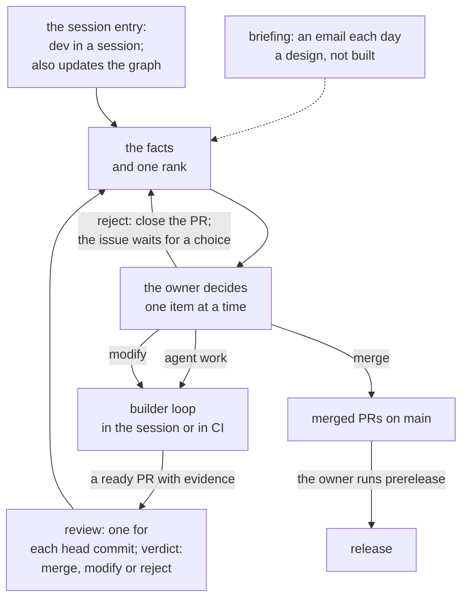
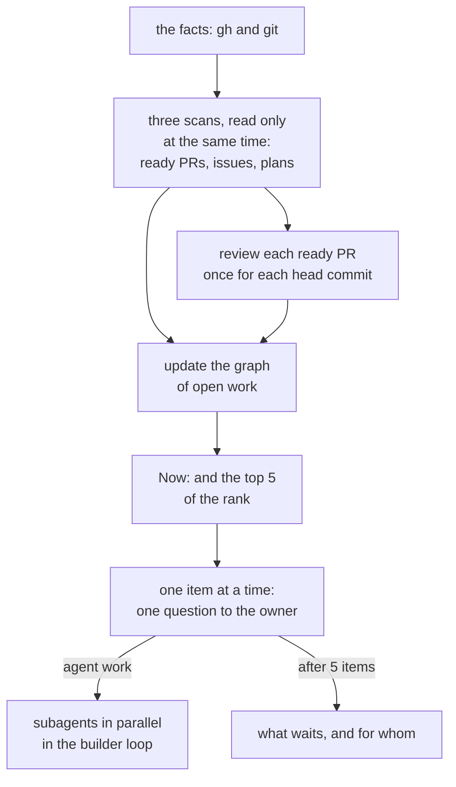
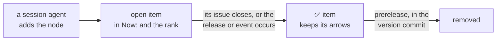

# Dev loop

> The dev loop is the outer loop: the attention queue of the owner, with the skill `dev`. This page holds its decisions and why. The session entry and the graph of open work are built; the briefing is a design that aboveloop does not implement (§2).

Marks: ✅ built · 🔶 partly built · ⬜ not built.

## Summary

- **The dev loop is the attention queue of the owner.** It does no work of an issue. It puts what waits for the owner in one order, and the work goes into the inner loops (§1).
- **One skill, one judgement.** The session entry (`dev` in a session) reads the facts with `gh` and `git`, and ranks them by the rules of `dev`. The briefing, a design that aboveloop does not implement, uses the same rules of what waits and the same rank (§1).
- **The briefing is a daily email to the owner, as a design** (§2). aboveloop has no skill, no workflow step and no server for it.
- **The session entry leads a session.** It scans, reviews each ready PR once for each head commit, updates the graph, shows the top 5 of the rank, and asks about one item at a time. The work goes in parallel (§3).
- **The rank** is urgent work, then started work, then the other issues from small to large. It comes from the facts only (§3).
- **The graph of open work** is one chart on `main`. Only a session agent changes it. It gives only the order (§4).
- **The review of each ready PR gives one of three verdicts:** merge, modify or reject. The owner decides (§5).
- The steps of the session entry are in the skill `dev` (`references/session.md`). [L3-loop-dev](L3-loop-dev.md) holds the rank, the format of the graph that `prerelease` reads, and the project configuration `.agents/dev.md`. How the dev loop sits above the inner loops is in [L2-loops §1](L2-loops.md#1-overview).

## 0. Terms

The terms that all loops share (the owner, agent, inner loop, outer loop, builder loop, dev loop) are in [L2-loops §0](L2-loops.md#0-terms).

| Term | Meaning |
| --- | --- |
| `dev` | The skill of the dev loop. In aboveloop it has one entry, the session entry (§3). The design has a second entry, the briefing (§2). |
| Briefing | A daily email to the owner: the entry of the dev loop with no session. A design that aboveloop does not implement (§2). |
| Session entry | The entry of `dev` in a session (§3; its steps: `dev`'s `references/session.md`). "start" is one of its trigger words, not its name. |
| Rank | The one order of the items that wait for the owner: urgent work, then started work, then the other issues from small to large (§3, [L3-loop-dev §1.2](L3-loop-dev.md#12-the-rank)). |
| Graph of open work | `knowledge/plan/index.md` on `main`: all open work of the repo in one chart, and the items that finished since the last release, with ✅ (§4, [L3-loop-dev §2](L3-loop-dev.md#2-the-graph-of-open-work)). |

## 1. The dev loop

The dotted line is the briefing, a design that aboveloop does not implement (§2).

| Part | What it does | Where |
| --- | --- | --- |
| The briefing | The entry with no session: one email each day. What occurred, what waits for the owner, which three tasks first. A design that aboveloop does not implement. | §2 |
| The session entry | `dev` in a session. It scans, updates the graph, shows the rank, and leads the owner one item at a time. | §3; its steps: `dev`'s `references/session.md` |
| The graph of open work | All open work of the repo in one chart, with the real waits. The items that finished since the last release stay, with ✅. | §4, [L3-loop-dev §2](L3-loop-dev.md#2-the-graph-of-open-work) |
| The owner's decisions | The owner's points of all loops. The dev loop puts them in order; the builder loop leads the owner through the D and O of one issue (the part of a session of `spec.md`). | §5, [L2-loops §4](L2-loops.md#4-how-the-loops-talk-to-the-owner), [L2-loop-builder §7](L2-loop-builder.md#7-the-owners-part) |
| The release | `prerelease` releases all merged PRs. Only the owner runs it. | [L2-release](L2-release.md) |

- **The dev loop is the attention queue of the owner.** It does no work of an issue itself. It shows the owner what waits, in order, and leads the owner through the decisions. When the owner picks an item, its work goes into an inner loop: the semi-automatic mode of the builder loop (in the session, or in a subagent of it), or CI.
  - Why: the decision bandwidth of the owner limits all loops (P1).
  - Why: a loop that manages the issues, the PRs and the plans sits above the loop that does the work of one issue.
  - Why: published work on agent loops puts a human at a boundary of review or decision, and the bandwidth of that human limits the throughput. Some of it has two levels, with the human in the outer loop: Osmani, "Engineers own the outer loop."; Codex, "The Scheduled view acts as your inbox."
- **The evidence in each PR is what the owner decides on.** So the inner loops spend effort on the evidence: the spec diff, a deep-verify before the last spec review (its forms: [L2-loop-builder §7](L2-loop-builder.md#7-the-owners-part)), and the test output in the PR. The owner does not read all code.
  - The test output that an agent reports is a claim, not proof (P2).
  - In a session, the session entry also reviews each ready PR (§3, §5).
  - Why: the owner cannot review all code.
  - A known limit: in the automatic mode, the implement run verifies its own code. A heavy spec in CI gets its deep-verify from subagents of the same run; the subagents did not write the draft. Published loops use one agent to do the work and a different agent to verify it. The owner keeps this limit.
- **The briefing is a part of the dev loop, not a loop of its own.**
  - Why: it does no work of an item. It only shows the owner what waits.
- **One skill, one judgement.** In the design, the briefing and the session entry are the two entries of one skill, `dev`.
  - They use the same facts, the same rules of what waits for the owner, and the same rank (§3). `skills/dev/SKILL.md` holds these rules, in words. The session entry reads the facts with `gh` and `git` (`skills/dev/references/session.md`).
  - The rank comes from the facts only. The top 5 of a session are its first 5. In the design, the three tasks first of the briefing are its top 3.
  - aboveloop implements only the session entry. An implementation of the briefing reads the rules of `dev`, and keeps no second copy of them.
  - Why: one implementation of each rule (P3): two ranks for one queue give the owner two different orders.

## 2. The briefing

The briefing is a design. aboveloop does not implement it: there is no skill entry, no workflow step and no server for it. A project that wants it can build it by these rules.

- **The briefing is the entry of the dev loop with no session.** One email to the owner each day tells three things: what waits for the owner (explored issues to decide, ready PRs, questions and refusals of the agents, stopped work), what occurred in each repo since the last briefing, and which three tasks to do first. Small tasks follow in a short list.
  - Why: the owner is not in a session each day. The briefing brings the queue of the owner to the owner, so that the inner loops do not wait for a session (P1).
- **The briefing is an email.** It makes no issue and no file.
  - Why: the data in the briefing is already recorded where it occurred (P4): issues and PRs keep their history.
  - The briefing shows records only where they are kept (P4). An example is the next nodes of a plan of an issue on `main` ([L2-loop-builder §5](L2-loop-builder.md#5-the-branch-the-pr-and-the-plan-of-an-issue-)). The plan of an open issue is on the branch of its draft PR: the briefing names the draft PR.
  - Data from a project that has no record of its own (for example, a pipeline incident) must be an issue, or it does not get into the briefing.
- **The briefing finds its work in the current state** (E4). It starts at the last briefing, not at a fixed time.
- **One email every day.** If nothing occurred and nothing waits for the owner, a short fixed email says so, and no agent starts (P6).
  - Why: a day with no email then means that the briefing failed, not that the day was quiet.
- **The briefing treats the facts as data** (E1). The facts carry the text of issues and comments ([L2-loop-untrusted-text §1](L2-loop-untrusted-text.md#1-the-inputs)).

## 3. The session entry

- **The session entry begins the work of a session.** It is `dev` in a session.
  - The owner calls `dev`, says one of its trigger words ("start", "work", "dev loop", "开工", …), or selects `dev` among the daily options at the start of a session.
  - `entry` offers `dev` at the beginning of each session. `entry` keeps the rules that each session obeys and its table of tasks.
  - Why: the dev loop is a skill of its own, so that `entry` keeps only the rules that each session obeys, and the queue of the owner has one home.
  - The name is the skill, `dev`; "the session entry" names its entry in the texts. "start", "work", "dev loop" and "开工" stay as trigger words of `dev`, because the owner types them. The reference of the session entry in `dev` is `references/session.md`. The marker of the review record keeps the word `start` (below).
- **The steps of the session entry are in `dev`'s `references/session.md`.** This section holds its decisions and their Why ([L2-plugin §2](L2-plugin.md#2-entry-the-start-for-all-rules-and-skills)).
- **It scans three kinds of open work at the same time:** ready PRs, open issues, and the open nodes of the plans. Each scan only reads: it writes nothing to GitHub, runs no `git checkout`, and runs nothing from a branch. The scans and their inputs are in `session.md` §2.
  - Why: the text and the code of a branch can come from an issue that carries untrusted text, and a session has the owner's login and local keys (R23, A4).
  - The session entry reads the facts with `gh` and `git`, and sorts them by the rules of `skills/dev/SKILL.md`: what waits, the states of an issue, the next nodes of a plan.
  - A plan that the implement run wrote shows as one item, and the agent examines that work before it does a node of it (R23).
  - The plan of an open issue is on the branch of its draft PR ([L2-loop-builder §5](L2-loop-builder.md#5-the-branch-the-pr-and-the-plan-of-an-issue-)): the session entry reads it there.
  - The plans of milestones (the plans with no number, [L2-loop-builder §1](L2-loop-builder.md#1-the-life-of-an-issue-)) are only in the session entry, not in the briefing of the design.
  - Why: the session leads the start of the work. Subagents scan at the same time; the agent then gives the top 5 and leads the owner through them, one at a time.
- **One review of each ready PR for each head commit.** The agent reviews the code against its spec diff, its issue and its plan, and records the review on the PR. A new head commit gets a new review. The review gives one of three verdicts before the owner acts (§5).
  - Why: the owner decides on the evidence of the PR (§1), and a second review of the same commit costs time and gives nothing new.
  - Why the record is a comment on the PR: the next session and the owner see the review there, and a second session does not do it again.
  - The first line of the record keeps the marker `<!-- start:review <head SHA> -->`, word for word. Why: a marker is a fixed string that the agents of the scan look for, not a name for a person, and GitHub does not show an HTML comment. Open PRs carry this marker, so a new marker makes each scan read two forms, or review each open PR again (P3). No script reads it. The builder-loop markers keep their name for the same reason ([L2-loop-builder §2.3](L2-loop-builder.md#23-each-issue-is-self-contained)).
- **The agent then updates the graph of open work (§4), and shows the top 5 of the rank.** It shows the `Now:` line and the top 5, with one line each about why.
  - Then it leads the owner through them one at a time: a PR to merge, an issue to decide, a decision (D) or a step (O) of the owner, or an agent node to do.
  - After each item, the agent names the next one. After the 5 items, it shows from the graph what waits, and for whom.
- **The rank: urgent work, then started work, then the other issues from small to large.** It is the one rank of the dev loop (§1). A push to `main` or of a release tag that the owner did not make comes before all groups. The rules of `skills/dev/SKILL.md` give the rank from the facts, and a project can change it in its `.agents/dev.md`. The items of each group, the order in a group and the tie are written once, there (「排序」; [L3-loop-dev §1.2](L3-loop-dev.md#12-the-rank)); the format of the file, and what a project can change, are in [L3-loop-dev §3](L3-loop-dev.md#3-the-project-configuration-agentsdevmd).
  - Why: the order of the work must be specified. Usually it is urgent PRs and issues, then the other PRs, then the other issues from small to large. A project can change it in its own repo.
  - By default, "urgent" is what stops a person or a loop outside the owner's queue, and what a fact shows: a failed run of `loop.yml` stops the loops of a repo. A push that the owner did not make stays before all groups, and a project cannot move it, because P2 counts on the owner to find such a push. No other default: a guess at urgency from the text of an issue is not a fact, and text from outside can ask for it (R23).
  - The open D and O nodes, a release O, the questions of `builder`, the stopped implement runs, the branches of implement and the next agent nodes go into the group of the PRs, as started work. Like a ready PR, each one is work that an agent already did in part, and it stops until the owner acts. A ready PR comes first in the group. The limit on the ready PRs that wait for the owner is R19 ([L2-loop-untrusted-text §3](L2-loop-untrusted-text.md#3-design-requirements); [L3-loop-builder §1.2](L3-loop-builder.md#12-implement)).
  - The size comes from the lines `Spec depth` and `Spec levels` of the newest Explore comment. Explore writes them for each issue (`builder`'s `explore.md` §5), and the session entry reads them from the comments of each issue that waits. A light spec has no D, no deep-verify and no spec review; a change of L1 or of the content of L2 needs the owner in a session ([L2-loop-builder §6](L2-loop-builder.md#6-what-the-automatic-mode-can-change-in-the-spec-)). The size of a plan is not used: an issue that waits for the owner's choice has no plan.
  - The rank comes from the facts only. The graph is not an input of the rank: the graph and the facts would give two orders for one queue (P3). The plan nodes give the count of the nodes that each item blocks. The graph keeps the whole view: `Now:`, the chart, and what waits for whom (§4).
- **The dev loop keeps only the work across issues.** It collects the facts, scans, keeps the graph, ranks, gives the top 5, and asks about one item at a time.
  - The work inside one issue goes into the builder loop: the spec step, and each D and O of a plan, by the part of a session of `spec.md`; an agent node by `implement.md`. Small work at once is a part of the builder loop too ([L2-loop-builder §1](L2-loop-builder.md#1-the-life-of-an-issue-)).
  - The text of the session entry holds no guidance for the work inside one issue. `entry` keeps the rules for each question to the owner (「怎么问 owner」).
  - The skill of the builder loop, `builder`, holds the steps of the work inside one issue: small work at once, the path for a node of a plan whose issue is closed, the subagents of one plan, the cleanup after a merge, and the mechanics of an agent node and of a PR. The session entry and `entry` only link there.
  - Why: the semi-automatic mode goes through `builder` too, so the guidance of the dialog for one issue is a part of `builder`. One text for each step serves both modes (P3).
- **One item, one question.** The agent asks about one item at a time, by the rules of `entry` (「怎么问 owner」). The dev loop gives only the order of the owner's points (the rank above); it holds no rule of how to ask. The owner's points of all loops are in one table in [L2-loops §4](L2-loops.md#4-how-the-loops-talk-to-the-owner).
  - Why: a question with no context cannot get a good answer. The agent follows `entry` to lead the conversation, and gives the context with each question.
  - Why: two levels. `entry` holds how to ask, the page of each loop holds where the owner acts, and the dev loop holds which comes first. A session that does not go through `dev`, and CI that asks in an issue comment, obey the same rules (L2-loops §4).
- **Questions go one at a time; the work goes in parallel.** The rule is in `entry` (「问是一个一个，活是并发」), for every session. The steps of the dev loop are in `session.md` §4.
  - Before the agent asks the owner about an item, it starts in background subagents all agent work that does not need the answer: the ready agent nodes of the plans, the agent work of the other items, and the work that prepares the choice (for example, the candidates of a D). When the owner chooses agent work, the agent starts a subagent for it and goes on to the next item.
    - Why: one question at a time is a rule for the questions of the owner, not for the work. The conversation with the owner goes on while the subagents work in parallel.
  - Agent work that does not wait for other work in the graph (several issues, or several A nodes of one plan) starts in parallel, one subagent each. The subagents of one plan follow `builder`'s `implement.md` §6 (「节点并发」). A subagent of a node can start subagents for its items, within the nesting limit of the runtime; at the limit, it does the items itself. Measured: a background subagent of a Claude Code session had no tool to start one.
  - One subagent at a time changes the spec and the plan of one issue; only the main agent changes the graph. Two pieces of work that change the same files go one after the other.
  - The main agent orchestrates, and subagents do the work. The main agent keeps only small bookkeeping: it runs the tests of a node, ticks the plan, commits, and changes the graph.
  - Why: work that does not wait for other work, by the graph or inside one plan, goes faster in parallel subagents.
  - Why: the main agent orchestrates. When it does the work itself, its context fills and the owner waits.
  - The bookkeeping stays with the main agent. Why: the tests examine the results of the subagents, because their report is a claim (P2). One writer for each worktree keeps the commits in order. These steps are small, so the work of the main agent stays small.
- **A subagent does work; it does not wait.** Some work waits for something that does not come soon: an external event, such as a CI run, a release or a review by another person. The agent then starts no subagent to wait for it. It adds a node for the external event (`E`) to the plan, and the graph shows what the node blocks. When the event occurs, the next scan continues from the graph.
  - Why: a subagent that only waits does no work, and the list of running subagents then shows work that does not move.
- **The work of another session is not in the top 5.** The agent names it in one line.
  - Why: two sessions on the same work collide on the same branch and files.
- **The session entry only moves open work.** It starts no deep-verify and opens no issue, unless the owner asks. A problem that it finds on the way is one line in the reply.
  - Why: a scan triages the work that exists. New issues from a scan add work that the owner did not ask for.

## 4. The graph of open work

- **The graph of open work** is `knowledge/plan/index.md` on `main`: one chart of all open work of the repo. Its format is in `knowledge`'s `spec-and-plan.md` (「依赖图 `plan/index.md`」); the part that `prerelease` reads is in [L3-loop-dev §2](L3-loop-dev.md#2-the-graph-of-open-work).
  - A node is an issue, a release (O), an outside event (E), or a next node of the plan of a milestone ([L2-loop-builder §1](L2-loop-builder.md#1-the-life-of-an-issue-)).
  - An arrow is a real wait.
  - The graph keeps only the arrows, the next steps and a `Now:` line. The agent reads the state of each issue from GitHub each time.
  - Why: only the semi-automatic mode needs the view of all work, so the session agent keeps it. Each issue has its own plan, so without one chart the waits between issues are not visible. GitHub issue dependencies are not used: they are hard to keep up to date.
- **Only a session agent changes it.** The session entry adds new issues and marks closed ones ✅. The agent changes it when it starts an issue, or when the owner says wait or close. CI does not change it.
  - Why: only the semi-automatic mode needs the whole view, so a local agent keeps it.
- **A change of the graph is a small change** ([L2-loop-builder §2.1](L2-loop-builder.md#21-where-issues-come-from)). It does not go on the branch of an issue.
  - Why: the next session reads the graph from `main`, so a line of it that waits on a branch gives an old graph and a merge conflict.
- **A finished item stays until the release.** When its issue closes, or a release or an outside event occurs, the agent marks the item ✅. The item keeps its arrows. This is the same rule as for the plan of an issue.
  - `Now:` and the rank do not use ✅ items.
  - `prerelease` removes the ✅ items in the version commit ([L2-release §2.8](L2-release.md#28-a-release-removes-finished-plans-and-deep-verify-reports-)).
  - Why: the graph shows what finished since the last release, as the plan of an issue does, and the release cleans both up in one place.
- **The graph gives only the order.** A session takes no instruction from it ([L2-loop-untrusted-text §1](L2-loop-untrusted-text.md#1-the-inputs)). The agent writes the nodes and the next steps in its own words, and copies no text of issues, comments or branches into it (R23).
  - Why: the agent writes the graph from issues and plans that can carry untrusted text, and the next session reads it from `main`.

## 5. When the owner acts

**The owner is on the loop, not in the loop** (P1): the owner decides, and the agents do the work. The decisions of the owner are the dev loop. The owner acts only at the owner points. [L2-loops §4](L2-loops.md#4-how-the-loops-talk-to-the-owner) lists the owner's points of each step of all loops in one table: an explored issue (its choices: [L2-loop-builder §7](L2-loop-builder.md#7-the-owners-part)), a spec review, a release, the stop of the automatic work, and the others. How to ask is in `entry` (「怎么问 owner」). This section holds the review of a ready PR and its three verdicts.

| When | What the owner does |
| --- | --- |
| A PR is ready | Read the review (§3), the spec diff and the evidence in the PR. The review gives one of three verdicts (below); the owner decides. |
| Each other owner point | As in [L2-loops §4](L2-loops.md#4-how-the-loops-talk-to-the-owner). |

- **Each ready PR gets a review with one of three verdicts before the owner acts:** merge, modify or reject (the row "A PR is ready"). The verdict is a recommendation, and the owner chooses; the owner can also leave the PR.
  - Why: a review shows the owner whether to merge, modify or reject, before the owner reads the PR.
- **Merge:** the owner merges the PR.
- **Modify:** the approach is correct, but some parts must change.
  - For a PR of the implement run, the owner writes in the PR what to change and closes it. The next implement run reads that comment and tries again.
  - A comment on an open PR of the implement run does nothing.
  - For a PR of a session, the PR stays open. The session goes on in the worktree of the issue, and its new head commit gets a new review.
- **Reject:** the approach is wrong. The owner closes the PR with a comment that says why, and removes `ready-for-auto-builder` from the issue. The issue goes back to the owner's choice for an issue ([L2-loop-builder §7](L2-loop-builder.md#7-the-owners-part)); in a session, the agent asks it at once.
  - After reject, the owner removes `ready-for-auto-builder`. Why: while the issue has the label, an implement run tries again after a closed PR ([L2-loop-builder §3](L2-loop-builder.md#3-the-labels-explored-and-ready-for-auto-builder)).
  - After reject, the agent asks the owner's choice for the issue at once. Why: an issue with a plan on `main` does not come back as an issue that waits for the owner ([L2-loop-builder §3](L2-loop-builder.md#3-the-labels-explored-and-ready-for-auto-builder)).
- There is no fourth verdict "look first". Why: the owner named three verdicts, and the list of places to look at stays in every review.
- What the builder loop does with a closed PR is in [L2-loop-builder §1](L2-loop-builder.md#1-the-life-of-an-issue-) ("A closed PR"). The criteria of each verdict, the review record and each choice in a session are in `dev`'s `session.md` §2 and §4.
