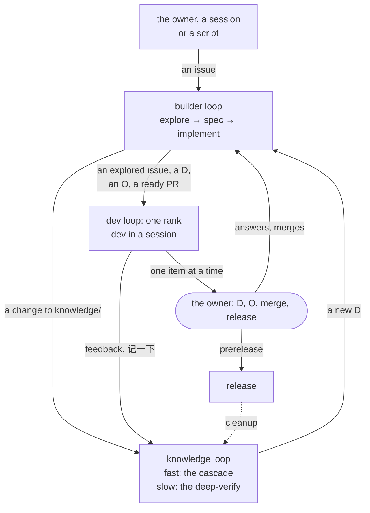
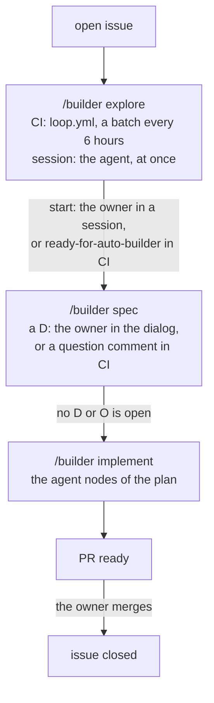
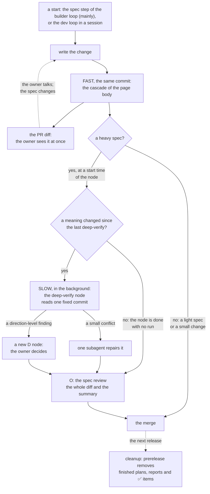

# Loops: the two levels and what the loops share

> What the loops share: the terms, one overview, the two inner loops in one form, how they connect, how they talk to the owner, the jobs, the names and what is pending. The skills (`knowledge` too), the workflow `loop.yml`, the session entry and the graph of open work are built; the briefing is a design that aboveloop does not implement. The loops in CI start in each project after `setup-app`.

Marks: ✅ built · 🔶 partly built · ⬜ not built.

## Summary

- **Two levels.** Two inner loops do the work: the builder loop (issues) and the knowledge loop (changes to `knowledge/`). The dev loop, the outer loop, decides where the attention of the owner goes ([§1](#1-overview), the overview chart).
- All tasks are issues. The owner, an agent in a session of the owner, or a script opens them.
- **Each inner loop has the same form** (§2): its input, its steps, its output, what starts it, and its page. The builder loop and the dev loop have their own pages; the knowledge loop is §2.2 of this page.
- **One table lists each point where two loops connect** (§3). A change to `knowledge/` starts the knowledge loop, and a direction-level finding returns to the builder loop as a D. The owner points of all inner loops enter the one queue of the dev loop.
- **The knowledge loop has a fast part and a slow part** ([§2.2](#22-the-knowledge-loop)). The cascade goes into the commit of the change, so the owner sees it at once. The deep-verify runs in the background before each spec review, and does not stop the owner.
- **The owner acts only at the owner points** ([§4](#4-how-the-loops-talk-to-the-owner)). How to ask the owner is in `entry`; where the owner acts is in the page of each loop; which point comes first is the rank of the dev loop.
- **The owner merges every PR of the loops** (P2). The agent merges a small change: [L2-loop-builder §2.1](L2-loop-builder.md#21-where-issues-come-from).
- **The workflow `loop.yml` of each project is the only trigger of the loops in CI** (§5). It launches a cloud agent only when there is work. A product's own loop (for example a data loop) has its own workflow, under the same rules (the general rules of a routine: [L2-loop-architecture §2](L2-loop-architecture.md#2-routines)).

## 0. Terms

| Term | Meaning |
| --- | --- |
| The owner | The person who owns the repos. Only the owner merges the PRs of the loops (P2). A small change is not a PR of the loops ([L2-loop-builder §2.1](L2-loop-builder.md#21-where-issues-come-from)). |
| Agent | A model that does work in a repo. |
| Cloud agent | An agent that the Cursor Cloud Agents API starts on a Cursor machine. Each one does one job one time. |
| Skill | A file of instructions for an agent. In the charts, the name of a skill starts with `/`. |
| Routine | One skill, the trigger that starts it, and the platform that runs it ([L2-loop-architecture §2](L2-loop-architecture.md#2-routines)). |
| Workflow `loop.yml` | The GitHub Actions workflow `.github/workflows/loop.yml` of a project. It uses no model. It reads GitHub and launches cloud agents ([L3-loop-workflow §1](L3-loop-workflow.md#1-the-workflow-loopyml)). |
| Inner loop | A loop that does the work of one item. There are two: the builder loop and the knowledge loop (§2). |
| Outer loop | The loop above the inner loops. It does no work of an item. It decides where the attention of the owner goes. There is one: the dev loop. |
| Builder loop | The life of an issue: open → explore → spec → implement → a PR that the owner merges. Its two modes, semi-automatic (a session) and automatic (CI), share the three steps, the plan and the rules. Each step has one text that both modes read (`explore.md`, `spec.md`, `implement.md`). How the modes differ: [L2-loop-builder §1](L2-loop-builder.md#1-the-life-of-an-issue-) (§2.1). |
| Knowledge loop | The inner loop that keeps `knowledge/` true. Its item is one change to `knowledge/` (§2.2). |
| Dev loop | The outer loop: the attention queue of the owner ([L2-loop-dev](L2-loop-dev.md)). |
| Cascade | The fast work of the knowledge loop: examine each page that builds on a changed page, and change it if it no longer holds. It goes into the commit of the change (§2.2). |
| Deep-verify | The slow work of the knowledge loop: subagents verify a spec change and its plan, and the agent repairs what they find (`knowledge`, deep-verify-knowledge). Its two forms, panel and solo: [L2-loop-builder §7](L2-loop-builder.md#7-the-owners-part). |
| Owner point | A step of a loop where the owner acts: a decision (D), a step (O), a merge, a release, or a thing that only the owner can do (§4). |
| Issue | A GitHub issue. One issue is one task. |
| PR | A GitHub pull request. |

The terms of each loop are in its own page. The terms of the dev loop (briefing, session entry, rank, graph of open work) are in [L2-loop-dev §0](L2-loop-dev.md#0-terms).

## 1. Overview

The inner loops do the work, and send what waits for the owner to the dev loop. The dev loop puts it in one order. The owner acts one item at a time, and the answers go back into the inner loops.

- **The inner loops** are in §2, and the arrows between them in §3. The owner's points are in §4.
- **The dev loop** is the attention queue of the owner. Its parts are the session entry (`dev` in a session), the graph of open work, the owner's decisions and the release. The session entry also keeps the graph. Its skill is `dev`. The briefing, an email each day with the same rank, is a design that aboveloop does not implement. [L2-loop-dev](L2-loop-dev.md) holds its decisions; [L3-loop-dev](L3-loop-dev.md) (the session entry, the rank, the graph and `.agents/dev.md`) holds the details.
- **The release** takes all merged PRs ([L2-release](L2-release.md)).

## 2. The two inner loops

Each inner loop has the same form: input, steps, output, what starts it, and its page. The links between the loops are in §3.

- Why: the inner loops are easier to compare in one form and in one place. §3 holds the arrows between them, and §4 holds how the loops talk to the owner.

### 2.1 The builder loop

- **Input:** an open issue. The owner, an agent in a session of the owner, or a script opens it.
- **Steps:** explore → spec → implement → a ready PR → the merge (the chart below).
- **Output:** a PR that the owner merges; the issue closes.
- **What starts it:** in CI, the workflow `loop.yml`: the explore run takes a batch every 6 hours; the implement run takes an issue with `explored` and `ready-for-auto-builder`. Each run is a cloud agent. In a session, the owner starts each issue. Each project decides which issues can start with no owner; all others wait for the owner.
- **Page:** [L2-loop-builder](L2-loop-builder.md), [L3-loop-builder](L3-loop-builder.md).

- **Two modes, one path:** a session and CI do the same three steps. How they differ: [L2-loop-builder §1](L2-loop-builder.md#1-the-life-of-an-issue-).

### 2.2 The knowledge loop

- **Input:** one change to `knowledge/`: a spec page, the index, a reference or a plan.
- **Steps:** write the change; the fast work (the cascade, in the same commit); the slow work (the deep-verify, in the background, before each spec review); the cleanup at the release (the chart below).
- **Output:** a `knowledge/` that is true: the change and its cascade in one commit of the PR, and the deep-verify mark and report.
- **What starts it:** it has no trigger, no job in CI and no cost of its own. The other loops start it and pay for it: the builder loop (mainly its spec step), the dev loop in a session, and the release for the cleanup (§3).
  - Why: the knowledge loop has steps of its own, but other work starts it. The main start is a spec step that changes `knowledge/`: `plan/`, `spec/` and other pages.
  - Why: the behavior stays as it is now: the dev loop and the builder loop start the knowledge loop. Its later forms are pending (§7).
- **Page:** this section. The skill `knowledge` holds its rules: the knowledge base (the levels, the graph in `knowledge/index.md`, what to examine after a change, conflicts), the form of specs and plans, the deep-verify and the knowledge check. Why it is a skill: [L2-plugin §2](L2-plugin.md#2-entry-the-start-for-all-rules-and-skills).
  - Why: the steps occur in three loops. One name lets each loop link to one description (P3).

- **Fast: the cascade, in the same commit.**
  - Write the change in the form that the skill `knowledge` gives.
  - Then examine each page that builds on a changed page (the column "Builds on" of `knowledge/index.md`).
  - Change each page that no longer holds, then examine the pages below it.
  - The change and its cascade go into one commit. The cascade is not a node of the plan, so the owner sees it in the PR diff at once.
  - A content commit does not change a page header: the date, the change lines, or the deep-verify mark. It does not change a Checked date. The release writes those.
  - A review reads the git diff of the page body. It does not read the header to decide that the meaning changed.
  - Why: the owner sees the fast work at once, in the same diff as the change. The slow work does not stop the owner.
  - Why: the date, the change lines, the deep-verify mark and the Checked dates are metadata. Only a release writes them, and a review uses the git diff of the body.
- **Slow: the deep-verify, a fixed agent node before each spec review (O), for a heavy spec.** It runs in the background, and the owner does not wait for it. Its rules (the start times, the fixed commit, the repairs, a new D node, the forms and the cost) and their Why: [L2-loop-builder §7](L2-loop-builder.md#7-the-owners-part). In CI: [L3-loop-builder §1.4](L3-loop-builder.md#14-the-spec-step-in-both-modes).
- **The owner acts only at a D, at the last spec review and at the merge:** [L2-loop-builder §7](L2-loop-builder.md#7-the-owners-part). All the owner's points: §4.
- **It is an inner loop.** It does work: it writes the change, examines the pages that build on it, and runs the deep-verify. Its level comes from the work that it does (§0), not from what starts it.
  - Why: a loop that is neither inner nor outer would be a third kind, with no rule.

## 3. How the loops connect

Each row is one arrow between two loops. The page of each loop tells its own part.

| Point | From | To |
| --- | --- | --- |
| A change to `knowledge/` | Builder loop, mainly its spec step: the spec, the plan and other pages. The implement step removes the ⬜ marks of what it built ([L2-loop-builder §1](L2-loop-builder.md#1-the-life-of-an-issue-)) | Knowledge loop: the cascade, in the same commit (§2.2) |
| The deep-verify node before each spec review (O) | Builder loop: the spec step of a heavy spec | Knowledge loop: the slow work, in the background (§2.2) |
| A direction-level finding of the deep-verify | Knowledge loop | Builder loop: a new D node of the plan of the issue |
| The owner's feedback, "记一下", or the result of a design discussion | Dev loop, in a session (`entry`, 「owner 说「应该怎么样」」; a design discussion: `entry`, 「还没定的设计，先做 spec 那一步」; an issue goes on by `builder`'s `issue-in-session.md`) | Knowledge loop: a small change in a PR that the agent merges at once; or an issue for the builder loop |
| A release | `prerelease` (the dev loop) | Knowledge loop: the cleanup removes the finished plans, their deep-verify reports and the ✅ items of the graph of open work ([L2-release §2.8](L2-release.md#28-a-release-removes-finished-plans-and-deep-verify-reports-)) |
| The owner points | Each inner loop (§4) | Dev loop: the one queue and its rank ([L2-loop-dev §3](L2-loop-dev.md#3-the-session-entry)) |

## 4. How the loops talk to the owner

**Three places, each with one job:** the general rule in `entry`, and the points of each loop in its own page; the dev loop gives only the order.

- **How to ask** is in `entry` (「拍板只问方向」, 「怎么问 owner」), in one copy. The form is there: context, the question, an example, the options, and why the first option. The reply names the loop and the place in it, as text in the reply. These rules keep the owner's attention, the most expensive resource, for the decisions that only the owner can make (P1).
- **Where the owner acts** is in the page of each loop: L2-loop-builder ([§1](L2-loop-builder.md#1-the-life-of-an-issue-), [§2.1](L2-loop-builder.md#21-where-issues-come-from), [§3](L2-loop-builder.md#3-the-labels-explored-and-ready-for-auto-builder), [§7](L2-loop-builder.md#7-the-owners-part)), [L2-loop-dev §5](L2-loop-dev.md#5-when-the-owner-acts), [L2-release §5](L2-release.md#5-the-owners-part) and §2.2 of this page. The table below lists all of them.
- **Which point comes first** is in the dev loop: the rank ([L2-loop-dev §3](L2-loop-dev.md#3-the-session-entry)). The dev loop holds no rule of how to ask.
- Why: a session that does not go through `dev` (the owner says 「继续 #N」), a design discussion, and CI that asks in an issue comment must obey the same rules. Every session reads `entry`. So the rules are there, in one copy, not in one copy for each loop (P3).

**How a question goes to the owner, in each mode.**

- **A session:** a question in the dialog, one at a time, by the fixed order of `entry`. The part of a session of `builder` spec.md leads the owner through a D or an O of one issue: it records the answer, gives the steps, and verifies each step.
- **CI:** a question comment on the issue. Which run stops, the label and the owner's answer: [L2-loop-builder §3](L2-loop-builder.md#3-the-labels-explored-and-ready-for-auto-builder).
- **What waits:** `dev` in a session shows each point that waits for the owner, in one rank ([L2-loop-dev §3](L2-loop-dev.md#3-the-session-entry)). The briefing, a design that aboveloop does not implement, lists the same points, except the next nodes of the plans on draft branches and of the plans of milestones: these are only in `dev` in a session.

**The owner's points.** Each row is one point where the owner acts. The page of each loop holds the detail.

| Loop | Step | What the owner does | How the owner is told | Blocks |
| --- | --- | --- | --- | --- |
| Builder | Open, in a session | Choose: an issue, or a small change with no issue ([L2-loop-builder §2.1](L2-loop-builder.md#21-where-issues-come-from)) | A question in the session | That change |
| Builder | Explore: a vague issue (no reading that the evidence holds). | Answer; write the answer in a comment ([L2-loop-builder §1](L2-loop-builder.md#1-the-life-of-an-issue-)) | A question comment on the issue | That issue |
| Builder | After explore | Choose for each explored issue: do it at once, start it, hand it to CI, close it, or wait ([L2-loop-builder §7](L2-loop-builder.md#7-the-owners-part)) | `dev` in a session | That issue |
| Builder | Spec: a D | Decide a direction-level question. Each change of L1 is a D | By mode (above) | The nodes after the D |
| Builder | Spec, heavy, in a session: the spec review (an O) | Read the spec diff of the draft PR and the summary of the deep-verify. Accept, or say what to change ([L2-loop-builder §7](L2-loop-builder.md#7-the-owners-part)) | A question in the session, after the deep-verify node ends | The implement step waits for the last one |
| Builder | Any step: an O that only the owner can do | Log in with the owner's own account, use the owner's device, pay, give a key, or do an action that cannot be undone (P1) | Session: the steps, one at a time. CI: a question comment; the run stops | The nodes after the O |
| Builder | A D or an O of the plan of a milestone (no issue; [L2-loop-builder §1](L2-loop-builder.md#1-the-life-of-an-issue-)) | Decide it, or do the step, as for an issue (`spec.md`, the part of a session). A PR that changes the content of that plan is a ready PR (the row "The PR is ready"): its merge is the owner's review, in place of a spec review | The D or the O: `dev` in a session ([L2-loop-dev §3](L2-loop-dev.md#3-the-session-entry)). The PR: as the row "The PR is ready" | The nodes after it in that plan |
| Builder | CI: the implement run stops for a reason that is not a D or an O: it refuses the issue, or the change must change L1 or the content of L2 | A refusal: answer in a comment and add the label again, or take the issue into a session. A change of L1 or of the content of L2: take the issue into a session, where the owner decides it ([L2-loop-builder §3](L2-loop-builder.md#3-the-labels-explored-and-ready-for-auto-builder), [§6](L2-loop-builder.md#6-what-the-automatic-mode-can-change-in-the-spec-)) | A question comment on the issue; `dev` in a session | That issue |
| Builder | The PR is ready | Merge, modify or reject, after the review of the dev loop ([L2-loop-dev §5](L2-loop-dev.md#5-when-the-owner-acts)). A small change has no owner point: the agent merges it | `dev` in a session | The code does not go to `main` |
| Knowledge | The cascade | Nothing at once. The owner sees it in the PR diff, with the change (§2.2) | The PR | No |
| Knowledge | The deep-verify finds a direction-level question | Decide it: it is a new D (the row "Spec: a D") | As a D | The nodes after the D |
| Dev | Release | Run `prerelease` ([L2-release §5](L2-release.md#5-the-owners-part)) | The daily options at the start of a session; a release O in the rank | The nodes after the release |
| Dev | A push to `main` or of a tag that the owner did not make; a failed run of `loop.yml` | Examine it. Disable the `loop.yml` of a project that does not operate correctly ([L2-loop-dev §3](L2-loop-dev.md#3-the-session-entry)) | `dev`, at the top of the rank | No |
| Any | A session: an agent asks a question or refuses | Answer it | A question in the session | — |
| Any | The setup: once for all apps, and for each app | The keys, the GitHub App (`<your GitHub App>`), its install on the repo of each app. `setup-app` gives the exact clicks ([L3-loop-components §1](L3-loop-components.md#1-global-aboveloop-set-up-once), [§2](L3-loop-components.md#2-each-app-setup-app)) | The open global steps: the issues of aboveloop. The open steps of an app: the plan of that app | The loops in CI of that app start after `setup-app` |
| Any | At any time | Open an issue. Remove `ready-for-auto-builder` from an issue to stop its automatic work. Disable the workflow `loop.yml` of a project that does not operate correctly | — | No |

## 5. The jobs

Each job is a skill, or a run of a skill (the field `step` of its input). The job has the same name in all pages, in the charts, and in `skills/`. **Each job finds its work in the current state, not in a time window** (E4). For example, the workflow reads the agents that still run before it launches one ([L3-loop-workflow §2](L3-loop-workflow.md#2-the-agents)).

| Job | Loop | What it does |
| --- | --- | --- |
| `builder`: the explore run and the implement run | Builder loop | [L3-loop-builder §1](L3-loop-builder.md#1-builder-) |
| `dev`: the session entry | Dev loop | [L2-loop-dev §3](L2-loop-dev.md#3-the-session-entry), [L3-loop-dev §1](L3-loop-dev.md#1-the-session-entry) |
| `knowledge` | Knowledge loop | §2.2. It runs inside the jobs of the other loops, and in a session. |

The workflow `loop.yml` of each project starts the automatic mode of the builder loop. How it starts each job in CI, and with which model and access, is in [L2-loop-architecture §2](L2-loop-architecture.md#2-routines).

## 6. Names and domains

- **Role addresses:** `dev-<role>@<domain>`, the address of each role in CI, on a domain of the owner. The builder loop is `dev-builder`, for example `dev-builder@example.com`. Each project's `.agents/*.md` names its address on an `Address:` line.
- **GitHub identity:** one GitHub App of the loops, on every repo. The agents in CI act as its bot (`<your GitHub App>[bot]`); an agent in a session acts as the owner. The footer names the app and the role (`dev-builder@example.com`). Its tokens: [L3-loop-components §1](L3-loop-components.md#1-global-aboveloop-set-up-once).
  - Why: one App for all repos and all jobs is one key to keep and one installation to examine.

## 7. Pending

**The later forms of the knowledge loop.** The behavior stays as it is now (§2.2, "What starts it"). Each form below gives the knowledge loop a trigger of its own, and is a later issue. With a trigger, it gets its own pages, like the other inner loop. Its level does not change.

| Form | What it adds | Cost |
| --- | --- | --- |
| A. Detection | The session entry of the dev loop runs the knowledge check and finds the stale pages. It shows the drift as items that wait for the owner. | A script, no model (E3, P6) |
| B. Repair in CI | A job of `loop.yml` repairs small drift as a PR: only L3 pages and mechanical edits, such as old update records, a stale mark of a part not built, or a link. Large drift becomes an issue for the builder loop. | One cloud agent for each repair. The owner merges each PR (P2). |
| C. A periodic full deep-verify | A full deep-verify of `knowledge/` at a fixed interval, for example at each release. | One full deep-verify each time ([L2-loop-builder §7](L2-loop-builder.md#7-the-owners-part)) |
