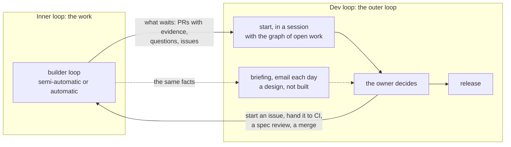
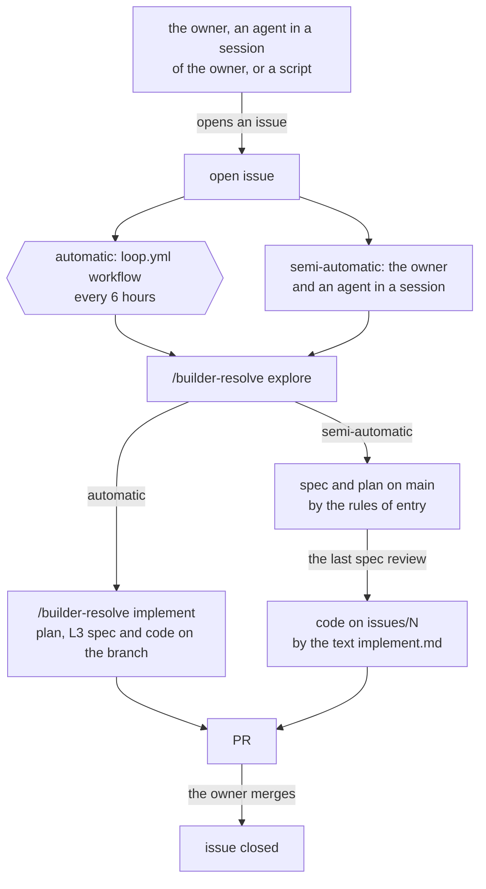

# Loops: the dev loop and what the loops share

> The loops have two levels. One inner loop, the [builder loop](L2-loop-builder.md), does the work: it changes issues into PRs, in a session or in CI. One outer loop, the dev loop, decides where the attention of the owner goes: `start`, the graph of open work, the owner's decisions, the release, and the briefing as a design (§2). This page holds the dev loop and what the loops share: how they connect, the jobs, and the names. The skills, the workflow `loop.yml`, `start` and the graph are built; the briefing is a design that aboveloop does not implement. The loop in CI starts in each project after `setup-app`. ⬜ The rules in `skills/` do not use these terms yet (the dev loop; the builder loop in both modes). The reference of `start` is still `start.md`, and "dev loop" is not a trigger word yet. In a session, the code step still follows `entry`, not `implement.md`.

Marks: ✅ built · 🔶 partly built · ⬜ not built.

## 0. Terms

| Term | Meaning |
| --- | --- |
| The owner | The person who owns the repos. Only the owner merges PRs (P2). |
| Agent | A model that does work in a repo. |
| Cloud agent | An agent that the Cursor Cloud Agents API starts on a Cursor machine. Each one does one job one time. |
| Skill | A file of instructions for an agent. In the charts, the name of a skill starts with `/`. |
| Routine | One skill, the trigger that starts it, and the platform that runs it. [L2-loop-architecture §2](L2-loop-architecture.md#2-routines) gives the routines of the loops. |
| Workflow `loop.yml` | The GitHub Actions workflow `.github/workflows/loop.yml` of a project. It uses no model. It reads GitHub and launches cloud agents ([L3-loop-workflow §1](L3-loop-workflow.md#1-the-workflow-loopyml)). |
| Inner loop | A loop that does the work of one item. There is one: the builder loop. |
| Outer loop | The loop above the inner loop. It does no work of an item. It decides where the attention of the owner goes. There is one: the dev loop. |
| Dev loop | The outer loop: the attention queue of the owner. Its parts are `start`, the graph of open work, the owner's decisions, the release, and the briefing as a design (§2). |
| Builder loop | The life of an issue: open → explore → spec → code → a PR that the owner merges. It has two modes: the semi-automatic mode in a session, and the automatic mode in CI (the workflow `loop.yml` and `/builder-resolve`). The modes have the same steps, plan and rules. Explore and the code step each have one text that both modes read. [L2-loop-builder §1](L2-loop-builder.md#1-the-life-of-an-issue-). |
| Issue | A GitHub issue. One issue is one task. |
| PR | A GitHub pull request. |
| Briefing | A daily email to the owner: the entry of the dev loop with no session. A design that aboveloop does not implement (§2.1). |
| `start` | The entry of the dev loop in a session (§2.2). |
| Graph of open work | `knowledge/plan/index.md` on `main`: all open work of the repo in one chart (§2.3). |

The terms of the builder loop are in its own page.

## Summary

- The loops have two levels. The inner loop, the builder loop, does the work of issues. The outer loop, the dev loop, decides where the attention of the owner goes.
- All tasks are issues. The owner, an agent in a session of the owner, or a script opens them.
- The builder loop researches issues and makes PRs from them. It is the life of an issue, in two modes with the same steps, plan and rules: the owner and an agent in a session (semi-automatic), or CI with no owner (automatic) ([L2-loop-builder §1](L2-loop-builder.md#1-the-life-of-an-issue-)). The differences come from what starts the work and who answers the questions.
- The dev loop shows the owner what waits, in order: `start` in a session, which also keeps the graph of open work. The design also has a daily briefing by email, which reads the same facts (§2.1; aboveloop does not implement it). The owner decides; agents do the work.
- **The owner merges every PR** (P2). Each project decides which issues can start without the owner; all others wait for the owner.
- **The workflow `loop.yml` of each project is the only trigger of the loop in CI.** It starts the automatic mode of the builder loop. It launches a cloud agent only when there is work. A product's own loop (for example a data pipeline) has its own workflow, under the same rules (`entry`: routines) ([L2-loop-architecture §2](L2-loop-architecture.md#2-routines)).

## 1. Overview

The inner loop does the work. The dev loop gives the owner what waits, in order, and the owner's decisions go back into the inner loop. The release takes all merged PRs ([L2-release](L2-release.md)). Dotted lines are the briefing, a design that aboveloop does not implement (§2.1).

The inner loop, the builder loop:

Boxes that start with `/` are skills. In the automatic mode, each one runs as a cloud agent. In the semi-automatic mode, the agent of the session reads the same two texts, `explore.md` and `implement.md`. It writes the spec and the plan on `main` by the rules of `entry` first ([L2-loop-builder §1](L2-loop-builder.md#1-the-life-of-an-issue-)). ⬜ In a session, the code step still follows `entry` (execute-plan). The six-sided box is the workflow `loop.yml`, the trigger in CI. The steps inside the loop are in its own page.

## 2. The dev loop

- **The dev loop is the attention queue of the owner.** It does no work of an issue itself. It shows the owner what waits, in order, and leads the owner through the decisions. When the owner picks an item, its work goes into the inner loop: the semi-automatic mode of the builder loop (in the session, or in a subagent of it), or CI.
  - Why: the decision bandwidth of the owner limits all loops (P1).
  - Why: a loop that manages the issues, the PRs and the plans sits above the loop that does the work of one issue.
  - Why: published work on agent loops puts a human at a boundary of review or decision, and the bandwidth of that human limits the throughput. Some of it has two levels, with the human in the outer loop: Osmani, "Engineers own the outer loop."; Codex, "The Scheduled view acts as your inbox."
- **The evidence in each PR is what the owner decides on.** So the inner loop spends effort on the evidence: the spec diff, a deep-verify before each spec review (full before the first, light before each later one: [L2-loop-builder §7](L2-loop-builder.md#7-the-owners-part); ⬜), and the test output in the PR. The test output that an agent reports is a claim, not proof (P2). When a session runs `start`, `start` also reviews each ready PR once for each head commit (§2.2). The owner does not read all code.
  - Why: the owner cannot review all code.
  - A known limit: in the automatic mode, implement verifies its own work. Published loops use one agent to do the work and a different agent to verify it. The owner accepts this limit.

| Part | What it does | Where |
| --- | --- | --- |
| The briefing | The entry with no session: one email each day. What occurred, what waits for the owner, which three tasks first. A design that aboveloop does not implement. | §2.1 |
| `start` | The entry in a session. It scans, updates the graph, ranks, and leads the owner one item at a time. | §2.2 |
| The graph of open work | All open work of the repo in one chart, with the real waits. | §2.3 |
| The owner's decisions | The start of an issue, a spec review, the merge; the owner's decisions (D) and steps (O) in the plans. | §2.4, [L2-loop-builder §7](L2-loop-builder.md#7-the-owners-part) |
| The release | `prerelease` releases all merged PRs. Only the owner runs it. | [L2-release](L2-release.md) |

- **The briefing is a part of the dev loop, not a loop of its own.**
  - Why: it does no work of an item. It only shows the owner what waits.
- **One set of facts.** `start` and the briefing read the same facts, by the same rules (one implementation, P3).

### 2.1 The briefing

The briefing is a design. aboveloop does not implement it: there is no skill, no workflow step and no server for it. A project that wants it can build it by these rules.

- **The briefing is the entry of the dev loop with no session.** One email to the owner each day tells three things: what waits for the owner (explored issues to decide, ready PRs, questions and refusals of the agents, stopped work), what occurred in each repo since the last briefing, and which three tasks to do first. Small tasks follow in a short list.
  - Why: the owner is not in a session each day. The briefing brings the queue of the owner to the owner, so that the inner loop does not wait for a session (P1).
- **The briefing is an email.** It makes no issue and no file.
  - Why: the data in the briefing is already recorded where it occurred (P4): issues and PRs keep their history.
  - Other data from a project (for example, a pipeline incident) must be an issue, or it does not get into the briefing. The one exception: the next nodes of a plan of an issue on `main` (L2-loop-builder §5).
- **The briefing finds its work in the current state** (E4). It starts at the last briefing, not at a fixed time.
- **One email every day.** If nothing occurred and nothing waits for the owner, a short fixed email says so, and no agent starts (P6).
  - Why: a day with no email then means that the briefing failed, not that the day was quiet.

### 2.2 `start`: the entry in a session

- **`start` begins the work of a session** (`entry`, reference `dev-loop.md`; ⬜ the reference is still `start.md`). It is not a skill of its own: it is a part of `entry`. The owner says "start" or "work" (⬜ also "dev loop"), or selects it at the start of a session. Three subagents scan at the same time:
  1. PRs that are ready (not drafts): the agent reviews the code of each, against its spec diff (in the semi-automatic mode, also the spec commits `#N` on `main`), its issue and its plan on the branch, once for each head commit: the review is a comment of the owner that starts with `<!-- start:review <head commit> -->`.
  2. Open issues: explored issues that wait for the owner ([L2-loop-builder §7](L2-loop-builder.md#7-the-owners-part)), and issues that explore has not done yet.
  3. Plans: the open nodes of each plan on `main` and on the branch of each open draft PR, whose nodes before them are done. The plans of issues on `main` (`<N>-<slug>.md`) are in `start` and in the briefing, by one rule. The plans with no issue number are only in `start`. A plan that implement wrote, on a branch or on `main`, shows as one item, and the agent examines that work before it does a node of it (R23).

  Without a subagent tool, the agent does the three scans one after the other. A scan with nothing to read starts no subagent.

  The agent then updates the graph of open work (§2.3) from the scans, and ranks from it. It shows the `Now:` line and the top 5, with one line each about why. Then it leads the owner through them one at a time: a PR to merge, an issue to decide, a decision (D) or a step (O) of the owner, or an agent node to do.
  - Why: the session leads the start of the work. Subagents scan at the same time; the agent then gives the top 5 and leads the owner through them, one at a time.
  - The order: first what lets the most work in the graph continue (a ready PR, an open D or O, a release), then the oldest.
  - **One item, one question.** Before each question, the agent tells four things: what it is; where it stops now; what the agent recommends, and what occurs then (who does it, cost, can it be undone); what occurs with no action. One question has one issue. The four things go into the question itself and its option descriptions, because the owner reads the question box.
    - Why: a question with no context, or many questions at once, cannot get a good answer. The agent follows `entry` to lead the conversation.
  - **Questions go one at a time; the work goes in parallel.** When the owner chooses agent work, the agent starts a background subagent for it and goes on to the next item. Agent work that does not wait for other work in the graph (several issues, or several A or C nodes of one plan) starts in parallel, one subagent each. Each issue has one worktree: git does not check out one branch in two worktrees. The subagents of one plan share the worktree of its issue and change files that do not overlap. They do not commit: the main agent runs the tests, ticks the plan and commits each node (⬜ `start.md` and execute-plan do not say this yet). One subagent at a time changes the spec and the plans on `main`; only the main agent changes the graph. Two pieces of work that change the same files go one after the other. The main agent orchestrates: it asks the owner, starts subagents, examines their results and reports. Subagents do the work: edits, specs and plans, PR reviews, deep-verify repairs and reports, merges with conflicts. The main agent keeps only small bookkeeping: it runs the tests of a node, ticks the plan, commits, and changes the graph.
    - Why: work that does not wait for other work, by the graph or inside one plan, goes faster in parallel subagents.
    - Why: the main agent orchestrates. When it does the work itself, its context fills and the owner waits.
    - Agent decided: the bookkeeping stays with the main agent. The tests examine the results of the subagents, because their report is a claim (P2). One writer for each worktree keeps the commits in order. These steps are small, so the work of the main agent stays small.
  - **Small work at once.** When the owner is present, the agent does at once an issue that is clear and small and that changes no L1 and no content of L2: a branch, the change, the tests, and a PR that is ready. It recommends this before the automatic mode.
  - **The work of another session is not in the top 5.** A worktree of the issue with a recent commit, or an open session named for the issue, shows it. The agent names it in one line.
  - **`start` only moves open work.** It starts no deep-verify and opens no issue, unless the owner asks. A problem that it finds on the way is one line in the reply.
    - Why: a scan triages the work that exists. New issues from a scan add work that the owner did not ask for.
  - After each item, the agent names the next one. After the 5 items, it shows from the graph what waits, and for whom.
  - `entry` offers `start` at the start of each session.

### 2.3 The graph of open work

- **The graph of open work** is `knowledge/plan/index.md` on `main`. It has a `Now:` line, one mermaid chart and one table. A node is an open issue, a release (O) or an outside event (E). An arrow is a real wait. The table gives for each issue the next step, who does it, and its plan. The graph keeps only the arrows, the next steps and `Now:`; the agent reads the state of each issue from GitHub each time. Only a session agent changes it: `start` adds new issues and removes closed ones, and the agent changes it when it starts an issue, or when the owner says wait or close. CI does not change it.
  - Why: only the semi-automatic mode needs the view of all work, so the session agent keeps it. Each issue has its own plan, so without one chart the waits between issues are not visible. GitHub issue dependencies are not used: they are hard to keep up to date.
- **The graph gives only the order.** A session takes no instruction from it. The agent writes the nodes and the next steps in its own words, and copies no text of issues, comments or branches into it (R23).
  - Why: the graph is on `main` and is trusted by rule ([L2-loop-untrusted-text §1](L2-loop-untrusted-text.md#1-the-inputs)), but the agent writes it from issues and plans that can carry untrusted text.

### 2.4 When the owner acts

**The owner is on the loop, not in the loop** (P1): the owner decides, and the agents do the work. The decisions of the owner are the dev loop. The owner acts only at these times:

| When | What the owner does |
| --- | --- |
| The owner goes through the issues in a session | Decide each explored issue that waits for the owner: the choices and the conditions are in [L2-loop-builder §7](L2-loop-builder.md#7-the-owners-part). Answer the questions and refusals of the agents in a session. |
| A spec review in a session | Read the full spec change of an issue, after a deep-verify. Accept it, or say what to change ([L2-loop-builder §7](L2-loop-builder.md#7-the-owners-part)). |
| A PR is ready | Read the spec diff and the evidence in the PR. Merge the PR, or write in the PR what to change and close it: the next implement, or the next session, reads that comment and tries again. To stop the automatic work, remove `ready-for-auto-builder` from the issue. A comment on an open PR does nothing. |
| At any time | Open an issue for a new idea or problem. Disable the workflow `loop.yml` of a project that does not operate correctly. |

## 3. How the loops connect

The builder loop and the dev loop meet at two points.

| Point | From | To |
| --- | --- | --- |
| What waits for the owner: explored issues, questions and refusals of the agents, ready PRs with their evidence | Builder loop: explore and implement ([L2-loop-builder §7](L2-loop-builder.md#7-the-owners-part)) | Dev loop: `start` (§2.2), and the briefing in the design (§2.1) |
| The owner's decisions: start an issue in a session, hand it to CI with `ready-for-auto-builder`, a spec review, a merge | Dev loop: the owner (§2.4) | Builder loop: the next step of the issue ([L2-loop-builder §1](L2-loop-builder.md#1-the-life-of-an-issue-)) |

## 4. The jobs

Each job is a skill, or a step of a skill. The job has the same name in all pages, in the charts, and in `skills/`. **Each job finds its work in the current state, not in a time window** (E4). For example, the workflow reads the agents that still run before it launches one ([L3-loop-workflow §2](L3-loop-workflow.md#2-the-agents)).

| Job | Loop | What it does |
| --- | --- | --- |
| `builder-resolve`, explore and implement | Builder loop | [L3-loop-builder §1](L3-loop-builder.md#1-builder-resolve-) |
| `start`, a part of `entry` | Dev loop | §2.2 |

How the workflow `loop.yml` starts each job in CI, and with which model and access, is in [L2-loop-architecture §2](L2-loop-architecture.md#2-routines).

## 5. Names and domains

- **Role addresses:** `dev-<role>@<domain>`, the address of each role in CI, on a domain of the owner. The builder loop is `dev-builder`, for example `dev-builder@example.com`. Each project's `.agents/*.md` names its address on an `Address:` line.
- **GitHub identity:** one GitHub App of the loop, on every repo. The agents in CI act as its bot (`<your GitHub App>[bot]`); an agent in a session acts as the owner. The footer names the app and the role (`dev-builder@example.com`). Its tokens: [L3-loop-components §1](L3-loop-components.md#1-global-aboveloop-set-up-once).
  - Why: one App for all repos and all jobs is one key to keep and one installation to examine.
