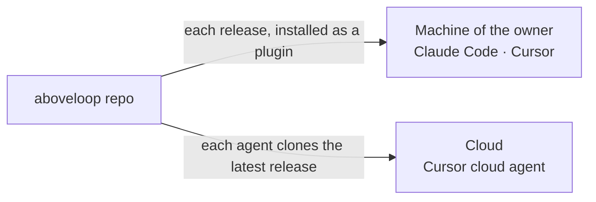

# Plugin

> How the rules reach the agents: the plugin on the machine of the owner, a clone in the cloud, and `entry` as the only start. The plugin, the marketplace and the repo all have the name `aboveloop`.

## 0. Terms

| Term | Meaning |
| --- | --- |
| Plugin | The package that Claude Code and Cursor install from this repo. It contains the skills. |
| Marketplace | The list that Claude Code reads to find the plugin. It also has the name `aboveloop`. |

Other terms, and "cloud agent": [L2-loops §0](L2-loops.md#0-terms).

## 1. Names

- The GitHub repo is `shiyuann/aboveloop`. The local folder is `~/workdir/aboveloop`. The plugin and the marketplace both have the name `aboveloop`.
- The entry skill is `entry`. Its full name is `aboveloop:entry`. The `AGENTS.md` of each project names only this skill.

## 2. `entry`: the start for all rules and skills

- **The `AGENTS.md` of each project says one thing: read `aboveloop:entry` first.**
  - Why: one start for every project and every coding agent. A rule changes in one place (P3).
- `entry` holds the rules that always apply: how to write and answer, when to stop and ask, which model to use, where automated work runs, how to keep the knowledge, and how to work on code.
- `entry` also has one table. For each type of task, the table tells which reference to read and which skill to use.
- All other skills are in that table: `setup-dev`, `setup-app`, `builder-resolve` and `prerelease`. `start`, the entry of the dev loop in a session, is a part of `entry`, not a skill ([L2-loops §2.2](L2-loops.md#22-start-the-entry-in-a-session)). When you add a skill, add its row in the same change.
- At the start of each session, an agent does three things:
  1. Get the one-line status (`setup-dev`).
  2. Read the `knowledge/index.md` of the project and its L1 pages (`knowledge/spec/L1-*.md`).
  3. Offer the owner the daily options, `start` first (`entry`; [L2-loops §2.2](L2-loops.md#22-start-the-entry-in-a-session)).

## 3. How it is loaded



- **On the machine of the owner: the plugin.** After a release, start a new session (§5). The release also refreshes the copy for Cursor. The marketplace comes from GitHub, so Claude Code reads the release in its cache.
- **In the cloud: a clone.** Cloud agents do not install plugins.
  - Why: Cursor cloud agents cannot read plugin skills. Cursor says that this is a known issue.
- Thus each cloud agent starts with no repos, and clones this repo and the project itself, with tokens of the GitHub App of the loop in its environment ([L3-loop-workflow §2](L3-loop-workflow.md#2-the-agents)). The prompt gives the path of the skill (`skills/<name>/SKILL.md` in the folder `kit`), and the agent checks out the latest release there, not `main` ([L2-release §2.2](L2-release.md#22-what-runs-for-real-reads-only-the-latest-release-)).
- **Only one copy.** Do not copy, vendor, or use submodules (P3).
- That a Cursor cloud agent reads the clone is W4 ([L3-loop-workflow §5](L3-loop-workflow.md#5-connection-points-how-much-is-verified)). It is measured: the first explore agent read the skill in the clone.

How far each way of loading is verified:

| Way | What occurs | Verified |
| --- | --- | --- |
| Claude Code, marketplace from this local folder | The plugin loads in place from the working copy at each session start, whatever its version. Uncommitted edits too. | Measured: the sessions (also in another project) loaded `entry` from the working copy, never from the cache. Docs: [plugins/loading](https://code.claude.com/docs/en/plugins/loading) |
| Cursor, `~/.cursor/plugins/local/aboveloop` | A real copy (rsync). A symlink there loads only when it points inside that folder. | Docs ([Cursor plugins](https://cursor.com/docs/plugins)); the copy is a real folder (measured) |
| Claude Code, marketplace from GitHub, pinned to a tag | The source names the repo and `ref` = the release tag; the update copies that tag into the cache, keyed by the version. To change the tag, remove the marketplace, add it with the new `#<tag>`, then install the plugin | Measured in a separate `CLAUDE_CONFIG_DIR`: `marketplace add "shiyuann/aboveloop#<ref>"` again with a new ref, then `plugin update`, installs the new ref (`gitCommitSha` and version). A ref changed by hand in `known_marketplaces.json` breaks the marketplace ("not found"). From a local folder, `add` is refused: remove first, then add and install. Measured on the owner's Mac: when the user settings declare the marketplace (`extraKnownMarketplaces`, with the old tag), `add` with a new tag is refused ("its source doesn't match its extraKnownMarketplaces entry"); after the ref in `settings.json` was set to the new tag by hand, `add` and the update passed. So each install removes the marketplace first, then adds it at the tag and installs. Measured with Claude Code 2.1.296, in a separate `CLAUDE_CONFIG_DIR`: `add "shiyuann/aboveloop#<old tag>"` and `install` write the marketplace into that config's `settings.json` (`extraKnownMarketplaces`, `ref` `<old tag>`; "declared in user settings"); `add "…#<new tag>"` is refused ("Cannot add marketplace "aboveloop": its source doesn't match its extraKnownMarketplaces entry in user or managed settings"); `marketplace remove aboveloop` takes the entry out of `settings.json` and uninstalls the plugin ("Also uninstalled 1 plugin from this marketplace"); then `add "…#<new tag>"` and `install` give the new version, the `gitCommitSha` of the tag's commit, `ref` `<new tag>` in `settings.json`, and the plugin enabled. `scripts/install-release.sh <tag>` passed from GitHub at the old tag, from a local folder, and with no marketplace; a second run at the same tag only installs and updates (no-ops) |
| Cloud agent, a clone at a ref | The agent starts with no repos, clones aboveloop with a read token that `loop.yml` signs, and checks out the commit of the latest release tag | Measured: a no-repo agent clones with a token from its environment, checks out a given commit, and reads its file; the token cannot push |

## 4. What is in the repo

```text
aboveloop/
  .claude-plugin/  .cursor-plugin/   plugin manifests for both tools
  skills/<name>/SKILL.md             skills; scripts live with their skill
  knowledge/
    index.md                         the list of pages and the dependency graph
    spec/L1-*.md  L2-*.md  L3-*.md   specs, by level
  services/loop/                     the composite action of every loop.yml (L3-loop-workflow)
  Makefile  VERSION  README.md
```

- **The repo root is the plugin root.** `knowledge/` also goes into the plugin copy. No agent reads it unless a task tells it to. Thus it uses no context.
- **`knowledge/` is in English, in ASD-STE100.** Specs, plans, references and the index are in English, in ASD-STE100 Simplified Technical English. The rules are in `entry`. [L2-loops](L2-loops.md) is the example. Quotes stay in the language of the speaker. Skills are not part of this rule.
- **No project names or project details in rules** (P5). Project details are in the `AGENTS.md`, `knowledge/` and `.agents/` configuration of each project.
- **The todos of the owner are issues, not files.**
  - Why: files go into the plugin copy. Thus a change to a todo file would make a release necessary.
- **The README tells only how to install and change the plugin.** The specs here are the source of truth for the design.
- **Each system gives its own routines** in its own spec, for example [L2-loop-architecture §2](L2-loop-architecture.md#2-routines). The general rules for routines are in `entry`.
- `setup-app` copies the workflow `loop.yml` into each project from `skills/setup-app/references/loop.yml`. Its code is the composite action `services/loop`, which every `loop.yml` workflow uses.

## 5. Versions

- `VERSION` is the single source. Its format is `YYYYMMDD.patch`. It changes only in a release.
- **A release of aboveloop is a tag** ([L2-release](L2-release.md)). After the push, `prerelease` installs that release on the machine of the owner (`make install-release`): `claude plugin marketplace remove aboveloop`, then `claude plugin marketplace add "shiyuann/aboveloop#<tag>"`, then `claude plugin install` (nothing is removed when it is already GitHub at that tag), then a check that the install is the tag's commit; and the copy for Cursor from the tree of the tag. Between two releases, the owner's sessions read the latest release; `make sync` installs it, and does not change the version.
  - Why: a session in any project reads only an official version of the rules (L2-release §2.2).
  - How: the marketplace comes from GitHub. Claude Code copies such a plugin into its cache, keyed by the version; a marketplace from a local folder loads in place, whatever the version.
- **The status line of `setup-dev` compares the installed version with the latest release tag.** It says that the plugin is old only when a newer release exists. It also tells how many commits are not released, and whether the Cursor copy is another version.
