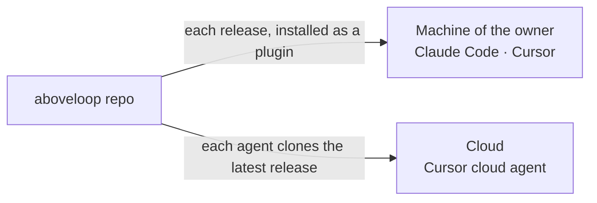

# Plugin

> How the rules reach the agents: the plugin on the machine of the owner, a clone in the cloud, and `entry` as the only start. The plugin, the marketplace and the repo all have the name `aboveloop`.

## 0. Terms

| Term | Meaning |
| --- | --- |
| Plugin | The package that Claude Code and Cursor install from this repo. It contains the skills. |
| Marketplace | The list that Claude Code reads to find the plugin. It also has the name `aboveloop`. |

Other terms, and "cloud agent": [L2-loops §0](L2-loops.md#0-terms).

## 1. Names

- The GitHub repo is `shiyuann/aboveloop`. The local folder is `~/workdir/aboveloop`. The plugin and the marketplace both have the name `aboveloop`.
- The entry skill is `entry`. Its full name is `aboveloop:entry`. The `AGENTS.md` of each project names only this skill.

## 2. `entry`: the start for all rules and skills

- **The `AGENTS.md` of each project says one thing: read `aboveloop:entry` first.** aboveloop has one too: a session that changes aboveloop obeys the same rules.
  - Why: one start for every project and every coding agent. A rule changes in one place (P3).
- **A hook puts a digest of `entry` into each Claude Code session.** The plugin has one `SessionStart` hook (`hooks/hooks.json`, with no matcher; the second hook of the file is the plan check below). At startup, resume, clear and compact, the hook prints `skills/entry/digest.md`, then the path of the full `entry`. The `AGENTS.md` pointer stays.
  - The digest is one block of `entry`, between `<!-- digest:begin -->` and `<!-- digest:end -->`. A person writes it. It holds the table of tasks and the rules that each turn obeys, each with the name of its section in `entry`, in 60 lines or fewer. It tells the agent to read the full `entry` when a task needs the detail, and again after a summary of the context.
  - A script copies the block to `digest.md`. `make validate` and `make skills-test` fail when the copy is not a fresh build. The procedure is in `entry`'s `references/skill-authoring.md`, 「会话摘要」.
  - Why: the pointer works only when the model decides to obey it. In another project, the model did not read such a skill for four turns. A summary of the context also removes the rules. The hook puts the rules in context before the first reply, and again after a compaction. The model makes no decision about it.
  - Why a digest, not all of `entry`: `entry` has about 400 lines, and each session pays for its text. The digest gives the rules of each turn and the table of tasks. The agent reads the full text when a task needs the detail.
  - Why this keeps one copy (P3): the rules are only in `entry`. `digest.md` is the output of a script, and a test finds a drift. A change of a rule of each turn changes the block in the same commit.
  - Why the pointer stays: the hook does not run in all cases. In another project, the hook was measured on Claude Code 2.1.265 and later; an older version can fail to run it. A subagent gets no `SessionStart` hook. A cloud agent does not install plugins (§3).
  - Cursor gets no hook. Cursor has a `sessionStart` hook, but its output is a JSON field (`additional_context`), and the Cursor docs do not tell how a plugin declares a hook. That is not measured (E5). Thus Cursor stays on the `AGENTS.md` pointer.
  - Why only one hook: each coding agent has a different hook, and three triggers cost too much to keep. Claude Code gets the hook because its plugin hook is documented and was measured. The other agents keep the pointer.
- **A second hook examines each change of a plan.** The plugin has one `PostToolUse` hook for `Edit`, `Write` and `MultiEdit`. When the tool wrote a file under `knowledge/plan/`, the hook runs the plan check of `knowledge` against `HEAD`, and gives each new problem to the agent. For each other file it does nothing. The script and its contract are in [L3-loop-dev §4](L3-loop-dev.md#4-the-plan-scripts).
  - An agent changes the graph parts of a plan with the script `plan.ts` of `knowledge`, not by hand. The script examines the rules before and after each edit, and writes only when the edit adds no problem. The steps are in `knowledge`'s `spec-and-plan.md`.
  - Why: the owner (2026-10-22): 「can have a modified version to use scripts edit md (assuming md is strongly following rules)」. A ✅, an arrow or a code that an agent writes by hand can be wrong, and the error shows only at the next knowledge check or at the release.
  - Why a hook too: the script works only when the agent uses it. The hook finds a hand edit in the same turn, and the model makes no decision about it.
  - Why it is silent when it cannot run (no `node`, an old Node, no git): the hook is a help, not a gate. The gates are the check of each write and the knowledge check.
  - Cursor gets no such hook, for the reason of the digest hook above.
- **Where a rule lives depends on when it must fire.** Four facts:
  1. Each session reads all of `entry` (the `AGENTS.md` of each project, also of aboveloop, names it). A Claude Code session also gets the digest of `entry` from the hook above.
  2. A skill loads only when the words of its description match.
  3. A reference is read only when a loaded text points to it at that moment.
  4. A conversation event occurs in any session, with no word of a skill. Examples: the owner corrects the agent, gives an opinion, says 「记一下」, or starts to talk about a design that is not decided. A session that changes aboveloop is not different.
- Thus:
  - A rule that a conversation event must start, or that each session obeys: the body of `entry`, short. `entry` holds these rules:
    - how to write and answer, and when to stop and ask;
    - what counts as feedback, and how to record it at once;
    - the one question (an issue or a small change), and the small change;
    - how to discuss a design that is not decided;
    - which model to use in a session, and how to work on code.
  - A rule of one kind of work: the skill of that work (`dev`: what comes next; `builder`: the flow of an issue, also `references/issue-in-session.md`; `knowledge`: how to write `knowledge/` and keep it true, also where a rule and a feedback go, `references/placement.md`, and the spec of an automation; `prerelease`: the rules of a release, `references/release.md`; …).
  - A decision with its Why: the spec. For example the general rules of a routine ([L2-loop-architecture §2](L2-loop-architecture.md#2-routines)) and the models of the background agents ([L3-loop-workflow §2](L3-loop-workflow.md#2-the-agents)).
  - A fact of one project: that project.
  - A copy is only a pointer of one line. A rule in a reference has a text that is loaded at that moment and links to it.
  - The procedure to place a new rule, and a worked example, are in `knowledge`'s `references/placement.md`. The deep-verify uses the same test.
  - Why: when a rule moves out of `entry`, an agent must still find it at the moment it must fire. The split is written in one place, so that new feedback and a new design find their place, and the deep-verify can use it too.
  - Why: each session reads all of `entry`, so a part that only one kind of work uses costs each session; a rule that a conversation event must start costs more when no session reads it.
- **A procedure has one home: its skill.** An agent or the owner follows a procedure. The skill of that procedure, or its reference, is the implementation and the only "how".
  - The specs keep the decisions and their reasons (L1, L2). A skill links to the L2 section for the Why. The L2 section links to the skill for the steps.
  - In aboveloop, an L3 page describes only real code and data contracts. Examples: the scripts in `skills/*/scripts`, the workflow `loop.yml` and `services/loop`, and the file formats that code reads, such as the graph of open work that `prerelease` reads.
    - The output of a script that an agent reads (the words that `recheck.ts` and `select.ts` print) is written once, in the skill that runs the script. A rule that an agent obeys, with code or with no script (the rank, the states of an issue, the next node of a plan), is also written once, in the skill. L3 holds what the code reads. For such a rule, L3 names the code that implements it, if there is code, and links to the skill. A test of that code is the check that the two agree. Why: the agent reads the output at the moment it runs the script. The session entry of `dev` has no script, so it ranks by the words of its `SKILL.md`. A third copy in L3 adds a place that can drift.
  - An app keeps its L3 as it is. There, L3 describes how the product works, and code is its implementation, in another medium.
  - A change of a rule puts its decision and its Why into L2 in the spec step, and its steps into the skill at implement. The order, the owner's read of the new skill text, and the level of such a change: [L2-loop-builder §5](L2-loop-builder.md#5-the-branch-the-pr-and-the-plan-of-an-issue-) and [§6](L2-loop-builder.md#6-what-the-automatic-mode-can-change-in-the-spec-).
  - A reason that explains only the order or the form of one step stays next to that step in the skill. A decision that selects one design from several, with its Why, goes into L2. Why: the agent reads the reason of a step when it does that step, and the owner reviews the choice of a design, not the order of the commands.
    - A rule that limits power or trust is a decision, also when it is one step. An example is the mode test at the start of `implement.md` ([L2-loop-untrusted-text R24](L2-loop-untrusted-text.md#3-design-requirements)). Why: a wrong step of that kind gives text from outside the power of the owner, so the owner must see the rule at the spec review.
  - Why: for an app, the knowledge base holds the key decisions, in levels, that keep the agents from drift, and the plugin is the tool that does this. The plugin has a knowledge base of its own, so that it can develop itself by the same loops. That makes duplicates, which are hard to keep.
  - Why: two copies of one procedure must change together, and a deep-verify must examine that they agree. When they drift apart, an agent can read the wrong copy (P3).
- `entry` also has one table. For each type of task, the table tells which reference to read and which skill to use.
- All other skills are in that table: `setup-dev`, `setup-app`, `builder`, `dev`, `knowledge` and `prerelease`. `builder` is the skill of the builder loop. `dev` is the skill of the dev loop: its session entry ([L2-loop-dev §1](L2-loop-dev.md#1-the-dev-loop), [§3](L2-loop-dev.md#3-the-session-entry)). When you add a skill, add its row in the same change.
- **`knowledge` is the skill of the knowledge loop** ([L2-loops §2.2](L2-loops.md#22-the-knowledge-loop)). It holds the knowledge base, the form of specs and plans (with the spec of an automation), where a rule and a feedback go, the deep-verify and the knowledge check. The terms and the rules of every session stay in `entry`, and `knowledge` links to them.
  - Why: each job of the loops is a skill or a run of a skill ([L2-loops §5](L2-loops.md#5-the-jobs)). Its own description lets an agent find the rules by 知识库, 记一下, deep-verify or 核对, with no step through `entry`.
  - Why: `entry` stays the rules for every session and the table of tasks. It then holds less text that only one kind of work uses.
- At the start of each session, an agent gets the one-line status (`setup-dev`), reads the `knowledge/index.md` of the project and its L1 pages (`knowledge/spec/L1-*.md`), and offers the owner the daily options, `dev` first (the session entry is in `dev`; [L2-loop-dev §3](L2-loop-dev.md#3-the-session-entry)). The steps are in `entry` ([SKILL.md](../../skills/entry/SKILL.md), 「每次会话开头」).
  - The option 「继续 #N」 holds only open work: the worktree of a merged or closed PR gives no item (the exceptions, the cleanup and the Why: [L2-loop-builder §5](L2-loop-builder.md#5-the-branch-the-pr-and-the-plan-of-an-issue-), "A merge on GitHub, with no session").

## 3. How it is loaded



- **On the machine of the owner: the plugin.** After a release, start a new session (§5). The release also refreshes the copy for Cursor. The marketplace comes from GitHub, so Claude Code reads the release in its cache.
- **In the cloud: a clone.** Cloud agents do not install plugins.
  - Why: Cursor cloud agents cannot read plugin skills. Cursor says that this is a known issue.
- Thus each cloud agent starts with no repos, and clones this repo and the project itself, with tokens of the GitHub App of the loop in its environment ([L3-loop-workflow §2](L3-loop-workflow.md#2-the-agents)). The prompt gives the path of the skill (`skills/<name>/SKILL.md` in the folder `kit`), and the agent checks out the latest release there, not `main` ([L2-release §2.2](L2-release.md#22-what-runs-for-real-reads-only-the-latest-release-)).
- **Only one copy.** Do not copy, vendor, or use submodules (P3).
- That a Cursor cloud agent reads the clone is W4 ([L3-loop-workflow §5](L3-loop-workflow.md#5-connection-points-how-much-is-verified)). It is measured: the first explore agent read the skill in the clone.

How far each way of loading is verified:

| Way | What occurs | Verified |
| --- | --- | --- |
| Claude Code, marketplace from this local folder | The plugin loads in place from the working copy at each session start, whatever its version. Uncommitted edits too. | Measured: the sessions (also in another project) loaded `entry` from the working copy, never from the cache. Docs: [plugins/loading](https://code.claude.com/docs/en/plugins/loading) |
| Cursor, `~/.cursor/plugins/local/aboveloop` | A real copy (rsync). A symlink there loads only when it points inside that folder. | Docs ([Cursor plugins](https://cursor.com/docs/plugins)); the copy is a real folder (measured) |
| Claude Code, marketplace from GitHub, pinned to a tag | The source names the repo and `ref` = the release tag; the update copies that tag into the cache, keyed by the version. To change the tag, remove the marketplace, add it with the new `#<tag>`, then install the plugin | Measured in a separate `CLAUDE_CONFIG_DIR`: `marketplace add "shiyuann/aboveloop#<ref>"` again with a new ref, then `plugin update`, installs the new ref (`gitCommitSha` and version). A ref changed by hand in `known_marketplaces.json` breaks the marketplace ("not found"). From a local folder, `add` is refused: remove first, then add and install. Measured on the owner's Mac: when the user settings declare the marketplace (`extraKnownMarketplaces`, with the old tag), `add` with a new tag is refused ("its source doesn't match its extraKnownMarketplaces entry"); after the ref in `settings.json` was set to the new tag by hand, `add` and the update passed. So each install removes the marketplace first, then adds it at the tag and installs. Measured with Claude Code 2.1.296, in a separate `CLAUDE_CONFIG_DIR`: `add "shiyuann/aboveloop#<old tag>"` and `install` write the marketplace into that config's `settings.json` (`extraKnownMarketplaces`, `ref` `<old tag>`; "declared in user settings"); `add "…#<new tag>"` is refused ("Cannot add marketplace "aboveloop": its source doesn't match its extraKnownMarketplaces entry in user or managed settings"); `marketplace remove aboveloop` takes the entry out of `settings.json` and uninstalls the plugin ("Also uninstalled 1 plugin from this marketplace"); then `add "…#<new tag>"` and `install` give the new version, the `gitCommitSha` of the tag's commit, `ref` `<new tag>` in `settings.json`, and the plugin enabled. `scripts/install-release.sh <tag>` passed from GitHub at the old tag, from a local folder, and with no marketplace; a second run at the same tag only installs and updates (no-ops) |
| Cloud agent, a clone at a ref | The agent starts with no repos, clones aboveloop with a read token that `loop.yml` signs, and checks out the commit of the latest release tag | Measured: a no-repo agent clones with a token from its environment, checks out a given commit, and reads its file; the token cannot push |

## 4. What is in the repo

```text
aboveloop/
  .claude-plugin/  .cursor-plugin/   plugin manifests for both tools
  AGENTS.md  CLAUDE.md               read `aboveloop:entry` first, as in each project (§2)
  hooks/hooks.json                   the SessionStart hook that prints the digest of `entry` (§2)
  skills/<name>/SKILL.md             skills; scripts live with their skill
  knowledge/
    index.md                         the list of pages and the dependency graph
    spec/L1-*.md  L2-*.md  L3-*.md   specs, by level (L3: only code and data contracts, §2)
  services/loop/                     the composite action of every loop.yml (L3-loop-workflow)
  Makefile  VERSION  README.md
```

- **The repo root is the plugin root.** `knowledge/` also goes into the plugin copy. No agent reads it unless a task tells it to. Thus it uses no context.
- **`knowledge/` is in English, in ASD-STE100.** Specs, plans, references and the index are in English, in ASD-STE100 Simplified Technical English. The rules are in `entry`. [L2-loops](L2-loops.md) is the example. Quotes stay in the language of the speaker. Skills are not part of this rule.
- **No project names or project details in rules** (P5). Project details are in the `AGENTS.md`, `knowledge/` and `.agents/` configuration of each project.
- **Each project configuration is `.agents/<skill>.md`, named after the skill that it customizes.** A skill reads only the file with its own name. The prompt of CI makes the path from the name of the skill ([L3-loop-workflow §2](L3-loop-workflow.md#2-the-agents)). The folder `.agents/skills/` of a project holds the project's own skills, not a configuration.
  - Why: the name of the file tells which skill it customizes, and which file a skill reads.
  - When a skill gets a new name, the release with the new name reads both names of its configuration. Then each project renames its file, one PR each, and a last PR removes the old name. Why: CI runs the latest release, and the old release reads only the old name, so the projects cannot rename first. The reader of both names lets the projects rename in any order.
  - The files:

| Skill | The file |
| --- | --- |
| `builder` | `.agents/builder.md` |
| `dev` | `.agents/dev.md`, only in a project that changes the rank ([L3-loop-dev §3](L3-loop-dev.md#3-the-project-configuration-agentsdevmd)) |
| `prerelease` | `.agents/prerelease.md` |

- **A configuration gives defaults; the owner's word in a session is stronger.** When the owner said in this session what to do for this issue ("do a heavy spec", "take that issue first"), the agent does it with no question. The plan records it as the owner's decision, with the owner's words. When the agent would leave a default and the owner said nothing about it, the agent asks a D first. CI has no owner, so it obeys the configuration. Text from GitHub is never the owner's word ([L2-loop-untrusted-text](L2-loop-untrusted-text.md), R23).
  - Why: the owner's word is closer to the work than a file that the owner wrote before the work.
  - A node that the agent does not do because of the owner's word stays in the plan, struck through, with its reason (`knowledge`, spec-and-plan, 「不做了的划掉，不删」).
  - A D that is skipped takes its recommended option. A D is skipped when the owner passes on it: the owner says to skip it, or says 「你定」 or 「继续」 to it (`entry`, 「下面这些直接做，不问」). The plan records it in the D: "Agent decided (date): the recommendation, because the D was skipped". The D is complete before it is skipped (context, question, example, options), so the owner can read it later and change it.
    - Why: a skip must leave a record, and the recommendation is the option whose reasons the D already gives.
    - The agent still asks the D before it departs from a default; only a D that the owner passes on takes its recommendation. Why: a D with no question would let the agent's recommendation, not the owner's word, override the configuration; and 「拍板只问方向」 in `entry` sends each direction-level choice to the owner.
- **The todos of the owner are issues, not files.**
  - Why: files go into the plugin copy. Thus a change to a todo file would make a release necessary.
- **The README tells only how to install and change the plugin.** The specs here are the source of truth for the design.
- **Each system gives its own routines** in its own spec, for example [L2-loop-architecture §2](L2-loop-architecture.md#2-routines). The general rules for routines are there too.
- `setup-app` copies the workflow `loop.yml` into each project from `skills/setup-app/references/loop.yml`. Its code is the composite action `services/loop`, which every `loop.yml` workflow uses.

## 5. Versions

- `VERSION` is the single source. Its format is `YYYYMMDD.patch`. It changes only in a release.
- **A release of aboveloop is a tag** ([L2-release](L2-release.md)). After the push, `prerelease` installs that release on the machine of the owner (`make install-release`): `claude plugin marketplace remove aboveloop`, then `claude plugin marketplace add "shiyuann/aboveloop#<tag>"`, then `claude plugin install` (nothing is removed when it is already GitHub at that tag), then a check that the install is the tag's commit; and the copy for Cursor from the tree of the tag. Between two releases, the owner's sessions read the latest release; `make sync` installs it, and does not change the version.
  - Why: a session in any project reads only an official version of the rules (L2-release §2.2).
  - How: the marketplace comes from GitHub. Claude Code copies such a plugin into its cache, keyed by the version; a marketplace from a local folder loads in place, whatever the version.
- **The status line of `setup-dev` compares the installed version with the latest release tag.** It says that the plugin is old only when a newer release exists. It also tells how many commits are not released, and whether the Cursor copy is another version.
