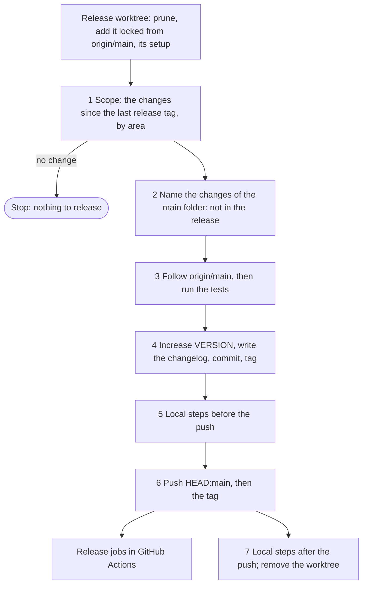

# Releases

> `main` is the history of development. Only a tag is an official version. The owner releases with one shared skill, `prerelease`. Each project writes only its own steps, in `.agents/prerelease.md`. The pushed tag starts the release jobs in GitHub Actions. A job on a schedule, and another repo that uses this repo, read only the latest release, not `main`. The latest release is the one that the release variable `RELEASE` names: `prerelease` writes it on the owner's Mac after the push. The rules are in `entry` (reference `release.md`).

Marks: ✅ built · 🔶 partly built · ⬜ not built.

## 0. Terms

| Term | Meaning |
| --- | --- |
| Release | The commit that a release tag marks. |
| Release tag | An annotated tag. Its name is the line in `VERSION`, for example `20261010.1`. |
| Release variable | The repository variable `RELEASE` of a project (GitHub Actions variables). Its value is `<tag> <sha>`: the name of the latest release, one space, and the full SHA (40 hex characters) of the commit of its tag. Only `prerelease` writes it, on the owner's Mac, with the owner's `gh` login, after the push of the tag (§1 step 6). The first write: when a project with release tags has no variable yet, or lost it, the owner's login writes it once with the command of `prerelease` (`release-var.ts write <tag>`), for the release that the owner names. No token of the loops can write it (§2.3). |
| Latest release | The release that the release variable names. It counts only when the tag of that name exists, its commit is the SHA of the variable, and `origin/main` reaches that commit. Else a job stops; it never falls back to an older tag (§2.3). A variable that is missing, that cannot be read, or whose value is not of the form `YYYYMMDD.N <sha>` also stops the job. A release tag that the variable does not name is not the latest release, whatever its version. Compare versions by the date, then the patch, as numbers: `20261010.10` is newer than `20261010.9`. Only names of the form `YYYYMMDD.N` are versions. A job in GitHub Actions fetches the tags first: `actions/checkout` fetches one commit and no tags by default. |
| `prerelease` | The shared skill that makes a release, from `origin/main` to the push, in the release worktree (§1). |
| Main folder | The folder where the repo of a project is cloned. Each session works in a worktree of its own, on a branch (L2-loop-builder §5). From any worktree of the repo, its path is `dirname "$(git rev-parse --path-format=absolute --git-common-dir)"`. |
| Release worktree | The git worktree where `prerelease` works: `<main folder>-release`, an absolute path, with a detached `HEAD` (§1). |
| Project configuration | The file `.agents/prerelease.md` of a project. It holds the release steps of that project. |
| Version command | The command of the Version section of the project configuration (§3). It increases `VERSION`, and it changes only the version files. |
| Version files | `VERSION`, and the files that a script copies its value or the date of the release into (§2.1), for example the manifests. |
| Release job | A GitHub Actions job that a pushed release tag starts. Examples: deploy the site, put files in a bucket, run the data loop one time. |
| Local step | A release step that only the machine of the owner can do. Examples: upload a build to TestFlight, install the plugin again. |
| Area | A set of paths in the project configuration, for example the mobile code. An area names the local steps that a change in it makes necessary. |

Other terms: [L2-loops §0](L2-loops.md#0-terms).

## 1. The order ✅

`prerelease` does these steps in this order. The owner starts it; no step asks the owner again.

A release runs in the release worktree (§0), with a detached `HEAD` from `origin/main`. All steps run there. The push is `HEAD:main`, then the tag.

- **Before step 1.** Run `git worktree prune`: it forgets a worktree whose folder is gone. If the release worktree is there, the last run stopped ("Continue after a stop", below). If it is not there, run `git fetch origin`, then `git worktree add --detach --lock --reason "prerelease <time>" <main folder>-release origin/main`. Then run the section "Release worktree" of the project configuration (§3) in it. Run that section again after each move of the worktree to `origin/main`.
- **The lock.** While a run works, the release worktree is locked, with the reason `prerelease <time>`. A stop of the run that holds the lock unlocks it (`git worktree unlock`); a run that stops because it finds the lock does not unlock it. A run that finds it locked, or whose `git worktree lock` fails, stops, and names the reason: another run works now, or a run died. When no run works, the owner unlocks it.
- **The end.** After step 7, `prerelease` unlocks the worktree and removes it (`git worktree remove` refuses a locked worktree).
- Why: several sessions work in the same repo at the same time. In its own worktree, a release takes no half-done work of another session, and no other session can move the version commit off its tag.
- Why: the path is fixed and absolute, so "continue after a stop" finds the worktree of the last run from any worktree of the repo.
- Why: two runs in one worktree mix their commits and tags. The lock shows that a run works, and `git worktree prune` keeps a locked worktree.
- Why: a new worktree has no installed packages and no ignored files of the main folder. The project names what its local steps need from them (§3).

1. **Scope.** Release only from the release worktree: its top folder (`git rev-parse --show-toplevel`) is the release worktree, and `HEAD` is detached. In another folder, or on a branch, stop. Find the latest release. List the commits after it and the files in the working tree. With no release tag yet, every commit and every area is in scope. With no release variable but a release tag on `origin/main`, stop and name it: the owner writes the variable first (§0, the first write), and the scope never guesses the latest release from the tags. Put each file in its area. The areas tell which local steps this release must do. If nothing changed since the latest release, stop. If a push to `main` since the latest release was not the owner's (the push record), stop and name the commits: the owner looks at them first. When the owner calls again in the same session after looking at them, the agent passes them with `scope.ts --seen <sha>,…`: they no longer stop the release, and the tag message lists them, so the record stays with the tag. A new push that the owner did not see still stops it.
2. **Name what stays out.** Step 2 commits nothing: the release worktree comes from `origin/main`, so it has no changes of its own. List the changes of the main folder: the files that are not committed, and the commits of `main` in the main folder that are not on `origin/main`. They are not in this release, and the reply names them. Their session commits the files. For the commits, the reply says "put them on a branch and a PR": each change goes to `main` through a PR, a small change too (L2-loop-builder §2.1). They go into the next release. The release worktree can have only the changes of a stop: the files of a stop inside step 4, or a fix inside a release that a stop left (both below). On any other change there, stop and name its files. Never move changes away with stash, restore or reset.
   - Why: all work goes to `main` through a PR, a small change too (L2-loop-builder §2.1, §5). A release must not put any work on `main` that no PR showed. The session that made a change commits it, so the release does not judge which change is small. The one exception is a fix inside a release (below): the release commits it, and the tag message lists it.
3. **Follow origin/main.** Fast-forward, rebase, or merge (merge when the local commits include a merge commit). On a resume with fix commits (no state file, below), rebase them onto the latest `origin/main`: git drops a fix that is already upstream. Resolve each conflict. Never force a push. Then run the tests. If they fail, repair the failure, commit the fix, and run the tests again (a fix inside a release, below). If they still fail, stop before the tag.
4. **Tag.** Run the version command (§3). It changes only the version files, and `VERSION` last. A release generates no data files: it ships the generated data that `origin/main` has, for example the seed data of an app. Add the section of this version to `CHANGELOG.md` (§2.7). Remove the finished plans, their deep-verify reports and the ✅ items of the graph of open work, and make each link to the removed files a permanent link (§2.8). Run the link check and the tests again. On a failure, make a fix inside a release before the version commit; if they still fail, stop. Commit the version change (the version files), `CHANGELOG.md`, the removals and the files with changed links alone, together. Make the release tag on that commit. Its message lists the fixes inside the release (`git log origin/main..<version commit>^`). Show the section to the owner in the reply; do not stop for it.
   - Why: a release generates no data files. A project refreshes its generated data outside the release, through a PR, like other work. Its tests run in the PR, and a red test takes the usual path of a repair.
   - Why: in an app, a seed of generated data matters only at a fresh install or a schema change. After one successful sync, the app uses the live data. So a seed of a few days is good enough.
   - Why: a refresh inside the release made the release need the network. It let text from web pages, which is untrusted ([L2-loop-untrusted-text](L2-loop-untrusted-text.md) I2), fail the tests of step 4. It also put generated files into the version commit.
5. **Local steps before the push**, for example an upload to TestFlight. If a step fails, stop before the push. A step that needs a fix: "A check that fails after the tag", below.
6. **Push** `HEAD:main` first, then the one new tag. Never push all tags. If origin refuses `main` because origin/main moved, fetch, merge origin/main into `HEAD` (never rebase: the tag stays on its commit), run the link check and the tests, and push again. A red check after this merge: "A check that fails after the tag", below. Stop on any other refusal.
   - Then write the release variable (§0): `RELEASE=<tag> <sha of the tag's commit>`, with the owner's `gh` login, and read it back. If the variable names a newer version than this tag, stop and name it: never write an older release over a newer one. If the write or the read fails, stop: the next run continues at `tag-pushed` and writes it.
   - Why: the release runs only on the owner's Mac, so the Mac writes which release is the latest. It costs nothing, and it needs no workflow.
   - Why: the write comes after the push of the tag. A reader examines that the tag exists at the SHA of the variable (§0), so a variable written before the push would stop every reader until the push.
7. **Local steps after the push**, for example install the plugin again. Then list the runs that the tag started, and tell the owner which failed. A release that starts no run (aboveloop) is not examined after the push: a broken one shows at the next run of the loops, and `setup-dev` has the escape for the owner's sessions. Then unlock and remove the release worktree. The reply lists each fix inside the release: its SHA, its subject and its files. It says when a fix changed only tests. It lists each `Merge follow-up` (the links, or a repair) in the same way: it comes after the tag, so the tag message cannot list it, and it reaches `main` with no PR (L2-loop-builder §2.1).

- **The state of a run.** Each time a run reaches one of the points below, it writes the point to a state file: `prerelease-state` in the git dir of the release worktree (`git rev-parse --git-dir` there). The file holds two lines, `version=<the line of VERSION at that time>` and `step=<point>`. It is written to a temporary file and then renamed, so a stop never leaves half a file. It is per worktree: it is never committed, it is not in the main folder's own git dir, and `git worktree remove` takes it away with the worktree. The script `state.ts` of the skill writes and reads it.
- **Continue after a stop.** The release worktree is there and not locked: the last run stopped. Lock it, and continue in it. Fetch, then read the state file. The resume goes by the point in the file, never by what git looks like. Git is a check: when the file and git do not agree (for example the file says `tagged` and there is no local tag, or origin cannot be read), stop and name both. The stop also names the two ways on, and the owner chooses: restore git to the point (for example make the local tag again on the version commit when the tag is not on origin, or, with no file, write the point that git shows), or start over without losing a fix: list the fix commits (`git log origin/main..HEAD`), keep the wanted ones with a branch, delete each local version tag of this run that is not on origin, then remove the worktree. The tags of this run are the version of the file, or with no file the local tags that the check named. For each, `git ls-remote --exit-code --tags origin refs/tags/<tag>`: exit 2, delete the local tag (it never left the machine, so its number is free); exit 0, keep it and stop (the number is used); another exit, stop (origin cannot be read). Else each point has one continuation:

  | Point | Written | The run continues |
  | --- | --- | --- |
  | No file | — | A stop before step 4, or a new worktree; never "the push is done". First examine for a `version:` commit in `origin/main..HEAD`, or a local version tag that is not on origin: the file was lost after step 4. Stop and name it; never rebase it in step 3. Else: a clean worktree with an empty `origin/main..HEAD`: move the worktree to `origin/main`, run the section "Release worktree" again, and start at step 1. Fix commits in `origin/main..HEAD`, or a fix that is not committed (a fix inside a release, then a stop): keep them, finish and commit the fix, then continue through step 3: rebase onto the latest `origin/main` (git drops a fix that is already upstream), and run the tests. Never move the worktree to `origin/main` there (no work of a fix goes). |
  | `bump` | Step 4, before the version command | A stop inside step 4. Do not increase the version a second time, and do not write a second changelog section. If `VERSION` is still the recorded version, the version command did not end (it changes `VERSION` last): run it again. Examine that the number is not used. If `HEAD` is the version commit and the worktree is clean, write `version-commit` and go on. Else the version files, `CHANGELOG.md` and the staged changes of the cleanup are this version's; any other change is a fix that is not committed: finish it and commit only its files. Then continue at the changelog command of step 4: run it and `changelog.ts`, and add the section of this version when `CHANGELOG.md` does not have it (never a second section). Then stage, run the cleanup, the link check and the tests, commit, and tag. |
  | `version-commit` | After the version commit | Make only the tag (when it is there on `HEAD`, only write `tagged`). Then step 5. A local tag of the version on another commit is a problem: the check names both commits, and the run stops (the two ways above). |
  | `tagged` | After the tag | Step 5, from the step that failed. Never increase the version, also when TestFlight has a build with its number: this release uploaded it. |
  | `refix` | "A check that fails after the tag", after `ls-remote` shows that the tag is not on origin, before the worktree moves | Finish that part: if the local tag is there and `HEAD` is its commit, move to its parent; if the local tag is there, examine origin again and delete the tag only when it is not on origin. Then repair, commit, and do step 4 again (`bump`). |
  | `before-push-done` | Every local step before the push passed | Step 6. Do not run the local steps before the push again. |
  | `merge` | Step 6, before the merge of `origin/main` | The rest of the merge part of step 6. The tag does not move, the local steps before the push do not run again, and a red check is never "before the push". Conclude a merge with conflicts; commit a repair that is not committed as a `Merge follow-up`. Then run the cleanup again (`Merge follow-up: links` if it changes files), the link check and the tests (a red one: a `Merge follow-up` repair), and push again with the writes of step 6 (`main-pushed`, `tag-pushed`). |
  | `main-pushed` | After the push of `HEAD:main` | Push only the tag, write the release variable, then step 7. |
  | `tag-pushed` | After the push of the tag | The push is done. Write the release variable when it does not name this release yet. Run again only the steps after the push that did not pass (the stop named them), then remove the worktree. Never a new version. When the owner asks for a new release instead, remove the worktree and start from `origin/main`. |
  | `after-push-done` | Every local step after the push passed | List the runs of the tag, and remove the worktree. |

  - Why: tags are shared by all worktrees. A start over that kept the local tag of the stopped run made the next run of the same day stop at each resume: the version command gave the same number, the check of a used number passed (a local tag is not used), and `git tag -a` failed. So start over deletes it, and the check at `version-commit` stops on it.
  - Why: a resume that found the stop point from git state left gaps. A stop after the merge of step 6 with a dirty worktree fit no case and made a second version; the same stop with a clean worktree went to "before the push" and moved the tag back; a new run that stopped early on the head of the last release looked like "the push is done". A recorded point has one continuation; git only confirms it.
- **A fix inside a release.** A test or the link check fails in step 3 or 4, or a local step of step 5 fails ("A check that fails after the tag", below). Repair it in the release worktree, and commit only the repaired files, before the version commit. A fix in step 4 adds its line to the changelog section before the version commit (§2.7). The tag message lists each fix commit (its SHA and subject), so the record stays with the tag, as for the pushes that the owner saw (step 1). The reply lists each fix (step 7).
- **A check that fails after the tag.** A local step before the push (step 5, for example an end-to-end test of a mobile app) or the tests after the merge of step 6 fail, and a fix is necessary. Only a tag on origin is a used version. Never move or delete a tag on origin, and never move a pushed commit.
  - **Before the push (step 5).** The local tag is not on origin: `git ls-remote --exit-code --tags origin refs/tags/<version>` exits with 2. Exit 0: the tag is on origin, the number is used; stop and name it. Another exit: origin cannot be read; stop. Write `refix`. Move the worktree to `<version commit>^` (`git checkout --detach`). Delete the local tag. Repair, and commit only the repaired files (a fix inside a release, below). Then do step 4 again with the same version: its changelog section and its tag message list the fix. Step 4 runs the version command again from the same old `VERSION`. A command that takes the number from the date gives a new number after midnight; the release uses that number: the deleted number was never on origin, so neither number is used, and the version command stays the only writer of the version files. Increase the version only when the number is used: its tag is on origin, or TestFlight has a build with it (the `BUILD` line). Then continue at step 5.
  - **After the merge of step 6.** The tag does not move: its commit passed the checks of steps 3–5, and step 5 shipped it, for example to TestFlight. Commit the repair on top of the merge as a `Merge follow-up`, like the links (§2.8). Then push again. The reply lists the repair (step 7).
  - Why: a local tag that never left the machine started no release job and reached nobody, so its version is free. The fix then goes into the tag, and the tag message lists it.
  - Why: the local tag goes last. Until then it names the version commit, so a resume at `refix` finds the commit to move from. With no local tag at `refix`, a `version:` commit of the version under `HEAD` means that the tag went by hand: a stop, never a redo of step 4 on it (a second version commit).
- A tag on origin is a used version. In step 4, and in the redo of step 4 before the push (above), if the tag of the new version is on origin already, or TestFlight has a build with its number, increase the version again and make a new tag. This does not apply to a resume at `tagged` or a later point: it never increases the version.
- If a step after the push fails, run that step again. Do not make a new version.

## 2. Decisions

### 2.1 A release is a tag, and the tag push is the only trigger ✅

- `VERSION` is the only source of the version. Other files read it, or a script copies it into them (P3). A file that needs semver, for example `package.json`, gets `YYYYMMDD.N.0`.
- A push to `main` starts no release job. Merged code waits for the next release.
- Why: `main` is the history of development. Only a tag is an official version.
- Why: a merge is not a decision to ship. The owner decides when code goes live (P1).
- Why: the latest release tag tells which code is live. A tag does not move.

### 2.2 What runs for real reads only the latest release ✅

- A job that runs the code of the project on a schedule runs the latest release. It does not run the head of `main`.
  - **NOTE:** GitHub runs a scheduled workflow from the workflow file at the head of `main`. A checkout of the tag changes only the code: the jobs, the steps and which step gets which key still come from `main`. So the schedule only dispatches the same workflow at the latest release tag (`workflow_dispatch` can name a tag), and the whole round comes from the tag.
- A pushed release tag starts one run with the new code at once.
- To put a repair live, make a release. Do not run the head of `main` by hand.
- Another repo that uses the code or the skills of this repo reads only its latest release. Example: the loops of every project use the composite action and the skills of aboveloop. `uses:` in a workflow takes a fixed name, so each `loop.yml` finds the latest release tag when it runs, checks out aboveloop at that tag, and runs the action from that checkout (`uses: ./…`). It reads aboveloop and its release variable with a read token that it signs itself (Contents read and Variables read), and its own steps pick the tag. The agents read the same tag. No branch or tag moves. Anyone who can push can push a tag with a larger version (R15): the latest release is only the tag that the release variable names (§0), so such a tag is ignored everywhere. No reader deletes it: it stays as evidence.
  - The one exception: the copy of `loop.yml` in each project runs from `main`, because GitHub runs only the repo's own workflow files (P3). A change to it must work with the action of the release before.
- Only development works on `main`: sessions, and branches for PRs. When aboveloop runs a loop on itself, every job also runs the skills of the latest release; explore and implement clone `main` too, as the code that they change.
- Why: a merged change does not change live data until the owner releases it. The data and the app then come from the same code.

### 2.3 Each release job examines that the tag is on `main` ✅

- Before a release job uses a key, it examines that the commit of the tag is on `main`. If it is not, the job stops.
- The checks fail closed: in a project that releases with `prerelease` (§4), each case that §0 names under "Latest release" stops the job. It never falls back to an older tag.
- A job that uses keys also examines that the tag is the latest release, and that the owner pushed it (R15). In a project that releases with `prerelease` (§4), how it knows depends on what starts the job. A project that does not release with `prerelease` keeps its own check in its release job (L2-loop-untrusted-text R15).
  - A job on a schedule, or a job of another repo, reads the release variable (§0). It runs only the release that the variable names.
  - A job that a tag push starts examines `github.actor`: the owner. It also examines, with `vars.RELEASE`, that its tag has a larger version than the release that the variable names, or that the variable names its tag at `GITHUB_SHA`. Why the second case: `prerelease` writes the variable seconds after the push (§1 step 6), so a job that waits for a runner, and each re-run, can see its own tag there. With no variable (the first release of a project), the job stops; after the variable is written (§1 step 6, or the first write of §0), a re-run passes. Today no such job holds a key (§4).
- Only the owner's login writes the release variable. The GitHub App of the loops (`<your GitHub App>`) has Variables read and no Variables write. The Cursor GitHub App has no Variables permission. `GITHUB_TOKEN` has no permission for variables. `setup-app`'s `check.sh` examines the two Apps, so a new permission does not open the variable silently.
- Why: a run at an older tag loads today's state, and then saves over what newer code saved.
- Why: private repos on GitHub Free have no branch protection (R15). Anyone who can push can put a tag on any commit.
- Why: a job on a schedule and a job of another repo start after the tag push, so they cannot see `github.actor` of that push. GitHub keeps no lasting record of who pushed a tag of a private repo on GitHub Free: the activity API and the events API show no tag (measured), the tags are not signed, and rulesets need GitHub Pro. So the owner's Mac writes the record, in the variable.

### 2.4 One shared skill. Each project writes only its own steps ✅

- `prerelease` is in aboveloop. A project keeps no release skill of its own. It writes `.agents/prerelease.md`, as it writes `.agents/builder.md` for `builder`.
- Why: one copy (P3). The order is the same in every project. Only the steps are different.
- Why: the order was learned one time (what to do when an upload fails, how to follow origin/main). Every project gets it.

### 2.5 The push comes after the local steps that must pass first ✅

- An upload to TestFlight is a local step before the push. If it fails, the skill stops before the push. The next run continues with the same version and the same local tag. A fix makes a new version commit and a new local tag with the same version (§1, "A check that fails after the tag").
- Why: a pushed tag is a used version, and it starts the release jobs. A version that did not ship must not be on origin.

### 2.6 Only the owner releases ✅

- The owner starts `prerelease`. That is the decision.
- No agent in CI releases.
- Why: a release reaches users, and it cannot be undone (P1).

### 2.7 Each release adds a section to `CHANGELOG.md` ✅

- `CHANGELOG.md` is at the root of the project. Each release tag has one section, `## <version> · <date>`. The newest section is at the top.
- The section tells what changed for the readers of the project, in simple words. It comes from the titles and the summaries of the PRs that merged after the last release tag (the owner saw them at the merge), and from `git log` for the commits with no PR. These are the fixes inside a release (§1): every other change goes to `main` through a PR ([L2-loop-builder §2.1](L2-loop-builder.md#21-where-issues-come-from), [§5](L2-loop-builder.md#5-the-branch-the-pr-and-the-plan-of-an-issue-)). A fix made in step 4 adds its line to the section before the version commit. It never reads issue bodies or comments: they are untrusted (E1), and the section goes into the tag without a merge.
- Each line links the issue, the PR and the plan that it has. A line from a commit with no PR has none. The links go to this repo only.
  - The link of a plan names `HEAD` when step 4 writes the section. So a plan that this release removes still opens.
  - The agent makes each link from a number, the repo and a file name of the form `<N>-<slug>.md`. It never copies a link from a text.
  - Why: a reader goes from a line to the work and its reasons in one step.
- Internal changes (a refactor, CI, tests) get one line at most.
- The changelog stays in the repo, in English, in every project. Its readers are the owner and the agents; no user reads it. Why: the repos are private, and a text that reaches users needs the owner to read it first.
- The section goes into the version commit, so the tag holds it.
- Releases before the first section get no section.
- Why: each version tag gets its own heading, and the heading tells the changes in simple words, for the users.

### 2.8 A release removes finished plans and deep-verify reports ✅

- `prerelease` removes these files in the version commit:
  - The plan of an issue, `knowledge/plan/<N>-<slug>.md`, when each node heading has ✅. A node that will not be done has ✅ in its heading and its items struck through.
  - The deep-verify reports of that issue, `knowledge/reference/deep-verify-<date>-<N>.md`, with its plan. Each deep-verify examines the spec changes of one issue, so each report has a number.
  - A report with the number of an issue that has no plan on `main` (its plan left before), whatever its date.
- A deep-verify report with no issue number stays, and the release gives a warning.
- A plan with no number stays (in a project, the plan of a milestone, L2-loop-builder §1).
- `prerelease` removes the ✅ items of the graph of open work, `knowledge/plan/index.md` ([L2-loop-dev §4](L2-loop-dev.md#4-the-graph-of-open-work)): the ✅ nodes of the chart with their arrows, and the ✅ rows of the table. The exact marks are in [L3-loop-dev §2](L3-loop-dev.md#2-the-graph-of-open-work).
  - Why: a done item first gets ✅ and stays in the graph, so the owner sees what was done. The release removes it.
- `prerelease` removes the row of each removed file from `knowledge/index.md`.
- It changes each relative link to a removed file into a permanent link: `https://github.com/<repo>/blob/<commit>/<path>#<anchor>`, at `HEAD` when step 4 removes the files (a commit that still has them). It looks in every Markdown file that git tracks. It lists other mentions of the files in the reply, and does not change them. It stages the version change first, and stops only when a file that it must change has changes that are not staged.
- After the merge of step 6, `prerelease` runs the removal and the link check again. It points a new link to a removed file at the parent of the version commit, and commits the result as `Merge follow-up: links`, or stops and names the files.
- A link to a file of another repo is a permanent link when an agent writes it.
- Why: a plan goes at the release, not at the merge; at the merge, its nodes only get ✅. A finished plan on `main` hides the open work. A permanent link keeps each cited measurement and decision one click away.

## 3. The project configuration ✅

`prerelease` reads all sections of `.agents/prerelease.md`. If a project does not need a section, the section says "None". If the file is not there, or a section is not there, the skill stops and names it.

| Section | What it holds | Example |
| --- | --- | --- |
| Areas | Each area: its paths, and the local steps that a change in it makes necessary | `mobile/**` → the upload to TestFlight |
| Release worktree | The commands to run in a new release worktree, or after it moves to `origin/main` (§1), and the files that it takes from the main folder. "None" when the local steps need nothing. | An app: `npm ci`, then `npx astro sync` in `web/`; only the `ASC_` lines of `.env.local` (`grep '^ASC_'`) |
| Version | The version command. It changes only the version files (§0), and `VERSION` last. A release generates no data files: a project refreshes generated data, for example a seed, through a PR (§1 step 4). A command that changes source files (a formatter) does not run in a release: a session formats its own change. On a resume where `VERSION` is not changed, the release runs the version command again (§1, "Continue after a stop", `bump`). | `make bump` (aboveloop: it also writes the version into the plugin manifests) |
| Changelog | Commands to run before the section, if any | None |
| Tests | The commands that must pass after step 3. A release runs all of them | `make test` |
| Before push | The local steps before the push. For each: its area, and how to run it again after a failure | The upload to TestFlight |
| After push | The local steps after the push | Install the plugin again |

- The configuration has no Commit section. A release commits only named files: the version files, `CHANGELOG.md`, the changes of the cleanup (§2.8), and the repaired files of a fix inside a release (§1).
  - Why: no step reads that section, because the release has its own worktree, so a rule there never acts and goes stale.
- The release jobs are not in the configuration. They are in the workflows of the project. The workflow is the record (P4).

## 4. The projects ✅

| Project | Local steps | Release jobs (on the tag) |
| --- | --- | --- |
| aboveloop | After push: install the plugin again on the machine of the owner ([L2-plugin §5](L2-plugin.md#5-versions)) | None. A tag starts no workflow |
| An app (example) | Its `.agents/prerelease.md`, for example an upload to TestFlight before the push, and after the push a deploy of the site from the release worktree | None. A tag starts no workflow |

- The workflow `loop.yml` of each project, and the cloud agents of the loops, read the latest release of aboveloop (§2.2).

## 5. The owner's part

- Start `prerelease` in a session when a release must go out.
- Give the GitHub App of the loops (`<your GitHub App>`) the permission Variables read, and accept it on the installation, so that each `loop.yml` can read the release variable of aboveloop. Never give a token of the loops Variables write (§2.3).
