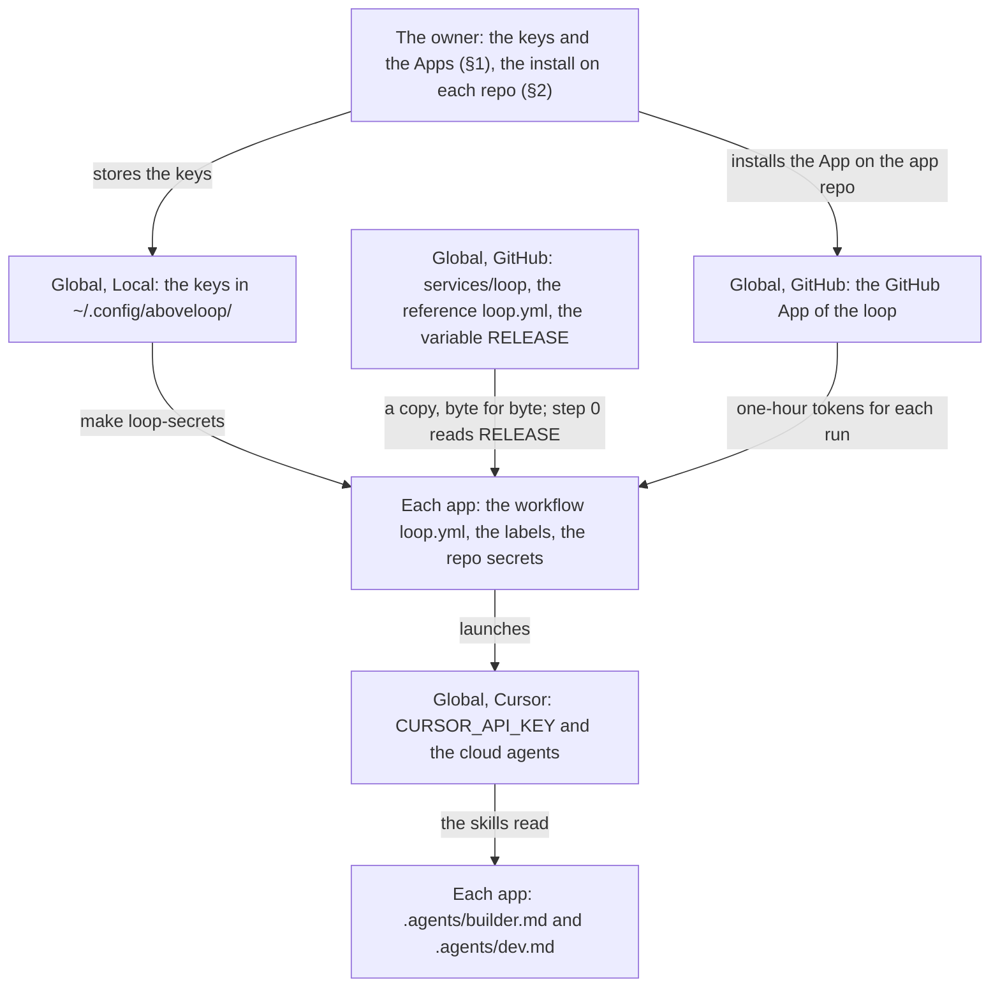

# Components

> Every part that the loops in CI need, and where it is: the global parts, set up one time (§1), and the parts of each app, set up by `setup-app` (§2). It also names the owner's part of the setup; the steps are in `setup-app`. All parts are built.

Marks: ✅ built · 🔶 partly built · ⬜ not built.

## Summary

- The loops in CI need two sets of parts. The **global** parts are set up one time, in aboveloop and the accounts of the owner (§1). **Each app** has its own copy of the other parts (§2).
- The skill `setup-app` sets up the parts of each app. Its script `scripts/check.sh <owner>/<repo>` examines them (§2).
- One GitHub App, `<your GitHub App>`, gives every GitHub token of the loops. Each run mints one-hour tokens, each narrowed to its use. The loops do not use the Cursor GitHub App (§1).
- The keys are stored one time on the Mac of the owner and copied into the repo secrets. They are never in a repo or a chat (§1, **Local**).
- The agent writes the code, the workflows and the configuration. The owner does only what needs the accounts of the owner: the keys and the Apps one time (§1, **The owner's part**), and for each app the install of `<your GitHub App>` (§2, **The owner's part**).
- Why these platforms: [L2-loop-architecture §1](L2-loop-architecture.md#1-platforms).

"Where" always starts with the platform: `GitHub ›`, `Cursor ›` or `Local ›` (the Mac of the owner). `<app repo>` is the repo of the app.

## 1. Global: aboveloop, set up once

**GitHub**

- **Composite action `services/loop`.** The code of every workflow `loop.yml`: it selects the work and launches the cloud agents ([L3-loop-workflow §1](L3-loop-workflow.md#1-the-workflow-loopyml)).
  - Where: `GitHub › aboveloop › services/loop/`
  - Where: `GitHub › aboveloop › Settings › Actions › Access` = "none": each `loop.yml` checks out the action at the latest release with a token that reads aboveloop, so no repo needs to use the action of aboveloop by name.
- **Reference workflow.** Each app gets a copy of it.
  - Where: `GitHub › aboveloop › skills/setup-app/references/loop.yml`
- **Repository variable `RELEASE` of aboveloop.** Its value is `<tag> <sha>`: the latest release of aboveloop ([L2-release §0](L2-release.md#0-terms)).
  - `prerelease` writes it on the owner's Mac after the push of the tag.
  - Each `loop.yml` reads it in step 0 ([L3-loop-workflow §1](L3-loop-workflow.md#1-the-workflow-loopyml)).
  - A project that releases with `prerelease` has its own `RELEASE`.
  - A tag push starts no workflow: the variable is the only record of the latest release.
  - Why: the variable holds the SHA, so a tag that someone else pushes or moves cannot change what runs (L3-loop-workflow §1, step 0).
  - Where: `GitHub › aboveloop › Settings › Secrets and variables › Actions › Variables`: `RELEASE`
- **The GitHub App of the loop, `<your GitHub App>`.** One App on every repo ([L2-loops §6](L2-loops.md#6-names-and-domains)). The agents act as the bot of the App.
  - Its permissions: Variables read (the release variable; no Variables write, [L2-release §2.3](L2-release.md#23-each-release-job-examines-that-the-tag-is-on-main-)); Contents write (for implement); Issues write; Pull requests write. No Workflows.
  - No token is kept. Each run of `loop.yml` mints one-hour tokens from it (`actions/create-github-app-token`); it signs the read token for aboveloop itself.
  - Each token is narrowed to its use. Why: each token has the smallest scope and a short life (E2).
    - For every agent: aboveloop only, with Contents read (the skills).
    - For step 0 of `loop.yml`: aboveloop, with Contents read and Variables read.
    - For explore: the repo, with Contents read and Issues write.
    - For implement: the repo, with Contents, Issues and PRs write, and no `workflows` (R5).
  - Where: `GitHub › account › Developer settings › GitHub Apps › <your GitHub App>`
  - Where its private key is: the App's key file in `Local › ~/.config/aboveloop/`, the repo secret `GH_APP_KEY_DEV` of each repo, and the environment of each implement run in CI (⬜; [L2-loop-untrusted-text](L2-loop-untrusted-text.md#3-design-requirements) A6). The key has no expiry and every permission of the App on every installed repo. The owner accepts this (A1 in [L2-loop-untrusted-text §3](L2-loop-untrusted-text.md#3-design-requirements)).
  - Where its ID is: the repo variable `GH_APP_ID_DEV`
- **Cursor GitHub App.** Not used by the loops: their agents start with no repos and clone with tokens of the GitHub App of the loop. It stays on the repos for the owner's own Cursor cloud agents. It has no Variables permission (`GET /apps/cursor`), so it cannot write the release variable; `check.sh` examines this.
  - Where: `GitHub › account › Applications › Cursor` (installed on aboveloop; each app adds its repo, if the App is not on all repositories)

**Cursor**

- **Cloud Agents API key `CURSOR_API_KEY`**, and a **spend limit**.
  - Where: `Cursor › dashboard › API keys`; `Cursor › dashboard › Spending`
- **Cloud agents** ([L3-loop-workflow §2](L3-loop-workflow.md#2-the-agents)): `builder` explore; `builder` implement. Explore can start subagents. The launch of the implement run defines the subagent `deep-verify` for its deep-verify (B1). Nothing to set up for them.

**Local**

- **The keys, stored one time.** Never in a repo or a chat. They are copied from here into the repo secrets.
  - Where: `Local › ~/.config/aboveloop/loop.env` (never in the aboveloop folder, which `claude plugin update` copies): `CURSOR_API_KEY` and `GH_APP_ID_DEV` (written by `make loop-key`); and the App's key file beside it. The App's key stays the pem file.

**Skills** (all in `GitHub › aboveloop › skills/`): `builder` runs as cloud agents; `setup-app` and the session entry of `dev` (`references/session.md`) run in a session of the owner.

**The owner's part** (one time). The agent writes the code, the workflows and the configuration. The owner sets up only the parts that need the accounts of the owner:

- The Cursor API key and a spend limit (**Cursor** above).
- The GitHub App of the loop and its key file (**GitHub** above).
- The Cursor GitHub App, for the owner's own cloud agents, not the loops (**GitHub** above).
- The keys in `~/.config/aboveloop/` (**Local** above).
- The steps, and the steps to change each key: `setup-app`'s [keys.md](../../skills/setup-app/references/keys.md).

## 2. Each app: `setup-app`

`setup-app` sets up these parts by [`references/loop.md`](../../skills/setup-app/references/loop.md). Then its script `scripts/check.sh <owner>/<repo>` examines each part.

- **Workflow `loop.yml`.** The only trigger of the loops in CI in the app, a copy of the reference workflow, byte for byte. It reads the latest release of aboveloop from the variable `RELEASE`, and runs the action from a checkout at it.
  - Where: `GitHub › <app repo> › .github/workflows/loop.yml`
- **Labels:** `explored` and `ready-for-auto-builder` ([L2-loop-builder §3](L2-loop-builder.md#3-the-labels-explored-and-ready-for-auto-builder)), the family `Kind:` ([L2-loop-builder §4](L2-loop-builder.md#4-labels-that-describe-an-issue)), and the labels of a PR `Mode:`, `Agent:` and `auto-builder` ([L2-loop-builder §4.1](L2-loop-builder.md#41-labels-that-describe-a-pr)). `setup-app` makes the labels of `references/labels.tsv`, and one `Kind:` label for each kind of the project.
  - Where: `GitHub › <app repo> › Issues › Labels`
- **Merged branches are deleted** ([L2-loop-builder §5](L2-loop-builder.md#5-the-branch-the-pr-and-the-plan-of-an-issue-)).
  - Where: `GitHub › <app repo> › Settings › General › Pull Requests › Automatically delete head branches`
- **Repo secrets**, copied from `Local › loop.env` with `make loop-secrets REPO=<app repo>`.
  - Where: `GitHub › <app repo> › Settings › Secrets`: `CURSOR_API_KEY`, `GH_APP_KEY_DEV`; `Settings › Variables`: `GH_APP_ID_DEV`
- **Configuration of `builder`**: the kinds of issue, the light kinds of the spec step (the section "Light spec" in the part Explore, or "None"; `builder`'s [spec.md](../../skills/builder/references/spec.md) §1), the Auto-ready rules, the tests, the evidence.
  - Where: `GitHub › <app repo> › .agents/builder.md`
- **Configuration of `dev`** (only in an app that changes the rank of the dev loop): what is urgent, the order of the groups, the size labels ([L3-loop-dev §3](L3-loop-dev.md#3-the-project-configuration-agentsdevmd)). With no file, the default rank applies. The session entry of `dev` reads it, and `check.sh` examines it.
  - Where: `GitHub › <app repo> › .agents/dev.md`
- **Access** (the owner).
  - Where: `GitHub › account › GitHub Apps › <your GitHub App> › Install App`: `<app repo>` in its repositories (`check.sh` asks GitHub as the App)
  - Where: `GitHub › account › Applications › Cursor`: `<app repo>` in the repository access, for the owner's own Cursor agents, not the loops (`check.sh` cannot read it)

**The owner's part** (each app). The owner sets up only the parts that need the accounts of the owner:

- The install of the GitHub App of the loop on the repo of the app (**Access** above). The loops do not need the Cursor GitHub App.
- The steps and the exact clicks: `setup-app`'s [SKILL.md](../../skills/setup-app/SKILL.md#要用户动手的).
- The open steps of an app are in the plan of that app.
