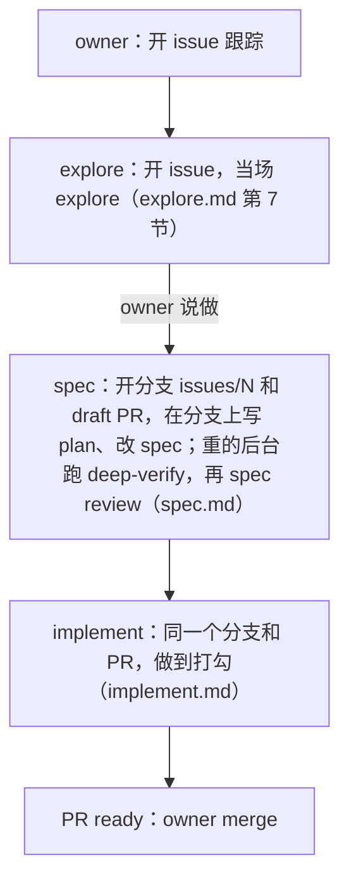

# builder · 会话里的一个 issue

> owner 在会话里要开 issue 跟踪一件事（`entry` 的「owner 说「应该怎么样」」），或说做一个 issue 时读：半自动模式从头到尾怎么走。词表在 [entry 的 SKILL.md](../../entry/SKILL.md)。

## 1. explore、spec、implement

agent 带着 owner 走完这个 issue 的半自动模式：builder loop 的三步 explore、spec、implement，每步一份 `builder` 的文字，和 CI 读的是同一份（[L2-loop-builder](../../../knowledge/spec/L2-loop-builder.md)）。每样改动都在一个分支上，走一个 PR（为什么在 `entry` 的「小改动」）。

1. explore：开 issue，当场 explore，照 [explore.md](explore.md) 第 7 节。issue 照 `entry` 的 [issue 模板](../../entry/references/issue-template.md)开。
2. spec：owner 说做，照 [spec.md](spec.md) 做，会话的部分在它最后一节（开分支 `issues/<N>` 和 draft PR，在分支上写 plan、改 spec，deep-verify，带 owner 过 D 和 O，spec review）。spec 和 plan 怎么改，见第 2 节。deep-verify 的形式（多人或单人）照 `knowledge` 的 [deep-verify-knowledge.md](../../knowledge/references/deep-verify-knowledge.md) 的「两种形式」。牵连的页放进同一个 commit。deep-verify 是 spec review 前面的固定节点，在后台跑，不先问 owner（spec.md 6.2）。
3. implement：spec 那一步结束（重的：最后一次 spec review；轻的：短 plan），照 [implement.md](implement.md) 在同一个分支上写代码，从它的第 0 步起，不再等 owner 叫执行。
4. 做完，照 [implement.md](implement.md) 的第 7–8 步收尾、写 PR 正文、过检查、标成 ready，回复里链过去。owner merge，就是 code sign-off。

- 新功能、改画面、改数据、修 bug、改规矩，都这样做。例外：已经开了的、清楚的小 issue，owner 在场时当场做完，不写 plan、不跑 deep-verify：照 [implement.md](implement.md) 第 9 节「当场做完的小事」。
- owner 说「交给 builder」：照 [implement.md](implement.md) 第 9 节的「交给 builder」。owner 没说，就不打 `ready-for-auto-builder`。
- 里程碑的 plan 里的节点，owner 点名做（「做 <里程碑> 的 A<k>」）：A 节点照 [explore.md](explore.md) 第 7 节先开成 milestone 里的 issue，D、O 照 [spec.md](spec.md) 6.4、6.5。
- 怎么写 spec 和 plan，在 `knowledge` 的 [spec-and-plan.md](../../knowledge/references/spec-and-plan.md)。

## 2. 在 issue 的分支上改 spec 和 plan

owner 说做（第 1 节第 2 步），就照 [spec.md](spec.md) 做 spec 那一步：开 issue 的分支和 draft PR，在分支上改 spec 和 plan，带 owner 做 spec review。这一节只写 spec 和 plan 怎么改。写之前，记在哪、写什么，照 `knowledge` 的 [placement.md](../../knowledge/references/placement.md) 第 2、3 节。

1. 在 `index.md` 里找要改的 spec 页。没有合适的页，就新写一页，登记进 `index.md`（[knowledge-base.md](../../knowledge/references/knowledge-base.md)）。
2. 改 spec，写应该的样子。L1、L2 的决定写「为什么」。不改页头。
3. 还没做到的那一段，标 ⬜ 和 issue 号，比如「⬜ #N」。
4. 照 [knowledge-base.md](../../knowledge/references/knowledge-base.md) 的「改了一页之后」，核对下游的页。核对和跟着改的页（cascade）放进这个改动的同一个 commit，不记成节点。
5. 写这个 issue 的 plan（`knowledge` 的 [spec-and-plan.md](../../knowledge/references/spec-and-plan.md) 的「plan 怎么写」）。spec 和代码之间差的每一样，都写成一个节点或条目。
6. 在 issue 的分支上提交，信息以 `#<N>` 开头，只带自己改的文件；push。回复里说改了哪几页，链到 draft PR，写下一步（比如「下一步：deep-verify，然后 O<k> spec review」）。

- 规矩本身就是 spec。改 `skills/` 里的 skill（从 `entry` 起）和它们的 references，或项目 `AGENTS.md` 里的规矩，也这样做，照这个顺序：
  - spec 那一步：把决定和它的为什么写进 L2。owner 在 spec review 读它。
  - implement 那一步：把步骤写进 skill，跟代码一起 merge。owner 在 PR 里、merge 之前读新的 skill 文字（[L2-loop-builder §5](../../../knowledge/spec/L2-loop-builder.md#5-the-branch-the-pr-and-the-plan-of-an-issue-)）。
  - 改 `skills/` 里一条规矩的意思，仍是改 L2 的内容（[L2-loop-builder §6](../../../knowledge/spec/L2-loop-builder.md#6-what-the-automatic-mode-can-change-in-the-spec-)）。
  - 为什么步骤只写在 skill 里：[L2-plugin §2](../../../knowledge/spec/L2-plugin.md#2-entry-the-start-for-all-rules-and-skills)。
  - 只改一段的，算小改动。merge 以后告诉 owner 下一版才到：`entry` 的「小改动」第 4 步。
- owner 这次说的，和一条记下的 owner 决定冲突：先问一句（`entry` 的「owner 说「应该怎么样」」第 1 步）。
