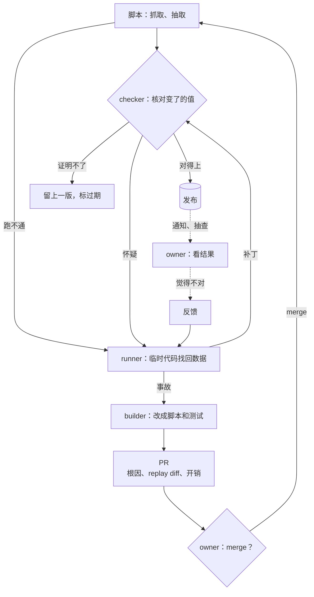
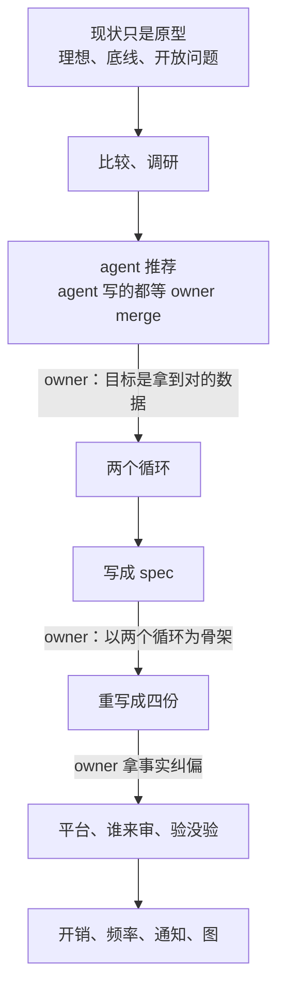

# case study：从原型谈到 spec，owner 从环里挪到环上

> 想看一次完整的设计讨论怎么谈成 spec 时读。不用每次读。这是一次真实讨论的复盘，不是规则。规则在 [design.md](design.md) 的「设计还没定：先讨论」。词表在 [SKILL.md](../SKILL.md) 和 design.md。

来源：一个活动类 App 的数据管道设计讨论，前后两天。活动、数据源、R2、GitHub Actions、Cursor 都是那个项目的。换到别的项目，换成自己的对象。

| 词 | 意思 |
| --- | --- |
| 数据循环 | 每轮自动跑，抓取、核对、发布数据。不用 owner。 |
| 代码循环 | agent 把问题改成代码，开 PR。owner merge。 |
| runner | 脚本跑不通时，用临时代码找回数据的 agent。 |
| checker | 核对变了的值的 agent。它只能怀疑，不能改。 |
| builder | 把事故改成脚本和测试、开 PR 的 agent。 |

## 结论

- 两天、十几轮，一套定时跑的抓取脚本谈成了四份 spec。
- 数据循环每轮跑，不用 owner。代码循环每天出 PR，owner merge。数据不等 owner 批准。代码不经 owner 批准不会变。
- spec 写得好，不是因为 agent 一次答对了。owner 在几个关口把它拉回来：先不许它把现状当定论；再逼它比较、查证、给推荐；推荐出来以后，owner 说清真正的目标，推翻了推荐。
- 最后 owner 在环上。目标、规则和代码都经 PR，由 owner 定。新东西收不收，由 owner 判断。owner 看通知、每周抽查、给反馈，能一键关掉 agent。owner 不逐个批准数据。

- runner、checker 那一圈是数据循环，不用 owner。
- builder、PR 那一圈是代码循环，owner merge。
- 虚线是 owner 在环上：看结果，觉得不对就反馈，不拦任何一步。

这三个 agent 现在跑在哪，不是那两天定的。见 [design.md](design.md) 的「routine 跑在哪」。

---

## 经过

### 1. 先发散

- **开题。** owner 说现在的实现只是原型，不用当定论。owner 给了三样东西：
  - 理想：不是一堆爬虫脚本，是会自愈、会演进的循环。脚本做确定的事。agent 处理意外，比如接口变了、解析失败。
  - 底线：不能失控。代码在 git 里。agent 只能写 issue 或开 PR。
  - 开放问题：定时任务跑 agent 还是跑脚本；角色怎么分。
- **先定人设。** 同一段的末尾：「you are a very knowledgable ai expert and senior engineer that can provide some solid responsible ideas.」owner 要的是懂行、敢给判断、同时负责。后来让 agent 调研时，owner 又说「do your job」：自己去做，不等 owner 一步步带着问。
- **owner 的方案也摆上桌。** owner 给了第二个方案：runner 当场修，把错和修法记进知识库；fixer 每天开一个系统性的 PR。owner 让 agent 对比两个方案。
- **要表，要调研。** owner 要一张优缺点表。owner 要 agent 查业界怎么做，看已经做成的系统和被认可的人。
- **要一条推荐和理由。** agent 推荐方案一：脚本照跑；一个只读的 debugger 查原因、写临时代码；每天一个 fixer 开 PR。agent 写的东西不经 merge 到不了用户。这一点靠权限保证，不靠 prompt。

### 2. owner 说清目标，推翻推荐

- owner 说 agent 理解错了目标。目标是拿到对的数据。数据的修复不该等 owner 批准。
- owner 说清了自己的审查值多少。范围一大，逐条审就没有用，因为审的依据全是 agent 自己的调研。owner 只用资深工程师的直觉审永久的修复，前提是附上完整的根因报告。
- owner 补了两件事：脚本成功不等于数据对，要一个 checker；用户报了错，要能马上找回对的数据，永久的修复随后再做。
- owner 要 agent 不在两个方案里挑，也不照单全收 owner 的说法。owner 又定了一次人设：「try to design using your senior engineer judgement」，和「start with basic concepts as I might know about the most state of the art pattern」。意思是：用资深工程师的判断设计，从基本概念讲起，因为 owner 不一定知道业界最新的做法。
- agent 给出两个循环，和底下七个概念：两个平面、两种速度；脚本优先，agent 兜底；先写、再审、再发；做的和核的分开；证据不是意见；agent 提议，代码裁决；owner 在环上，不在环里。agent 逐条说了改了 owner 方案的哪几处。

### 3. 写成 spec，再按模型重排

- owner 在图上改名：审计就叫 checker。fixer 和 builder 是一个角色，合并。owner 要 agent 把定时任务怎么触发画进图。owner 问成功标准记在哪、事故怎么存。owner 喜欢 agent 的一句话：「a report is a claim」。用户的报告是断言，不是证据。
- owner 说可以写 spec 了。owner 要求写上设计的核心来源、引文，和每条给了设计什么。agent 把来源和引文放进 reference，spec 只链过去。核对时，agent 改正了一条记错的引文。
- 第一版把两个循环写在一份新文件里，旧 spec 的骨架没动。owner 问为什么不以两个循环为核心。源的评级该是 builder 的子机制。builder 细节多，又有自己的 skill，该单独一份。owner 不介意整份重写。
- owner 还要把每个 PR 里的反馈原话记进 knowledge。review 和 issue 会消失，knowledge 留下。
- 重写之前，agent 用问卷问了四件要拍板的事：agent 在哪跑、状态放哪、文档怎么拆、用什么语言。agent 在哪跑这一件，owner 没选推荐的那个。结果是四份 spec，加每个数据目标一份档案。

### 4. owner 拿事实纠偏

- **agent 先怪平台。** agent 说 GitHub 的定时不准，在设计里加了一个 Cloudflare Worker 当闹钟。owner 不信：这么基础的功能不该坏，多半是配置问题，也不该为它多造一个组件。agent 重数了 39 次定时运行。主定时设在整点。GitHub 文档写明整点最挤，会推迟，会丢。每天 12 个时段只跑了 5 个。agent 把定时挪开整点，写明时区，量一周，删掉 Worker。另一处晚到还没查清，量完再说。
- **agent 把「影响用户」当成「要 owner 审」。** agent 把图片转写、地图图钉、放行记录留在 git，理由是它们决定用户看到什么。owner 说这些都是自动生成的。owner 不在环里逐条审，只在环上给反馈，和大部分数据一样。人工补的活动也算反馈。agent 改成按产出的人分：owner 和写代码的 agent 写的进 git，管道产出的进数据存储。
- **没验过的东西写成了设计。** owner 问关键的连接点验过没有、还有哪些没验。agent 把每个跨平台的连接点列成一张表：验到哪一步（实测、文档、论坛、没验）、怎么试、没过怎么办。
- **agent 在回复里派活。** owner 说要 owner 做的事先记在 spec 里，计划定了 owner 再做。

### 5. 落到能跑、养得起

- **开销分情况写。** 每个 agent 写三个数：没事时、出事时、一个月各花多少。每个数写明怎么估：token 按它要读什么、走几步估；单价用公开价；频率用一周的运行记录。以后换成实测。特别贵的源，单独写多少、为什么。
- **owner 改写了 builder 的目标：** 这个目标，用什么方法能稳定、便宜地拿到对的数据，并且验证它？输入输出固定的活，builder 改写成脚本，省下 agent 的钱。builder 写的检查，也和 runner 的补丁一样，拿存下的输入回放验证。
- **频率跟着源走。** 一年公布一次的榜单，一年问一次。
- **通知只是一段自动总结。** 出了事发一封邮件，不另造系统。通知要免费。做不到，就只看状态页。agent 把厂商的套餐名原样写进了 spec，owner 读成要多一个付费组件。其实收件人换成验证过的地址，就免费。
- **图要能读。** 两个循环、三个平台塞在一张图里，owner 的预览排成 2718 × 1815 px，看不清。agent 拆成一张总图，加每个循环一张。

---

## owner 在环上

### 定义怎么变的

| 时候 | owner 管什么 | 靠什么 |
| --- | --- | --- |
| 开题，owner 的初稿 | 所有代码改动 | agent 不能直接改代码，只能写 issue、开 PR |
| agent 的推荐 | agent 写的一切，到用户手里之前都等 merge | 权限：agent 只读，钥匙只在发布那一步 |
| owner 说清目标 | 只审永久的修复，带根因报告；数据不等 owner | 独立的 checker、值指回原文、补丁有期限 |
| agent 又收紧一次 | 转写、图钉、放行记录也要 owner 审 | 「它们决定用户看到什么」 |
| 最后 | 目标、规则、源、代码，都经 PR；收不收新源；抽查；反馈；开关 | replay diff、每周抽查、通知和状态页 |

agent 两次把 owner 往环里拉：一次在推荐里，让 agent 写的都等 merge；一次在存储上，让机器产出的数据也要 owner 审。owner 两次推回去，判据是同一条：owner 审这一步，能不能加上系统给不了的东西。

- 永久的改动合不合理，要工程直觉。新东西该不该收，要产品判断。这两处 owner 审。
- 逐个的数据值，owner 的依据只有 agent 的调研，审了也没用。这些交给独立的核对。owner 在环上看结果。

### owner 最后管的事

1. **merge 或拒掉 PR。** 先看 replay diff：把存下的输入全部重放，列出 merge 以后用户那边会变的每个值。再看开销。agent 写的报告是它自己的说法，可能很自信地错。
2. **收不收新东西。** 用户要加一个新的数据源。builder 做完整条验证，在 PR 里写一节「收录判断」：符不符合产品定位，有什么例外。比如一个不完全对口、但影响力够大的活动，也收。merge 就是收。拒掉要留一句理由，回给提的那个用户。
3. **每周抽查 5 个值。** 随机挑 agent 发布的值，打开官方页面核对，十分钟。这是唯一一处不由系统给自己打分的检查。
4. **看通知，给反馈。** 觉得不对，就走和用户同一条反馈的路。
5. **关掉。** 一个开关停掉 agent 的发布。脚本照跑。

还没到时候做的事，比如升级付费档、配权限、建 token，记在 spec 的「owner 的那一份」里。计划定了再做。

### 让它站得住的几件事

- **报告是断言，不是证据。** 用户说的、agent 说的，都要在已登记的源上找到才算。
- **每个值指回原文。** 发布的值指回它来自的原始字节。代码核对引文真在字节里。只有这一步抓得住编造。
- **做的和核的分开。** checker 新开上下文，用和 runner 不同家族的模型。checker 只能怀疑，不能改。
- **agent 提议，代码裁决。** agent 只写文件：补丁、结论、评论。发布那一步不跑模型。钥匙只在那一步。
- **补丁是临时的。** 脚本的值优先。7 天里没有 merge 正式的修复，就退回上一版，加过期标记。临时代码不能长成第二套没人审过的代码。
- **错比缺贵。** 证明不了，就留上一版。不发一个看着对的值。

### 换到别的项目

on the loop 还有一个前提：错了能被发现（有独立的核对和抽查）；能退回（有上一版）；代价有上限。前提不成立的，是动作，不是数据。这些动作 owner 留在环里：花钱、对外发布、给客户发消息、删除、改线上状态。

换一个电商类的项目：从供应商或平台同步来的商品信息、库存、竞品价格，可以走两个循环。改售价、上下架、发营销邮件，要 owner 确认。这一段是推断，那次讨论没有谈电商。

---

## 带出好 spec 的问法

按用在什么时候排。引号里是 owner 的原话。

**定人设**

- 开场定 agent 是谁：「you are a very knowledgable ai expert and senior engineer that can provide some solid responsible ideas.」懂行，敢给主意，同时负责。
- 要 agent 动手时说「do your job」：调研自己去做，不等 owner 带着问。
- 要设计时再定一次，并说清听的人是谁：「try to design using your senior engineer judgement」「start with basic concepts as I might know about the most state of the art pattern」。
- owner 也说清自己的角色：「I will only do my check using my senior engineer intuition」。agent 做判断和讲解，owner 审永久的改动。

**开局**

- 说清现状只是原型：「you don't have to take the current implementation for granted. it is a prototype.」
- 给理想、底线和开放问题，不给答案。
- owner 的方案也摆上来：「compare the two」。

**逼出判断**

- 要一张表，要调研，看做成过的系统和被认可的人：「pay attention to those who already has successes or respected opinion leader」。
- 要一条推荐和理由：「now I need a recommendation on which path to go and why?」
- 推荐不对时，说清真正的目标，和 owner 的审查在哪有用：「the goal is to get the correct data」「my review becomes meaningless as my review basis is purely based on your research」。
- 不许 agent 在给定的方案里挑，也不许照单全收，要它从基本概念讲：「dont just choose one or the other. nor take my words for granted.」

**写成 spec**

- 要来源、引文，和每条给了什么：「include the core sources/references for the design and the quotes and why you think they provide principle/examples/ideas」。
- 看结构，主模型是骨架：「为什么这个Data Pipeline的不是以两个loop为核心？」子机制细节多、有自己的读者，就单独一份。允许整份重写。

**拉回现实**

- 怀疑结论的前提：「this is pretty basic functionality that I don't believe products like github actions can fail. It should be some misconfiguration or something else.」
- 问验证：「……这些关键性的integration point你都验证过吗？还有你说的没有验证过的东西。」
- 问开销：分情况、怎么估的、哪个最贵、为什么。
- 把目标写成方法题：「这个目标，用什么方法能稳定、便宜地拿到对的数据并且验证他们？」

**管住收尾**

- 「那些需要我做的事情先存在spec里面，等计划定了我再做，别上来就给我布置任务。」
- 图看不清就拆：「你能把每个loop拆成单独的图吗，然后再用一个总图描述两个loop合作。」
