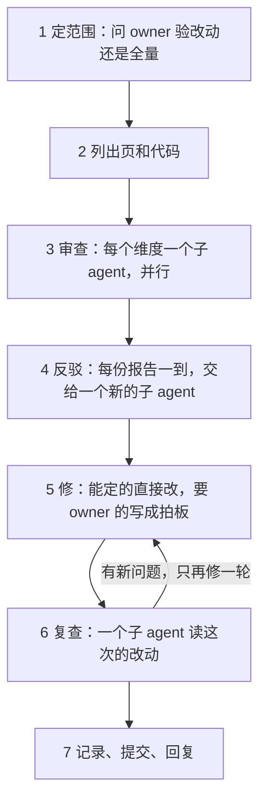

# deep-verify-knowledge：深度验证 spec 和 plan

> owner 叫 deep-verify、叫深查 spec 和 plan 时读。每次 spec review 之前（[SKILL.md](../SKILL.md) 的「owner 说『应该怎么样』」），和执行一份旧 plan 之前（[execute-plan.md](execute-plan.md)），也跑它。词表在 [SKILL.md](../SKILL.md)。

规矩是先改 spec（[SKILL.md](../SKILL.md) 的「owner 说『应该怎么样』」）。改多了，会出三种毛病：

- plan 跟不上 spec：照 plan 全做完，也到不了 spec 写的样子。
- spec 在现在的代码上做不出来。
- spec 自己前后矛盾，有技术常识的错、严重的设计问题，或该定没定的方向。

改一页时的核对（[knowledge-base.md](knowledge-base.md) 的「改了一页之后」）只看上下游的几页，看不出这些。deep-verify 开几个子 agent 深查一遍，查完自动修，页头留下标记。

## 词

| 词 | 意思 |
| --- | --- |
| 范围 | 这一次要验的页。 |
| 维度 | 一类要查的问题。一共四个，见「3 审查」。 |
| 发现 | 一个子 agent 报出的一个问题，带证据。 |
| 反驳 | 另一个子 agent 尽力证明一条发现不成立。 |
| 标记 | 页头元信息里记 deep-verify 的那一段。 |

## 流程



没有 `knowledge/index.md`，就说这个项目没有知识库，停下。

## 1 定范围

两种范围：

- **改动**：没有标记的页；标记之后改过意思的页；顺着 `index.md` 往下，建立在这些页上的页，一直到 plan。工作区里没提交的改动也算。
- **全量**：`index.md` 里所有的 spec 和 plan，加上 `knowledge/plan/` 里 issue 的 plan。reference 不验，只当证据读。

「改过意思」：写标记的那次提交之后，这一页加了或改了更新记录。只打勾、记证据、改错字和链接，不算。找写标记的那次提交（按标记上的日期找；只改了标记后面「open:」那一格的提交不算）：

```bash
git log -1 --format=%h -S'**deep-verify <标记上的日期>**' -- <页>
```

拍板改掉一个 open 的拍板时，标记只改「open:」那一格，不改日期。同一天跑了第二次 deep-verify，按 commit message 找。

每次都问 owner 验哪一种。owner 已经说了范围，就不问。

1. 一个问题，两个选项，各写有几页。有提问的工具（比如 Claude Code 的 AskUserQuestion），就用它。
2. 推荐的放第一个。下面三种情况推荐全量：没有一页的标记是全量；L1 改过；改动的页超过一半。别的情况推荐改动。
3. 改动的范围是空的：不问。说一句「都验过了，没有改动」，停下。
4. 两种范围一样（比如还没有一页有标记）：不问，验全量，回复里说一句。

从 [execute-plan.md](execute-plan.md) 来的，两种范围都只在那份 plan 和它建立在的页里。

**一个 issue 的 spec review 之前：** 半自动的 spec 改动在 main 上，先 `git pull --rebase`；全自动的在分支上，先 merge `origin/main` 进分支（不 rebase：分支已经 push 了）。范围照上面「改动」的规则（看标记），加上这个 issue 的 plan。第一轮就是这个 issue 改过的页（main 上以 `#<N>` 开头的 commit，或分支的 diff）和它们下游的页；以后几轮只是上一次 deep-verify 之后又改过意思的页。别的 issue 改过的页，标记也过期了，也在范围里。不问 owner，验改动。这时不用「没有一页的标记是全量」这一条；只有 L1 改过，才问。

## 2 列出页和代码

1. 读 `index.md`，列出范围里的页。
2. 给每页配上它建立在的页（往上直到 L1）。这些当依据读。
3. 找出 spec 说到的代码：在仓库里搜文件名、命令名、函数名、字段名。记下路径。
4. 分给子 agent：
   - 维度 C 只开一个子 agent，读范围里所有的页。为什么：矛盾常在两组页之间，拆开就看不见。
   - 别的维度，页多（超过 6 页左右）就按 `index.md` 里的组拆，每组一个子 agent。

主 agent 不把所有页读进自己的上下文。它读 `index.md` 和页头，细读交给子 agent。

## 3 审查

四个维度：

| 维度 | 查什么 |
| --- | --- |
| A plan 到得了 spec 吗 | spec 里还没做到的每一段，都有一个没勾的节点。每个「还没做」的标都指向一个开着的 issue，或一个 plan 还在 main 上、有没勾节点的 issue（spec review 之前：这个 issue 的 plan 里一个没勾的节点）。照 plan 全做完，就是 spec 写的样子：不缺一步（迁移、配置、钥匙、上线、改文档）。每条「过」真能证明 spec 那一段做到了。箭头是真的等，不缺也不多。打了 ✅ 的，代码里真有。plan 照 [spec-and-plan.md](spec-and-plan.md) 的格式写 |
| B spec 在现在的代码上做得出来吗 | 读 spec 说到的代码。spec 用到的 API、平台功能、限额，照厂商现在的文档或实测核对。跨平台的连接点写了验到哪一步。要推倒现有的结构，plan 里有这件活。钱和配额够 |
| C spec 前后一致吗 | 一页里、几页之间没有矛盾。下层不和上层冲突。一个词一个意思，一个东西一个名字。一个事实只写在一处。没有过时的事实。`index.md` 的「建立在」写对了 |
| D 设计站得住吗 | 技术常识的错：一样技术实际不是这样工作的。严重的设计问题：不可信的文字被当成指令、丢数据、并发、单点、开销失控、出了错没人知道。没解决的方向问题：一定下来就改动大片设计，却没写成「待定」或 owner 拍板。违反 L1 的原则 |

给每个子 agent 的 prompt 写齐这几样：

- 它的维度，和上表那一格。
- 范围里的页、当依据的页、相关的代码路径。
- 只读，不改文件。
- 断言之前先读到。代码给 `路径:行`。文档给链接和原文。另一页给原文。平台的说法查厂商现在的文档，不凭记忆。
- 每条发现照下面的格式写。没找到问题，就说没找到。不为凑数报。

每条发现写：

1. 页和位置，引一句原文。
2. 问题是什么。
3. 证据。
4. 多重：**挡路**（照现在的 spec 或 plan 做下去会做错）、**重要**、**小**。
5. 修法：一条建议。要 owner 拍板的，写为什么，给 2～4 个选项。

- 模型照 [SKILL.md](../SKILL.md) 的「用哪个模型」：验证 spec 那一档。
- 没有开子 agent 的工具：在会话里一个维度一个维度地查，记录里写明。

## 4 反驳

1. 一份审查的报告一到，就交给一个新的子 agent 反驳，不等别的审查。它没看过审查的过程。几份报告里重复的发现，只交给一个子 agent。
2. 它对每条发现读证据，尽力证明不成立。每条给一个结论：成立；不成立（写为什么）；拿不准。
3. 不成立的，丢掉。拿不准的，不自动修：要 owner 判断的写成拍板，别的开一个 issue。报告删掉以后，它还在 issue 里。
4. 主 agent 边收边记一份清单（放在临时目录）：每条发现的结论、谁修。第 6 步的复查和第 7 步的 commit message 都用它。

为什么：修是自动的。错的发现一修，就把对的 spec 改坏了。

## 5 修

主 agent 自己修，不交给子 agent：几处修改要互相对得上。

**直接修：**

- 小的冲突（[knowledge-base.md](knowledge-base.md) 的「两页说的不一样」）。
- spec 有、plan 没有的活：加进那件事的 plan，照 [spec-and-plan.md](spec-and-plan.md) 写节点和箭头。
- 「还没做」的标指错了或少了。箭头缺了或多了。plan 的格式。
- 打了 ✅ 却没做到的节点：去掉 ✅，写清差什么，附证据。
- 技术上的错，代码或厂商文档说明了哪个对。
- L3 里做不出来的细节，只有一个合理的改法。
- 一个设计问题，事实说明了哪个修法明显更好：照它修，写成「agent 定的（日期）：…，因为…」。
- L2 的 Why 空着：有合适的 owner 原话就填原话，写明出处。不为填它写 D。

**写成 owner 拍板（D）。** 只有方向问题写成 D（[SKILL.md](../SKILL.md) 的「拍板只问方向」）。写进那件事的 plan。还没有 plan，写进 spec 的「待定」。下面任何一种都是：

- 要改 L1。
- 和一条记下的 owner 决定矛盾。
- 几种修法在几个维度上难以取舍：产品意图、钱、能担多大的风险。
- 要花钱、要钥匙、要账号。

拍板照 [spec-and-plan.md](spec-and-plan.md) 写：先调研，给 2～4 个选项，推荐的放第一个，箭头指向它挡着的节点。几个拍板是同一件事（比如安全），图下写一句，让 owner 一起定。

**不做：** 不改代码。不做 plan 里的节点。

修完，照 [knowledge-base.md](knowledge-base.md) 的「改了一页之后」核对下游的页。

## 6 复查

1. 开一个新的子 agent，只给它这次的 diff 和对应的发现。
2. 它查两件事：每处修好了没有；有没有带进新的矛盾。
3. 有新问题，再修一轮，再复查一次。还剩的，写成拍板或写进记录。不修第三轮。

## 7 记录、提交、回复

1. **范围里的每一页写标记。** 放在元信息第一段的下面，自成一段：

   ```markdown
   > **更新 <日期>** · ……
   >
   > **deep-verify <日期>** · 全量 · 留给 owner：#<N> D4
   >
   > - <日期>：……
   ```

   - 第二格写范围：全量或改动。
   - 第三格写这一页还开着的拍板。没有，写「没有留下的问题」。
   - 英文的页写 `full` 或 `changes`，`open: #<N> D4` 或 `no open finding`。
   - 一页只有一段标记。新的一次替换旧的。
2. **改了意思的页，加一条更新记录**，以「deep-verify：」开头（[spec-and-plan.md](spec-and-plan.md) 的「开头一段元信息」）。
3. **`index.md` 里，范围里每页的「核对过」改成今天。**
4. **写报告**：`knowledge/reference/deep-verify-<日期>.md`，一次一页，只追加。为一个 issue 跑的，写 `deep-verify-<日期>-<N>.md`：几个 issue 同一天跑，名字不撞。它跟着 issue N 的 plan 走：plan 全部 ✅ 以后，发版时 `prerelease` 把两样一起删掉，指向它们的链接改成永久链接。写这几样：
   - 数：几条发现，修了几条，几条给 owner，几条不成立。
   - owner 要拍的，按先后排成一张表：节点、问题、推荐、挡着什么。
   - 最严重的几条，每条写证据。
   - 这一次实测的、查到的文档原文。spec 里用到它们的地方，链到这一页。
   - 每条发现一行：哪几个 ID、问题、结果（修了、拍板的代号、不成立）。
   - 登记进 `index.md` 的 reference 表。
   - 为什么：owner 读知识库，不读 commit。
5. **提交。** commit message 第一行写范围和数，正文链到报告。
6. **回复。** 第一句是结论：几条发现，修了几条。要 owner 拍板的，列出代号，链到报告和 plan。过程在报告里，不写进回复。从 [execute-plan.md](execute-plan.md) 来的，回去接着执行。
