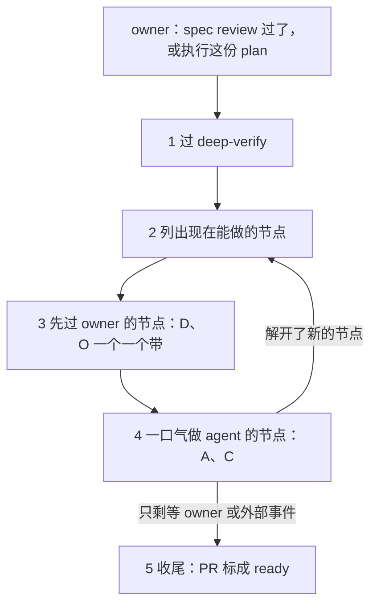

# 执行一份 plan

> owner 过了一个 issue 的最后一次 spec review 时读。owner 点名执行一份旧的 plan 或其中的节点时也读（「执行这份 plan」「做 A3」）。通用的词在 [SKILL.md](../SKILL.md)。plan 的词（节点、条目、代号）在 [spec-and-plan.md](spec-and-plan.md)。

最后一次 spec review 过了，或 owner 叫执行，agent 就带着这一轮往前走。半自动的 issue 到这时才开分支、worktree 和 draft PR（[SKILL.md](../SKILL.md)「owner 说『应该怎么样』」第 8 步）：plan 从 main 带到分支上，之后只在分支上改。agent 的节点，一口气做到打勾。轮到 owner 的，agent 一个一个带 owner 做完或定下。只有真的 dependency 才停。

## 流程

1. **过 deep-verify。** 见下一节。
2. **列出现在能做的节点。** 指向一个节点的节点都 ✅ 了，它就能做。owner 只点了一个节点，就列它和挡着它的节点。挡着它的也在这一轮里做。
3. **先过 owner 的节点。** 能做的 D、O，一个一个带 owner 过（「带 owner 拍板」「带 owner 做步骤」）。
   - 为什么：owner 刚叫执行，这时在场。owner 的事放在前面，后面 agent 的长活就不再等 owner。
4. **再一口气做 agent 的节点。** 能做的 A、C，交给子 agent 做到打勾（「agent 的节点做到底」）。图上互不等、也不改同一批文件的节点，同一条消息里各开一个子 agent 并发做（[start.md](start.md) 的「问是一件一件，做是并发」）；改同一批文件的，一个接一个。一个 M 的节点都 ✅ 了，发布也看得到了，就给 M 打勾。
5. **回到第 2 步。** 做完的节点解开了新的节点，就接着走。能做的都做完了，照 [SKILL.md](../SKILL.md) 的「说做完了之前」收尾。issue 的 plan 只剩发版和发版之后的节点，就收尾：
   1. merge `origin/main` 进分支（不 rebase：分支已经 push 了），跑测试。
   2. 发版之后的节点留在 plan 里，不开新 issue。merge 以后它们在 main 上等，`start` 会列出来。
   3. 这个 issue 做完了的部分，去掉「⬜ #N」；等发版的部分留着。
   4. 核对 plan 里每个 D 和 spec review 的回答，都写进了 spec。
   5. 给做完的节点打 ✅，plan 留着：merge 以后它在 main 上，所有节点都 ✅ 以后，下一次发版由 `prerelease` 删掉。把 PR 标成 ready，写上证据。owner merge 以后，删本地分支和 worktree。

## 过 deep-verify

1. 顺着 `index.md` 的「建立在」，找出这份 plan 和它建立在的所有页，一直到 L1。issue 的 plan 不在 `index.md` 里：它建立在这个 issue 改过的页上（main 上以 `#<N>` 开头的 commit，或分支的 diff），再顺着这些页往上找。
2. issue 的 plan：最后一次 spec review 之前跑过 deep-verify，之后没改过意思，就跳过。别的情况：每页都有 deep-verify 的标记，标记之后都没改过意思（[deep-verify-knowledge.md](deep-verify-knowledge.md) 的「1 定范围」）：跳过。回复里说一句「deep-verify 过了（日期），跳过」。
3. 不然，照 [deep-verify-knowledge.md](deep-verify-knowledge.md) 跑一遍，范围只在这些页里。它照常问 owner 验改动还是全量。
4. deep-verify 修完，再接着执行。它新加的 D，和别的 D 一样带 owner 拍板。

## 什么挡路，什么不挡

一个节点只被指向它的节点挡住。只有这三样让 agent 停下：

- 指向它的 D、O 还没做完。
- 指向它的 E 还没到。
- 半路碰到新的 dependency（「agent 的节点做到底」）。

下面这些不挡路，照做下去：

- **写代码的节点。** 写完、测试过、提交，push 到 issue 的分支，接着做下一个。不停下等 owner 看代码：owner 在 PR 里看。旧的 plan 没有 issue：照 [SKILL.md](../SKILL.md) 的「写代码的取向」，先开一个 issue 和分支。
- **没有箭头指过来的 owner 节点。** 一个 D 还开着，只挡它箭头指着的节点。别的照做。
- **检查（C）。** 它没有出去的箭头。没过就修：修是 agent 的活。修要 owner 的，加一个节点。
- **做完一个节点。** 不问「要不要继续」，不为报进度停下。回复里写一行进度，接着做。
- **半路的阻碍。** 见「agent 的节点做到底」。
- **日子。** 见 [spec-and-plan.md](spec-and-plan.md) 的「验收不等日子」。
- **不是真的等的箭头。** agent 确定后一个节点的做法不受前一个节点的结果影响，就改图：删掉箭头，图下写一句为什么。然后接着做。

## 带 owner 拍板（D）

1. 一个 D 一个问题，照 [SKILL.md](../SKILL.md) 的「怎么问 owner」：背景、一个具体场景、每个选项的后果，推荐的放第一个。
2. 背景里写：它改的是哪一条（链到 plan 那一节），它挡着哪几个节点。
3. owner 答了：在 plan 里打勾，写日期和 owner 的原话。这个决定改了 spec，就当场改 spec，加一条更新记录。
4. owner 说以后再定：留着 ⬜，接着做不被它挡的节点。

plan 里，交给 owner 的事一次交齐（[SKILL.md](../SKILL.md) 的「什么时候问 owner」）。执行时，agent 一个一个带。

## 带 owner 做步骤（O）

1. **先自己再试一次。** 权限和工具可能变了。agent 做得了，就自己做，把这个节点改成 agent 的。
2. **一次给一个 O。** 写：
   - 第一行：做什么，做完解开哪个节点。
   - agent 为什么做不了，一句。
   - 编号的步骤：网址、点哪里、填什么。值写全，能直接复制。
   - 做完的样子。
   - 做完回什么：一句「好了」，或一个不保密的值，比如一个 ID。
3. **钥匙不进对话。** 要存 token 的步骤，写明存到哪、用哪条命令。owner 自己跑。
4. **步骤要 owner 花几分钟以上，agent 不干等。** 给完步骤，接着做不被它挡的 agent 节点。这一轮结束时，再问一句做完没有。
5. **owner 回了，agent 先验。** 能查的自己查：读 API、跑检查、看页面。验过了，在 plan 里打勾，写日期和证据。验不过，说差在哪一步，给改的步骤。
6. owner 说以后再做：留着 ⬜，接着做不被它挡的节点。

## agent 的节点做到底

- **最后一次 spec review 过了（或 owner 叫执行这份旧 plan），指向它的节点都完成了，agent 就把它做到打勾。** 中途不停。spec review 没过，就不动手（[SKILL.md](../SKILL.md) 的「owner 说『应该怎么样』」）。
- **半路的阻碍先当成不是 blocker。** 能查的去查。能定的自己定。能修的修。一条路被拦了（权限、工具），换一条路，或者攒到最后一起问。
- **只有两种是新的 dependency：** 非 owner 不可的事（登录、花钱、拍板、撤不回的动作）；一个真的外部事件。
- **碰到新的 dependency，照这几步做：**
  1. 改 plan：把它加成一个节点（owner 拍板、owner 的步骤，或外部事件），给它代号，正文加一节。
  2. 在图上连好箭头。
  3. 在原来那一条下面，写清卡在哪一步。
  4. 停下被它挡住的那一部分。同一个节点里不等它的部分，照样做完。
  5. 新的 D、O，照上面带 owner 过。
- **节点拆到依赖一样。** 一个节点里有的部分等 owner、有的不等，就拆成两个节点。不等的那个先做完。
- **做完一个节点，就在 plan 里打勾、记证据、提交。** 状态在 plan 里，不只在回复里。条目怎么记，见 [spec-and-plan.md](spec-and-plan.md) 的「条目怎么记」。
