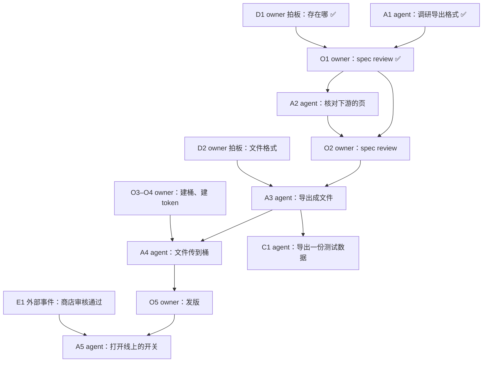

# spec 和 plan 怎么写

> owner 说一样东西应该怎么样、讨论还没定的设计，或写、改 spec 和 plan 时读。开始之前，先对照 [SKILL.md](../SKILL.md) 的「用哪个模型」。

## 词

通用的词（owner、agent、用户、spec、plan、拍板）在 [SKILL.md](../SKILL.md) 的词表里。这一页另加：

| 词 | 意思 |
| --- | --- |
| in the loop | 每一步都等 owner 批准。 |
| on the loop | owner 定规则、审永久的改动、看结果，能随时叫停，不逐步批准。 |
| routine | 一个自动跑的活：一个 skill、叫醒它的触发、跑它的平台。 |
| 节点 | plan 的依赖图里的一个框。 |
| 条目 | plan 正文里的一个勾选项。 |
| 子项 | 一个条目下面的勾选项。 |
| 代号 | 节点和条目的编号，比如 A2、O3。 |
| agent 的节点 | agent 构建的一块，交付一样能用的东西。代号 A。 |
| issue 的分支 | `issues/<N>`，挂在 issue N 上，一个 draft PR。半自动：最后一次 spec review 以后开，放代码和 `skills/` 的改动。全自动：spec、plan 和代码都在上面。 |
| spec review | owner 的一个步骤（O）：owner 读完这个 issue 的整份 spec 改动（main 上以 `#<N>` 开头的 commit）。之前先跑 deep-verify。 |
| owner 的步骤 | 只有 owner 做得了的一步，比如登录后台建一把 token。 |
| 检查 | 构建做完之后的线上验收。 |
| 外部事件 | 不由 owner 或 agent 决定的事，比如一个源发布了新数据。 |

---

# owner 说「应该怎么样」：在 main 上改 spec 和 plan

owner 在会话里说一样东西应该怎么样。agent 先照 [SKILL.md](../SKILL.md) 的同名一节，问开不开 issue。owner 说做，就在 main 上改 spec 和 plan，带 owner 做 spec review。这一节写怎么改。最后一次 spec review 过了，才开分支写代码。

1. 在 `index.md` 里找要改的 spec 页。没有合适的页，就新写一页，登记进 `index.md`（[knowledge-base.md](knowledge-base.md)）。
2. 改 spec，写应该的样子。L1、L2 的决定写「为什么」。页头加一条更新记录，写上 issue 号。
3. 还没做到的那一段，标 ⬜ 和 issue 号：「⬜ #N」。
4. 照 [knowledge-base.md](knowledge-base.md) 的「改了一页之后」，核对下游的页。要花时间的核对，可以记成 A 节点，放到下一次 spec review 前面。
5. 写这个 issue 的 plan（下面的「plan 怎么写」）。spec 和代码之间差的每一样，都写成一个节点或条目。
6. 在主目录（停在 main 上）提交，信息以 `#<N>` 开头，只带自己改的文件；`git pull --rebase`，push。回复里说改了哪几页，加链接，写下一步（比如「下一步：deep-verify，然后 O1 spec review」）。

- 规矩本身就是 spec。改 `entry` 和它的 references，或项目 `AGENTS.md` 里的规矩，也这样做：应该怎样先写进 `knowledge/spec/`；`skills/` 里的文字到写代码时在分支上改，跟代码一起 merge。只改一段的，算小改动，直接提交，当场 push。aboveloop 的规矩 merge 以后，下一版才到 owner 的会话里：告诉 owner，不替 owner 发版。
- owner 这次说的，和一条记下的 owner 决定冲突，先问一句：改那条决定，还是只这一处例外（[knowledge-base.md](knowledge-base.md) 的「两页说的不一样」）。
- owner 过了最后一次 spec review，照 [execute-plan.md](execute-plan.md) 写代码。

---

# 设计还没定：先讨论

顺序：先谈清楚，再写 spec 和 plan。改代码，等最后一次 spec review 过了。

agent 是懂行、负责的资深工程师：

- agent 给判断，并说清有几成把握。
- agent 从基本概念讲起。owner 不一定知道业界最新的做法。
- 该查的，agent 自己查。agent 不等 owner 一步步带着问。

讨论时，照这几步做：

1. 不把现在的实现当定论。它可能只是原型。
2. 把几条路放进一张表，比优缺点。查做成过的系统，查被认可的人怎么说。
3. 给一条推荐和理由。不只在 owner 给的方案里挑，也不照单全收 owner 的说法。改了 owner 方案的哪里，逐条说。
4. owner 纠正时，先对齐目标。问清 owner 要什么结果，owner 的审查在哪一步有用。然后再改设计。

## 有自动化或 agent：owner 在环里还是环上

用两条判据：

- **owner 审这一步，能不能加上系统给不了的东西？** 永久的改动合不合理、新东西该不该收，要 owner 判断。逐个的数据值，owner 的依据只有 agent 的调研，审了也没用。
- **错了能不能发现、能不能退回、代价有没有上限？** 做不到的，owner 留在环里：花钱、对外发布、删除、改线上状态。

另外三条：

- **存储按产出的人分。** owner 和写代码的 agent 写的东西，进 git，走 review。机器产出的是数据，进数据存储。「影响用户」不等于「要 owner 审」。
- **搬一个安全关卡之前，先看出错的代价和已有的关卡。** 别处的「agent 提议、代码核对后执行」，防的是 agent 的产出直接到用户手里。这里前面已经有 owner 把关，就不再加一道代码关，也不为它加部件。
- **owner 在环上时，spec 写清三件事：** owner 管哪几件事；owner 看什么（通知、抽查）；owner 怎么叫停。

## routine 跑在哪：GitHub Actions 叫醒，Cursor 云端 agent 干活

每个系统在自己的 spec 里写一节 routine：哪个 skill、谁叫醒、输入、模型、要哪些能力、多少钱、连接点验到哪。例子：aboveloop 的 [L2-loop-architecture §2](../../../knowledge/spec/L2-loop-architecture.md#2-routines)。不另开一份「所有 routine」的 spec。

- **触发只用 GitHub Actions。** 定时、手动、别的服务叫醒（`workflow_dispatch`），都写进项目里的 workflow。workflow 不用模型：它先看状态，有活才开 agent。空跑不花模型的钱。
- **干活的是 Cursor 云端 agent。** workflow 经 Cursor 的 Cloud Agents API（`POST https://api.cursor.com/v1/agents`）开 agent，一件活一个。不用 Claude routine，不用 Cursor Automation。模型照 SKILL.md 的「用哪个模型」选。
- **触发只做两件事：** 指出 skill；交出输入。输入写在 prompt 里，标成不可信的数据。skill 不写平台，不写多久跑一次。agent 从状态里找活，不靠时间窗。
- **钥匙留在 workflow 里。** agent 只拿这件活用得着的那一把，经 `envVars` 给。Cursor 的 key 不给 agent。Cursor agent 自己的 GitHub token 开不了 issue（实测 403）。agent 要写 issue，workflow 就从工作循环的 GitHub App mint 一把一小时的 token，只给这件活要的权限。不用长期的个人 token。
- **workflow 的代码只有一份。** `setup-app` 照它的 reference 文件，把工作循环的 workflow 装进每个项目。代码是 aboveloop 里的 composite action。别的系统要定时跑 agent，照这个做法。
- **结果由产生它的那一步写。** 开 issue 的那一步写齐 context（[issue-template.md](issue-template.md)）。不为写结果另加一个触发。

owner 说可以写成 spec 了，就照下一节写。一次完整的讨论在 [case-study-design-discussion.md](case-study-design-discussion.md)。不用每次读。

---

# spec 怎么写

spec 写应该怎么工作：理想中的样子。spec 分三层，文件名以层级开头；层、文件名、依赖图、改了一页之后要核对什么，见 [knowledge-base.md](knowledge-base.md)。

- **开头一段元信息。** 标题下第一段写三样：上次更新的日期；一句话说现在做到哪；最近的改动。
  - 每条改动一行，写「日期：改了什么」。新的在上，留 5 条左右。更早的看 git log。
  - 同一天或连着几天的改动，合成一条，只写最后的结果。
  - 改 spec 内容的那次提交里，同时改这一段。只改措辞、错字或链接，不用记（[knowledge-base.md](knowledge-base.md)）。
  - L1 的改动写清改了哪几条（比如 P2）。下面的页靠它找出要核对的。
  - 只写改了什么，不写经过：改名记录、迁移表、「以前叫 X」都不留。
- **deep-verify 过的页，第一段下面多一段标记。** 格式和什么时候算过期，见 [deep-verify-knowledge.md](deep-verify-knowledge.md)。
- **先放一张小流程图或一张表**，说清主路径。ER 图、文件列表放在后面。
- **先写整体行为，再写细节。**
- **原则和决定写「为什么」，不写经过。** L1、L2 的每一条，用一到三条写现在还成立的理由。怎么一步步定下来的，不写，在 git 里（[knowledge-base.md](knowledge-base.md) 的「为什么」）。
- **以主模型为骨架。** 模型变了，就整份重排。不在旧骨架旁边另开一份。子机制细节多、有自己的读者（比如一个 skill），就单独写一份。
- **一个文件讲一件事。** 把文字挪到别处时，内容不能丢。
- **spec 和代码不一样的地方，都有活。** 那一段标 ⬜ 和 issue 号（「⬜ #N」）：issue 开着，或它的 plan 还在 main 上、有没勾的节点。旧 plan 还没迁移成 issue 的，⬜ 后面写那份 plan 的名字和节点的代号（写法见下面的「引用别的 plan 的节点」）。做完了，删掉这个标。
- **owner 不要了的，从 spec 删掉。** 不另存旧档。
- **讨论的结论写进 spec。** 设计的依据写进 `knowledge/reference/`，只追加（deep-verify 的报告除外，见 L2-release §2.8）：来源、核对过的引文、每条给了设计什么（原则、做成的例子，或想法）。spec 链过去。
- **会反复跑、会花钱的，写开销。** 分三种情况写：没事时、出事时、一个月。每个数写清来源（实测、单价、假设），和以后用什么实测替换。特别贵的，单独写多少、为什么。
- **跨平台的连接点，逐个写验到哪一步：** 实测、文档、论坛、没验。没实测的，配一个可行性试验（[testing.md](testing.md)），写清没过怎么办。试验过了，后面的步骤才能依赖它。
- **有 owner 要做或要拍板的事，留一节「owner 的那一份」。** 比如花钱、开权限、建 token、还没定的选择。写清计划定了以后 owner 做什么。

```markdown
> **更新 <日期>** · 第 3 版。两个循环是骨架；agent 那一半还是设计。
>
> **deep-verify <日期>** · 全量 · 没有留下的问题
>
> - <日期>：成本改成实测；加通知一节
> - <日期>：状态页只给 owner 看
```

---

# plan 怎么写

plan 写改哪些文件、谁做、按什么顺序做。spec 和代码之间差的，都在 plan 里。owner 要做的、要拍板的，都写在 plan 里，不只写在回复里。

- plan 不写大段设计。spec 不写文件级的待办。
- plan 写明它对应哪份 spec。spec 和 plan 不写在同一个文件里。
- **一个 issue 一份 plan。** 文件名是 `plan/<N>-<几个词>.md`，比如 `plan/42-export.md`。半自动：owner 说做的时候，写在 main 上；开了代码分支以后，只在分支上改。全自动：implement 写在分支上。
  - 代号从 1 开始编。
  - 不登记进 `index.md`：这个 issue 的 spec commit（半自动）或分支的 diff（全自动）看得出它改了哪几页。
  - merge 以后它留在 main 上，做完的节点打 ✅，发版之后的节点在里面等。所有节点都 ✅ 以后，下一次发版由 `prerelease` 删掉它，指向它的链接改成永久链接。为什么写在 spec 里。
  - 几个 issue 合成一个 PR：用一个 issue 的号给分支和 plan 命名。别的 issue 下留一条评论链到 PR，PR 里每个都写一行 `Fixes`。
  - 半路发现的活属于别的事，就开一个新 issue，不塞进手上这份。
  - 共用的项目（比如 aboveloop）的 issue，可以给每个 app 一组节点，写这个 app 要做的活；app 自己的活，开在 app 自己的仓库里。
  - 为什么：一张图只画一个 issue，owner 拿图看得清它到哪了、等谁。代码一个 issue 一个分支，几个 agent 同时干活不撞。
- **依赖图 `plan/index.md`**：所有开着的活一张图，半自动统揽全局时用。只有会话里的 agent 改它，CI 不改。格式：
  - 元信息里一行 `Now:`：下一步是什么、等谁。
  - 一张 mermaid 图：节点是开着的 issue（`I47["#47 …：agent"]`）、发版（`O`）、外部事件（`E`）；箭头是真的在等。节点标上谁做。
  - 一张表：issue、下一步、谁、plan 的链接。
  - 图只存箭头、下一步和 `Now:`。issue 开着还是关了，每次从 GitHub 现读，不抄进图。
  - 谁改：`start` 每次对一遍 GitHub，新 issue 加进来，关了的拿掉；agent 开工、owner 说等或关的时候，顺手改。为什么在 [L2-loop-builder §7](../../../knowledge/spec/L2-loop-builder.md#7-the-owners-part)。
- **还没迁移的旧 plan**（一件事一份，比如 `plan/sync.md`）照旧登记在 `index.md`，照这一页的格式写，直到它的活都迁移成 issue。

## 例子

一份 plan 有三块，顺序固定：

1. 元信息（照 spec）。
2. 一张依赖图。图下几行说明。
3. 图上每个节点一节，按图上的先后排。

例子分四段写，因为代码块不嵌套（[SKILL.md](../SKILL.md) 的「代码块不嵌套」）。开头：

```markdown
# my-app #<N> plan：导出

> **更新 <日期>** · issue [#<N>](…) 的待办。spec 的改动在 main 上，commit 以 `#<N>` 开头。现在等 owner：O1 spec review。
>
> - <日期>：……
```

依赖图：



图下的说明，和每个节点一节：

```markdown
- O1 时 owner 要改两处，改完牵连别的页：A2 核对，再接 O2。
- 最后一次 spec review 是 O2。O2 过了，A3、A4 不再等 owner 叫执行。
- 导出不用桶，上传要等 O3–O4。所以拆成两个节点：A3、A4。
- 只有 A5 等发版，所以图上画了 O5。别的节点 merge 以后，跟着下一次发版走，不画。
- C1 是检查，不挡谁：它没有出去的箭头。

## A1 agent：调研导出格式 ✅

- [x] 做完的节点压成一两行（日期、commit）。

## D1 owner 拍板：存在哪 ✅

owner 定的（<日期>，「原话」）：……

## O1 owner：spec review ✅

- [x] deep-verify（<日期>，报告链接）。owner 读完，要改两处（<日期>，「原话」）。

## A2 agent：核对下游的页 ⬜

- [ ] **A2.1 ……**

## O2 owner：spec review ⬜

agent 做不了：spec 改动要 owner 认。

之前：deep-verify，范围是这个 issue 的 spec 改动（报告链接）。

- [ ] owner 读这几页：……（每页一句改了什么）。
- 做完的样子：owner 说过了，或说要改哪里。要改，就当场改，再加一个 spec review。

## D2 owner 拍板：文件格式 ⬜

改的是 A3.2 怎么做。

- **推荐：CSV。** 理由一句。
- JSON：为什么不推荐。
```

后半：

```markdown
## A3 agent：导出成文件 ⬜

- [x] **A3.1 <一件事>**（<日期>，`abc1234`，证据）
- [ ] **A3.2 导出成文件**（`src/export.ts`）。等 D2。
  - [x] 做完的子项（日期、证据）
  - [ ] 等 D2 的子项
  - 过：导出的用例在 `make test` 里通过。

## C1 agent：导出一份测试数据 ⬜

- [ ] 跑 `make export`，数文件的行数。过：和库里的行数一样。

## O3–O4 owner：建桶、建 token ⬜

agent 做不了：要 owner 的云账号登录。按顺序做。做完解开 A4。

- [ ] **O3 建桶。**
  1. 点哪里。
  2. 填什么。
  - 做完的样子：……
- [ ] **O4 建一把只能写这个桶的 token。** ……

## A4 agent：文件传到桶 ⬜

- [ ] **A4.1 上传**（`src/upload.ts`）。等 O3–O4。过：……

## O5 owner：发版 ⬜

agent 做不了：只有 owner 叫 `prerelease`。做完解开 A5。

- 做完的样子：带这个 PR 的 tag 在 origin 上。

## E1 外部事件：商店审核通过 ⬜

等什么；怎么知道到了。到了：做 A5。

## A5 agent：打开线上的开关 ⬜

- [ ] **A5.1 ……**。等 O5、E1。
```

## 依赖图和节点

- **一个节点只有一个角色、一种任务。** 不把 owner 的活和 agent 的活放进一个节点。节点分五种：

  | 任务 | 谁 | 代号 | 在图上 |
  | --- | --- | --- | --- |
  | 构建 | agent | A1、A2 | 在 |
  | 拍板 | owner | D1、D2 | 在，箭头指向等它的节点 |
  | 步骤 | owner | O1、O2 | 在，箭头指向等它的节点 |
  | 检查 | agent | C1、C2 | 在。箭头从它检查的节点来，没有出去的箭头 |
  | 外部事件 | 没有人 | E1、E2 | 在 |

  A 节点那一节里的条目，代号是节点的代号加序号：A2.1、A2.2。只有 owner 做得了的检查，用 O 代号，画进图，没有出去的箭头。
- **spec review 是 O 节点。** 一轮 spec 改动结束时放一个。指向它的节点（调研、核对、拍板）都做完，deep-verify 也跑过，才带 owner 做。owner 要改的，当场改；改动牵连的活是 A 节点，和这个 spec review 一起指向下一个 spec review。写代码的 A 节点挂在最后一个 spec review 后面。
- **发版是 O 节点**：owner 叫 `prerelease`。只在有节点要等发版时才画，比如线上的开关、新代码上线后改 label。发版之后的节点留在 plan 里，在 main 上等。最新一版（L2-release §0）包含这次 merge 了，发版节点就算做完：`start` 看得出来，做下一个节点的 agent 给它打 ✅。
  - 为什么：一次发版带走好几个 merge 了的 issue。每份 plan 都画一个发版，它们就都卡在同一个点上。
- 以前的 plan 里有 M 节点（发布、上线）。新的 plan 不用 M。
- **每个节点的标签以它的代号开头。** 标签写代号、谁、几个字的要点：「A3 agent：导出成文件」「D2 owner 拍板：文件格式」「O3–O4 owner：建桶、建 token」「O2 owner：spec review」「E1 外部事件：商店审核通过」。做完的加 ✅。
- **节点第一次出现就写全标签。** mermaid 源码里一个节点先以光秃秃的代号出现（`O15 --> C1`），有的预览就只画「C1」，后面写的标签和 ✅ 都不显示。先写带标签的那一行，再写别的箭头。
- **代号在一份 plan 里唯一。** 两个节点不用同一个代号。每种代号在整份 plan 里连续编号。代号不复用，划掉的也占着。
- **引用别的 plan 的节点，写上 issue 号或那份 plan 的名字**，比如「#<N> D2」「sync 那份 plan 的 C1」。只写「plan」和节点号，读的人不知道是哪一份。
- **一个 A 节点里有的部分等的不一样，就拆成两个 A 节点。** 每个有自己的代号。不画成「A9 的这一块」「A9 的那一块」。
- **几个 owner 步骤可以合成一个节点。** 条件：它们连着做，解开同一个节点。代号写成一段（O1–O2）。
- **箭头只画真的等。** 没有前一个，后一个就做不了，才画箭头。
- **图下几行写为什么这样排。** 写哪些看着要等、其实不等。
- 一个 A 节点里条目多、有先后，再给它一张小图。
- **图太宽，就拆成两张：做完的一张，开着的一张。** 开着的那张用 `flowchart LR`：不相连的节点竖着排。开着的节点挂在做完的节点上，就在开着的那张里再画一次那个做完的节点。

## 每个节点一节

- **图上每个节点在正文里有一节。标题就是它的标签。** 标题用 `##`，写和图上一样的代号和字。后面加 ✅（做完）或 ⬜（没做完）。owner 拿图对正文，一眼对得上。
- **正文里没有图上没有的 `##` 节。** 图上也没有正文里没有的节点。
- **节按图上的先后排。** owner 的节点（D、O）排在它挡着的那一节前面。
- **一个节点里条目多、有先后，可以再给它一张小图。** 小图上的节点，是这一节里的 `###` 小节，标题也是它的标签。
- **做完的节点压成一两行。** 细节看 git log。
- **每种节点那一节写什么：**
  1. **agent（A）。** 一个 A 节点交付一样能用的东西，能单独说「做完了」。
     - 条目的代号是 A2.1 这样。每条写：做什么（路径、做法、命令）；怎样算过。条目多，就按主题分 `###` 小节。
     - 检查不写在这一节里。它们是 C 节点（第 4 条）。构建做完，A 节点就打勾。
  2. **owner 拍板（D）。**
     - 写：改的是哪一条；推荐的放第一个；另外几条为什么不推荐。
     - 拍板之前，agent 先自己调研。agent 能定的，不放进来。
     - owner 定了，就打勾，写日期和 owner 的原话。
  3. **owner 的步骤（O）。**
     - 写：agent 为什么做不了（一句）；按要做的顺序，每步点哪里、填什么；做完的样子；解开哪一节。
     - 不只写「步骤见 spec 某节」。
     - 放进来之前，agent 先自己做一遍（[SKILL.md](../SKILL.md) 的「什么时候问 owner」）。
     - 只有 owner 做得了的检查，也是 O。写一句 agent 为什么做不了。它在图上，没有出去的箭头。
     - spec review 写：deep-verify 的报告；要 owner 读的几页，每页一句改了什么；还开着的 D。owner 说完，打勾，写日期和原话。
  4. **检查（C）。** 构建和 owner 的步骤做完之后的线上验收。
     - agent 做：跑命令、触发 workflow、看页面、读日志。每条写跑什么、看什么、怎样算过。
     - 一个节点的几项检查合成一个 C 节点，代号写成一段（C1–C3）。箭头从它检查的那个节点来。它没有出去的箭头：检查不挡谁。
     - 它和被检查的节点各自打勾：构建做完，A 节点就打勾；检查节点等它的条目全打勾。
  5. **外部事件（E）。** 写：等什么；怎么知道到了；到了做什么。系统能自己报出来的，写明谁报。
- **英文的 plan** 的标签用 Agent、Owner decides、Owner、Event，比如 `A2 Agent: export to a file`、`O2 Owner: spec review`。

## 条目怎么记

- **没做完的条目拆成子项，分别打勾。** 做完的子项写日期和证据。没做完的写等谁：agent、owner，或哪个外部事件。子项全勾完，条目才打勾。
- **不做了的划掉，不删。** 写成 `- [x] ~~**O2 …**~~ 不用做了（日期）：理由`。
- **验收不等日子。** 写着「满一周」「等到某日」的，先拿手上的数据量。量过了就打勾，把日子删掉。只有真的外部事件才留作等待，比如源还没发布、第一次真出事。写明等什么，让系统自己报出来。不靠日历，也不建定时任务等日子。
