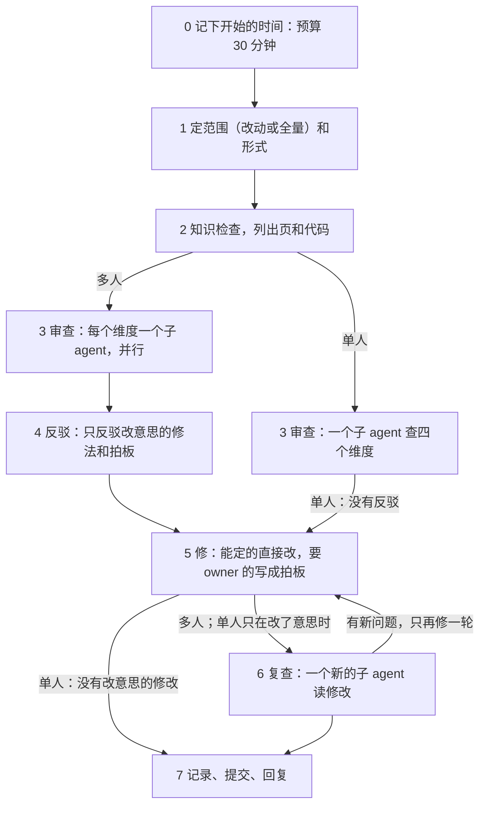

# deep-verify-knowledge：深度验证 spec 和 plan

> owner 叫 deep-verify、叫深查 spec 和 plan 时读。这些时候也跑它：重的 spec 那一步写完草稿以后（`builder` 的 [spec.md](../../builder/references/spec.md) 3.3）：CI 里照常跑；会话里，它是每次 spec review 前面一个固定的节点，在后台跑，不先问 owner（spec.md 6.2）。CI 里照最后一节「CI 里的 deep-verify」做。词表在 [entry 的 SKILL.md](../../entry/SKILL.md)。

规矩是先改 spec（[entry 的 SKILL.md](../../entry/SKILL.md) 的「owner 说『应该怎么样』」）。改多了，会出三种毛病：

- plan 跟不上 spec：照 plan 全做完，也到不了 spec 写的样子。
- spec 在现在的代码上做不出来。
- spec 自己前后矛盾，有技术常识的错、严重的设计问题，或该定没定的方向。

改一页时的核对（[knowledge-base.md](knowledge-base.md) 的「改了一页之后」）只看上下游的几页，看不出这些。deep-verify 开子 agent 深查一遍，查完自动修，页头留下标记。

## 词

| 词 | 意思 |
| --- | --- |
| 范围 | 这一次要验的页。 |
| 维度 | 一类要查的问题。一共四个，见「3 审查」。 |
| 发现 | 一个子 agent 报出的一个问题，带证据。 |
| 反驳 | 另一个子 agent 尽力证明一条发现不成立。 |
| 标记 | 页头元信息里记 deep-verify 的那一段。 |
| 形式 | 一次 deep-verify 怎么跑。两种：多人、单人，见「两种形式」。形式不是范围：两种形式都能验全量，也能验改动。 |
| 多人 | 每个维度有审查的子 agent（C 只开一个），有反驳，有复查。 |
| 单人 | 一个子 agent 查全部四个维度，没有反驳。修改了意思，才有一次短的复查。 |
| 规模档 | 定第一轮用哪种形式的规矩，见「1 定范围」。 |
| 小发现 | 修了不改意思，也不改节点、箭头和拍板的发现，见「3 审查」。 |
| 知识检查 | 一个脚本，只查几样事的形式，见「2 知识检查，列出页和代码」。 |
| knowledge 目录 | `knowledge` 的 `SKILL.md` 所在的目录。这一页在它的 `references/` 里。 |

## 两种形式

deep-verify 有两种形式：多人、单人。先在第 1 步定范围（全量或改动），再定形式。

| 步骤 | 多人 | 单人 |
| --- | --- | --- |
| 3 审查 | 每个维度有审查的子 agent，并行。C 只开一个。页多，别的维度按组拆 | 一个子 agent 查四个维度。不按组拆 |
| 4 反驳 | 只反驳两类发现：修了改意思的，要写成拍板的 | 没有 |
| 5 修 | 主 agent 修 | 主 agent 修 |
| 6 复查 | 一个新的子 agent 读这次的修改 | 只在修改了意思时有，只读这些修改，只一次 |
| 7 记录 | 写一份报告 | 往今天的报告追加一小节 |

哪种情况用哪种：

- 一个 issue 的第一次 deep-verify：照「1 定范围」的规模档。草稿写完就在后台开始（spec.md 6.2）。
- 以后几轮：都用单人。改到 L1 或 L2，也用单人。
- 以后几轮，上一次 deep-verify 之后 L1 改过，验全量：还是单人（owner 定的）。
- owner 在 spec review 以外叫的 deep-verify：照规模档。

- 为什么：开销。每次都跑多人，deep-verify 跑得太勤，每次几十分钟。测过：一次多人的 deep-verify 跑 33～65 分钟（照 commit 的时间）。owner 每次都等。
  - 挡路的发现很少。测过的三轮多人：15 条里 1 条，33 条里 1 条，32 条里 0 条。
  - 反驳丢掉的也少。测过的两轮多人：15 条里 1 条，32 条里 3 条。
  - 以后几轮的 diff 小，一个子 agent 够了。

## 流程



没有 `knowledge/index.md`，就说这个项目没有知识库，停下。

## 0 预算：30 分钟

每一次 deep-verify，会话里和 CI 里都一样，从开始起 30 分钟（墙上的时间）。

1. 开始时记下时间。
2. 一个角色（一个审查、一个反驳、复查）只在它能在第 30 分钟之前交回时才开始。子 agent 做的角色和自己做的角色（没有子 agent 时）都守这一条。
3. 第 30 分钟以后，不开始任何角色。
4. 然后修成立的发现（第 5 步），写记录（第 7 步）。这两步在第 30 分钟以后做。
5. 到第 30 分钟还没有反驳的发现，算没验过，不修。这说的是多人的发现：它该去反驳（第 4 步），预算砍掉了它的反驳。照第 4 步拿不准的发现处理：会话里，要 owner 判断的写成拍板，别的开一个 issue；CI 里，写进 plan 的记录和 PR 的 Not verified。CI 里，deep-verify 这个节点这时就算做完，接着往下做。
   - 单人的发现本来没有反驳，不归这一条：会话里照第 4 步的「单人没有反驳」；CI 里照「CI 里的 deep-verify」（[L2-loop-builder §7](../../../knowledge/spec/L2-loop-builder.md#7-the-owners-part)）。

- 为什么：owner 每次都等 deep-verify。预算定在 30 分钟以内，它就不再一跑几十分钟。

## 1 定范围

两种范围：

- **改动**：没有标记的页；标记之后改过意思的页；顺着 `index.md` 往下，建立在这些页上的页，一直到 plan。工作区里没提交的改动也算；spec review 之前的那一次不算：它只验那个固定的 commit（下面「一个 issue 的 spec review 之前」第 0 条）。
- **全量**：`index.md` 里所有的 spec 和 plan，加上 `knowledge/plan/` 里 issue 的 plan。reference 不验，只当证据读。

「改过意思」：写标记的那次提交之后，这一页加了或改了更新记录。只打勾、记证据、改错字和链接，不算。找写标记的那次提交（按标记上的日期找；只改了标记后面「open:」那一格的提交不算）：

```bash
git log -1 --format=%h -S'**deep-verify <标记上的日期>**' -- <页>
```

拍板改掉一个 open 的拍板时，标记只改「open:」那一格，不改日期。同一天跑了第二次 deep-verify，按 commit message 找。

每次都问 owner 验哪一种。owner 已经说了范围，就不问。

1. 一个问题，两个选项，各写有几页。有提问的工具（比如 Claude Code 的 AskUserQuestion），就用它。
2. 推荐的放第一个。下面三种情况推荐全量：没有一页的标记是全量；L1 改过；改动的页超过一半。别的情况推荐改动。
3. 改动的范围是空的：不问。说一句「都验过了，没有改动」，停下。
4. 两种范围一样（比如还没有一页有标记）：不问，验全量，回复里说一句。

**规模档：** 定一个 issue 第一轮用哪种形式（「两种形式」）。

- 这个 issue 改过的 spec 页不超过 3 页，而且都是 L3：单人。
- 改到 L1 或 L2，或超过 3 页：多人。
- 这些算 L2：`skills/` 里的一条规矩；plan 里一个要改 `skills/` 规矩的节点；文件名没有层级的 spec 页。
- 只数这个 issue 改过的 spec 页。plan、依赖图和下游的页不数：一个子 agent 反正要读它们。
- 别的 issue 的页，标记过期了，还在范围里，但不数。为什么：规模档量的是这个 issue 的改动。
- 不是为一个 issue 跑的（owner 另叫的）：数范围里的 spec 页。

**一个 issue 的 spec review 之前：**

0. 不问 owner。会话里它在后台跑，验一个固定的 commit；跑的时候 owner 可以接着改。第 5 步在最新的 spec 上修：一条发现落在那个 commit 之后改过的行上，先对着现在的字再验一遍（spec.md 6.2）。
   - 主 agent 记下那个 commit，写进报告。审查的子 agent 读它，不读工作区：主 agent 先开一个它的 detached worktree（`git worktree add --detach <临时目录> <sha>`），知识检查也在那里跑；第 7 步以后删掉。
   - 「上一次 deep-verify 之后」从它记下的那个 commit 算，不从写标记的那次提交算：跑的时候改的，进下一次的范围。它自己的修改不算。
1. 先同步。两种模式的 spec 改动都在 issue 的分支上：先 merge `origin/main` 进分支。不 rebase：分支已经 push 了。
2. 不问 owner，验改动。这时不用「没有一页的标记是全量」这一条。
3. 上一次 deep-verify 之后 L1 改过（一个 issue 的第一次：L1 的标记之后）：验全量，不问 owner。

范围都加上这个 issue 的 plan：

- 第一轮照上面「改动」的规则（看标记）：这个 issue 改过的页（分支的 diff），和它们下游的页。形式照规模档。
- 以后几轮用单人。范围是上一次 deep-verify 之后的 diff（从它记下的 commit 算），和直接建立在改过的页上的页（只往下一层）。不按组拆。
- 别的 issue 改过的页，标记也过期了，也在范围里。

## 2 知识检查，列出页和代码

1. 先跑知识检查：

   ```bash
   node --experimental-strip-types --no-warnings <knowledge 目录>/scripts/knowledge-check.ts --cwd <项目根>
   ```

   - 它只查形式（[L2-loop-builder §7](../../../knowledge/spec/L2-loop-builder.md#7-the-owners-part)）。要判断的，留给审查的子 agent（「3 审查」）。
   - 它查四样：
     - 相对链接的锚点在目标文件里。
     - `index.md`「建立在」里的名字是表里的页，层级不比这一页低。
     - spec 里每个「⬜ #N」的 issue 开着，或它的 plan 还有没勾的节点。
     - plan 里标题的 ✅ 和它的条目、图里的标签对得上。
   - 它打两种行：`problem` 和 `question`。有 `problem`，它的退出码是 1。deep-verify 照样往下走。
   - 读不到一个 issue 的状态（没登录、没网），它打「could not read #N」。这不算 `problem`。
   - 它的输出原样给每个审查的子 agent，当作事实（「3 审查」）。
   - `problem` 由主 agent 修，和小发现一批修（「5 修」）。
   - `question` 交给审查的子 agent 判断。
2. 读 `index.md`，列出范围里的页。
3. 给每页配上它建立在的页（往上直到 L1）。这些当依据读。
4. 找出 spec 说到的代码：在仓库里搜文件名、命令名、函数名、字段名。记下路径。
5. 分给子 agent：
   - 维度 C 只开一个子 agent，读范围里所有的页。为什么：矛盾常在两组页之间，拆开就看不见。
   - 别的维度，页多（超过 6 页左右）就按 `index.md` 里的组拆，每组一个子 agent。

主 agent 不把所有页读进自己的上下文。它读 `index.md` 和页头，细读交给子 agent。

## 3 审查

四个维度：

| 维度 | 查什么 |
| --- | --- |
| A plan 到得了 spec 吗 | spec 里还没做到的每一段，都有一个「还没做」的标，和一个没勾的节点（spec review 之前：这个 issue 的 plan 里一个没勾的节点）。照 plan 全做完，就是 spec 写的样子：不缺一步（迁移、配置、钥匙、上线、改文档）。每条「过」真能证明 spec 那一段做到了。箭头是真的等，不缺也不多。打了 ✅ 的，代码里真有。plan 照 [spec-and-plan.md](spec-and-plan.md) 的格式写。形式由知识检查查（「2 知识检查，列出页和代码」）：标指向的 issue 开着或它的 plan 有没勾的节点，标题的 ✅ 和条目、图里的标签对得上。不重查 |
| B spec 在现在的代码上做得出来吗 | 读 spec 说到的代码。spec 用到的 API、平台功能、限额，照厂商现在的文档或实测核对。跨平台的连接点写了验到哪一步。要推倒现有的结构，plan 里有这件活。钱和配额够 |
| C spec 前后一致吗 | 一页里、几页之间没有矛盾。下层不和上层冲突。一个词一个意思，一个东西一个名字。一个事实只写在一处。没有过时的事实。`index.md` 的「建立在」写全了、写对了：每页真建立在写的那几页上，一页不缺。形式由知识检查查（「2 知识检查，列出页和代码」）：链接的锚点在，名字是表里的页，层级不比这一页低。不重查 |
| D 设计站得住吗 | 技术常识的错：一样技术实际不是这样工作的。严重的设计问题：不可信的文字被当成指令、丢数据、并发、单点、开销失控、出了错没人知道。没解决的方向问题：一定下来就改动大片设计，却没写成「待定」或 owner 拍板。违反 L1 的原则 |

给每个子 agent 的 prompt 写齐这几样：

- 它的维度，和上表那一格。单人：四个维度，和上表四格。
- 范围里的页、当依据的页、相关的代码路径。
- 知识检查的输出，当作事实。它打出的 `problem` 不再报。`question` 由子 agent 判断：是问题，就照下面的格式报。
- 只读，不改文件。
- 断言之前先读到。代码给 `路径:行`。文档给链接和原文。另一页给原文。平台的说法查厂商现在的文档，不凭记忆。
- 每条发现照下面的格式写。没找到问题，就说没找到。不为凑数报。

每条发现写：

1. 页和位置，引一句原文。
2. 问题是什么。
3. 证据。
4. 轻重：**挡路**（照现在的 spec 或 plan 做下去会做错）、**重要**、**小**。
5. 修法：一条建议。要 owner 拍板的，写为什么，给 2～4 个选项。

**小发现：** 修了不改意思，也不改节点、箭头和拍板。

- 「改意思」照「1 定范围」的「改过意思」：这次修要给那一页加或改一条更新记录。
- 修了改意思的，或要写成拍板的，至少算重要。主 agent 在第 4 步分类时改过来。
- 为什么：不然只凭审查的子 agent 定的轻重，决定哪条修法去反驳。
- 小发现不去反驳（第 4 步）。主 agent 一批修，或不修（第 5 步）。报告只写数（第 7 步）。

- 模型照 [entry 的 SKILL.md](../../entry/SKILL.md) 的「用哪个模型」：验证 spec 那一档。两种形式都用这一档。
- 没有开子 agent 的工具：在会话里一个维度一个维度地查，记录里写明。

## 4 反驳

只有多人有反驳。单人见本节最后。

1. 一份审查的报告一到，主 agent 就按每条发现提的修法分类：
   - 修了改意思：去反驳。
   - 要写成拍板（D）：去反驳。
   - 别的（错字、链接、标记、日期）：不反驳，第 5 步修。
   - 小发现都落在「别的」里：不反驳。
2. 去反驳的，交给一个新的子 agent，不等别的审查。它没看过审查的过程。几份报告里重复的发现，只交给一个子 agent。
3. 它对每条发现读证据，尽力证明不成立。每条给一个结论：成立；不成立（写为什么）；拿不准。
4. 不成立的，丢掉。拿不准的，不自动修：要 owner 判断的写成拍板，别的开一个 issue。报告删掉以后，它还在 issue 里。
5. 主 agent 边收边记一份清单（放在临时目录）：每条发现的类、结论、谁修。第 6 步的复查和第 7 步的 commit message 都用它。

为什么：修是自动的。错的发现一修，就把对的 spec 改坏了。只有改意思的修法和拍板会改坏 spec，所以只反驳这两类。

**单人没有反驳。** 要写成拍板的发现，也没有反驳（owner 定的）。

- 主 agent 照样分类，照样记清单。
- 写一个拍板之前，主 agent 自己读那条发现的证据。证据撑不住，就丢掉，记进清单。
- 改了意思的修改，由第 6 步的复查再看一遍。

## 5 修

主 agent 自己修，不交给别的子 agent：几处修改要互相对得上。会话里，spec review 之前的那一次，「主 agent」是一个修的子 agent：别的子 agent 不在改这个 issue 的 spec 和 plan 时才开始，在最新的 spec 上修，第 6 步（只开复查的子 agent）和第 7 步也是它做；会话的主 agent commit（[L2-loop-dev §3](../../../knowledge/spec/L2-loop-dev.md#3-the-session-entry)：一个 worktree 一个写的人）。

**直接修：**

- 小的冲突（[knowledge-base.md](knowledge-base.md) 的「两页说的不一样」）。
- spec 有、plan 没有的活：加进那件事的 plan，照 [spec-and-plan.md](spec-and-plan.md) 写节点和箭头。
- 「还没做」的标指错了或少了。箭头缺了或多了。plan 的格式。
- 打了 ✅ 却没做到的节点：去掉 ✅，写清差什么，附证据。
- 技术上的错，代码或厂商文档说明了哪个对。
- L3 里做不出来的细节，只有一个合理的改法。
- 一个设计问题，事实说明了哪个修法明显更好：照它修，写成「agent 定的（日期）：…，因为…」。
- L2 的 Why 空着：有合适的 owner 原话就填原话，写明出处。不为填它写 D。

**小发现：** 主 agent 攒成一批，一次修完。不值得修的（比如只差措辞），不修。

- 知识检查打出的 `problem`（第 2 步）也在这一批里修，都修。
- 其中修了要改意思的，不算小发现，照第 4 步分类。

**写成 owner 拍板（D）。** 只有方向问题写成 D（[entry 的 SKILL.md](../../entry/SKILL.md) 的「拍板只问方向」）。写进那件事的 plan。还没有 plan，写进 spec 的「待定」。下面任何一种都是：

- 要改 L1。
- 和一条记下的 owner 决定矛盾。
- 几种修法在几个维度上难以取舍：产品意图、钱、能担多大的风险。
- 要花钱、要钥匙、要账号。

拍板照 [spec-and-plan.md](spec-and-plan.md) 写：先调研，给 2～4 个选项，推荐的放第一个，箭头指向它挡着的节点。几个拍板是同一件事（比如安全），图下写一句，让 owner 一起定。

**不做：** 不改代码。不做 plan 里的节点。

修完，照 [knowledge-base.md](knowledge-base.md) 的「改了一页之后」核对下游的页。

## 6 复查

**多人：**

1. 开一个新的子 agent，只给它这次的 diff 和对应的发现。
2. 它查两件事：每处修好了没有；有没有带进新的矛盾。
3. 有新问题，再修一轮，再复查一次。不修第三轮。还剩的，照本节最后一段处理。

**单人：** 复查短一些。

1. 没有一处修改改了意思：不复查，到第 7 步。
2. 有：开一个新的子 agent，只给它改了意思的修改和对应的发现。
3. 它查同样两件事。
4. 有新问题，再修一轮，不再复查。还剩的，照本节最后一段处理。

为什么：单人没有反驳。不复查，一处修错就到了 owner 面前，或进了代码。

**两种形式：复查查出的问题，照第 3 步分轻重。** 报告里写法和发现一样（第 7 步），规矩在 [L2-loop-builder §7](../../../knowledge/spec/L2-loop-builder.md#7-the-owners-part)：只有挡路和重要的进报告。

- 挡路和重要的：报告里每条一行。最后一轮还剩的，写成拍板，或在报告里那一行写明没修。
- 小的：报告里只给数。最后一轮还剩的，写进这个 issue 的 plan，deep-verify 节点下面，每条一行。不是为一个 issue 跑的，没有 plan：只给数。
- 修好了的小问题：哪里都不写一行，只算进数。

## 7 记录、提交、回复

1. **范围里的每一页写标记。** 放在元信息第一段的下面，自成一段：

   ```markdown
   > **更新 <日期>** · ……
   >
   > **deep-verify <日期>** · 全量 · 留给 owner：#<N> D4
   >
   > - <日期>：……
   ```

   - 第二格写范围：全量或改动。不写形式：两种形式都照范围写。
   - 第三格写这一页还开着的拍板。没有，写「没有留下的问题」。
   - 英文的页写 `full` 或 `changes`，`open: #<N> D4` 或 `no open finding`。
   - 一页只有一段标记。新的一次替换旧的。
2. **改了意思的页，加一条更新记录**，以「deep-verify：」开头（[spec-and-plan.md](spec-and-plan.md) 的「开头一段元信息」）。
3. **`index.md` 里，范围里每页的「核对过」改成今天。**
4. **写报告**：`knowledge/reference/deep-verify-<日期>.md`，一次一页，只追加。为一个 issue 跑的，写 `deep-verify-<日期>-<N>.md`：几个 issue 同一天跑，名字不撞。它跟着 issue N 的 plan 走：plan 全部 ✅ 以后，发版时 `prerelease` 把两样一起删掉，指向它们的链接改成永久链接。多人写这几样：
   - 数：几条发现，修了几条，几条给 owner，几条不成立。小发现几条，修了几条。复查查出几个问题，其中小的几个。
   - owner 要拍的，按先后排成一张表：节点、问题、推荐、挡着什么。
   - 最严重的几条，每条写证据。
   - 这一次实测的、查到的文档原文。spec 里用到它们的地方，链到这一页。
   - 每条挡路和重要的发现一行：哪几个 ID、问题、结果（修了、拍板的代号、不成立）。复查查出的挡路和重要的问题也一样。
   - 小发现和复查的小问题不逐条列：只给数，可以带上 ID，不写每条的问题和修法。最后一轮还剩的小问题，每条一行写在 plan 里（第 6 步）。
   - 登记进 `index.md` 的 reference 表。
   - 为什么：owner 读知识库，不读 commit。
   - **单人**往今天那份报告的末尾追加一小节：数、挡路和重要的发现、拍板的代号。小发现和复查的小问题也只给数，和多人一样。
   - 今天还没有那份报告（比如换了一天）：新建一份，只写这一小节，登记进 reference 表。
5. **提交。** commit message 第一行写形式（多人或单人）、范围和数，正文链到报告。
6. **回复。** 第一句是结论：几条发现，修了几条。要 owner 拍板的，列出代号，链到报告和 plan。过程在报告里，不写进回复。

## CI 里的 deep-verify

CI 里，implement 那一轮做重的 spec 时跑 deep-verify（`builder` 的 [spec.md](../../builder/references/spec.md) 3.3）。没有 owner，所以上面几步这样改：

- **不问 owner。** 范围是这个 issue 改过的页和它的 plan，验改动。
- **拿不准的发现，和别的 issue 的页上的发现，** 写进 PR 的 Not verified，不开 issue。
- **一个拍板（方向问题）**：照 `builder` 的 [implement.md](../../builder/references/implement.md) 第 4 步停（第 1 种）。要改 L1 或 L2 的内容才修得了：停（第 2 种）。
- **记录**是 plan 里 deep-verify 节点下面的一节，不写 `knowledge/reference/` 的报告。记录原样留下每个角色交回的报告，带它的 id：平台给的 agent ID；没有，就是调用的顺序。
- **标记**只写在这一轮改过的页上。
- **项目还没分层**（`knowledge/spec/` 里没有分层的页）：只验 plan，用维度 A 和 B。
- **形式**照「两种形式」。第一次验重的 spec，照规模档（「1 定范围」）。deep-verify 之后又改了（spec.md 3.5），用单人。单人的发现没有反驳，所以只修代码、厂商文档或定死的规矩说清了的，别的写进 Not verified（[L2-loop-builder §7](../../../knowledge/spec/L2-loop-builder.md#7-the-owners-part)）。
- **每个角色是本轮 subagent `deep-verify` 的一次新调用。** 不 resume 以前的调用。
  - 多人：每个维度的审查、每个反驳（第 4 步）、复查（第 6 步），各一次。审查并行跑。
  - 单人：一次调用查四个维度；复查（第 6 步，只在改了意思时）一次。
- **一个角色的 prompt** 写清角色、范围、路径，和它要的 GitHub 事实（仓库、issue 号、分支）。不引 GitHub 上的任何字。
- **开不了 subagent**：写草稿的那一轮不验自己的草稿，结束；下一轮把角色交给 subagent。下一轮也开不了：一个角色接一个角色自己做，只修代码、厂商文档或定死的规矩说清了的发现，Not verified 里写「review, rebuttal and second look by one agent」。
- **deep-verify 之后又改了**（spec.md 3.5）：同一轮里给这次改动开新的调用。开不了 subagent：同一条规矩，自己再过一遍。
