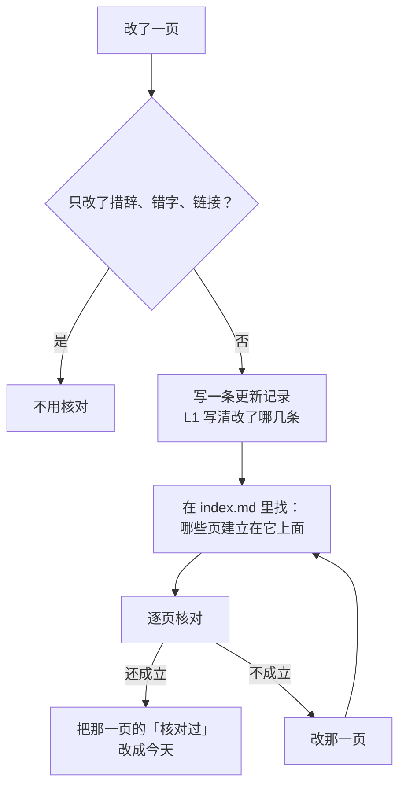

# 知识库

> 读、写 `<项目根>/knowledge/` 时读。给新项目建知识库时读。改了一页、要核对别的页时读。两页说的不一样时读。词表在 [entry 的 SKILL.md](../../entry/SKILL.md)。

知识库在 `<项目根>/knowledge/`。下文的 `knowledge/…` 都指这里，不指 aboveloop 自己的目录。知识库是产品、架构、决策的真相。代码对不对，拿它判。

**不凭记忆编。** owner 问到产品、优先级、数据形状、当初为什么这样定，agent 去读，不猜。读不到，就说读不到。

## 词

| 词 | 意思 |
| --- | --- |
| 层 | spec 的三级：L1、L2、L3。plan 和 reference 不分层。 |
| 上层、下层 | L1 比 L2 上，L2 比 L3 上。 |
| 建立在 | 一页的内容从哪几页来。写在 `index.md` 的表里。 |
| 核对 | 拿一页对着它建立在的页读一遍，看它还成不成立。 |

## 目录

```
knowledge/
  index.md          ← 目录，也是唯一的依赖图。必须有。每加一页都更新它
  spec/             ← 应该怎么工作：理想中的样子。文件名以层级开头
    L1-….md
    L2-….md
    L3-….md
  plan/             ← 还要做什么、谁做、按什么顺序。index.md 是所有开着的活的依赖图，做完的打 ✅，发版时删。一个 issue 一份（42-export.md）：先在 issue 的分支上，merge 以后在 main 上；全部 ✅ 以后发版时删掉。不登记。不分层
  reference/        ← 实测、调研、原件。只追加，不改写成 spec。例外：deep-verify 的报告跟着它的 issue 的 plan 走，plan 全部 ✅ 以后发版时一起删掉，链接改成永久链接（L2-release §2.8）。不分层
```

用户的反馈不进知识库：它开成 issue（[issue-template.md](../../entry/references/issue-template.md)）。owner 的反馈当场记进 issue，或手上这个 issue 的 spec 和 plan（[feedback.md](../../entry/references/feedback.md)）。

`index.md` 是唯一的入口。它列出这里有哪些页、每页写什么、建立在哪几页上。

## 三层

| 层 | 放什么 | 谁改 |
| --- | --- | --- |
| L1 | 为什么做、给谁做、原则、硬约束。比如用户是谁、产品原则、工程原则、定位 | 只有 owner。agent 想改，写成 plan 里的 owner 拍板 |
| L2 | 关键的决定和用户故事。比如用户旅程、架构选型、每个 loop 定了什么 | agent 照 owner 定过的写。不自己发明决定 |
| L3 | 具体怎么工作。比如每一屏、数据契约、服务器的接口 | agent |

- 一页通常一屏。不设行数上限。
- L1 每次会话都读，所以写得短、写得准。
- 每条原则编号（P1、E1），别的页引用编号，不抄原文。抄的一份，原文一改就错。

## 文件名

`L<层>-<组>[-<题目>].md`。

- **同一组的页挨着排。** 组名放在层级后面的第一个词。比如 `L2-loops.md`（几个 loop 共有的）、`L2-loop-dev.md`（dev loop）、`L2-loop-builder.md`；`L2-sync.md`、`L3-sync-checker.md`。
- **同一件事，各层用同一个名字。** 比如 `L2-loop-builder.md` 和 `L3-loop-builder.md`。
- **没有更合适的组，就用领域当组名。** 领域只有两个：`prod`、`eng`。比如 `L1-prod-user-profile.md`、`L2-prod-positioning.md`。
- 产品和工程分得清，才拆成两页。不为了填名字硬拆。
- 一页换了层或组，就改名。同一次提交里改掉所有链接。

## 为什么

- **L1、L2 的每条原则和决定都写「为什么」。** 一到三条，写现在还成立的理由。
- **不写经过。** 怎么一步步改过来的，在 git 里。更新记录只留最近几条（[spec-and-plan.md](spec-and-plan.md)）。
- owner 的原话，只在它就是理由时写进来。
- L3 写具体怎么工作。有用的理由可以写，不强求。

理由写下来，是为了以后改的时候知道：这条原则撑着哪些决定。理由不成立了，这条就该重新看。

## 依赖图：`index.md` 里的一张表

| 页 | 写什么 | 建立在 | 核对过 |
| --- | --- | --- | --- |
| `spec/L1-foundation.md` | … | — | — |
| `spec/L2-loops.md` | … | L1-foundation（P1、P4） | <日期> |
| `spec/L3-loop-builder.md` | … | L2-loop-builder、L2-loop-untrusted-text（R13–R15） | <日期> |

- 每页一行。每份里程碑的 plan 也有一行：spec 一改，plan 可能要跟着改。issue 的 plan 不登记：它建立在这个 issue 改过的页上（它的 PR 的 diff）。依赖图 `plan/index.md` 也不登记。reference 没有。
- 「建立在」写页名。引用上层的编号时，括号里写编号。
- 一页只能建立在同层或上层的页上，不成环。两页互相要用到对方，定规矩的那页在上游，另一页只链过去。
- 「核对过」是这页最后一次对着它建立在的页核对的日期。
- 一页算「过期」：它建立在的页，最新一条更新记录比它的「核对过」新。

## 改了一页之后



1. 改 L1 之前，先要 owner 拍板。
2. 只改措辞、错字、链接，不算改。不加更新记录，也不核对下面的页。
3. 改了意思，就在那一页的开头加一条更新记录。L1 的记录写清改了哪几条（比如 P2）。
4. 在 `index.md` 里找出建立在它上面的页。引用了编号的，只看引用了改动那几条的页。
5. 逐页核对。还成立，就把「核对过」改成今天。不成立，就改那一页，再从第 4 步查它下面的页。
6. 这些都在同一次提交里做完。

## 两页说的不一样

**拿知识干活时，上层赢。** 比如写代码时 L3 和 L1 冲突，照 L1 做。冲突本身照下面处理。

**小的冲突：agent 直接改，回复里说一句。** 满足下面全部，就是小的：

- 上层的页，或一条更新的记录（plan 里打了勾的、实测过的），明确说了哪边对。
- 只改字、状态标记、过时的事实。
- 不改代码，不改用户看到的东西，不花钱，不碰 owner 的决定。

**大的冲突：停下，问 owner。** 中了下面任何一条，就是大的：

- 下层记着 owner 的一个决定，上层跟它矛盾。可能是上层过时了。
- 一个决定的理由不成立了。
- 要改，就得改代码，或改用户看到的东西。
- 好几页互相矛盾。
- agent 判断不了哪边对。

问的时候这样写：「知识库可能坏了：A 页说 X，B 页说 Y。」给 2～4 个选项，推荐的放第一个，写进 plan 的 owner 拍板。owner 的时间最贵：小的不问。

## 什么时候读什么

| 什么时候 | 读 |
| --- | --- |
| 每次会话开头 | `index.md` 和所有 `spec/L1-*.md`。会话里已经有全文，就不再读 |
| owner 问产品行为、优先级、数据形状 | 对应的 L2、L3 |
| 要改代码 | 对应的 plan。plan 链回它实现的 spec |
| owner 问「当初为什么这样定」 | L1、L2 的「为什么」。要具体的数字或原话，读 reference |
| 写对外的文案、定位 | L1，和 `prod` 组的页 |
| owner 说「记一下」「加进知识库」 | 照本页做，再更新 `index.md` |

会话开头不把整个知识库读进上下文。`index.md` 告诉 agent 要用哪一页，agent 再去读那一页。

## 没有知识库时，怎么建

新项目第一次要写 spec 时才建。不先建一堆空目录。

1. 写 `knowledge/index.md`。先只写标题，和「这里会放什么」两行。
2. 有了具体的内容，再建子目录。先写 spec，就建 `spec/`。
3. 先写一页 L1：用户是谁、为什么做、几条原则。业务、人设、受众这类跨话题的东西，也放进 L1。不散在各处。
4. 每加一页，在同一次提交里把它登记进 `index.md` 的表：建立在哪几页、核对过的日期。不在表里的页，等于不存在。

## 已有知识库，怎么改成分层

1. 把每一页的内容分到三层。一页里混着原则和细节，就拆开。
2. 原则和跨话题的东西（比如 `profile.md`）收进 L1 的页，每条编号，写「为什么」。
3. 删掉经过：改名记录、迁移表、「以前叫 X」。git 里有。
4. 同一件事说了好几遍的，只留一处，别处链过去。
5. 改所有链接，写 `index.md` 的表。
6. 拆的时候碰到的冲突，照「两页说的不一样」处理。

## 常见的错

- **写进回复就算完。** 讨论的结论要写回 spec。不写回，下次会话它就没了。
- **把 reference 改写成 spec。** 实测的数字和调研是原始材料，只追加。结论要进 spec，就另写一页，留着出处。
- **不更新 `index.md`。** 加了页不登记，下一个 agent 找不到它，又写一份。
- **改了上层，不核对下层。** 下面的页还照旧的原则写，没人发现。
- **把经过写进 spec。** spec 越写越长，应该怎么工作反而看不清。
